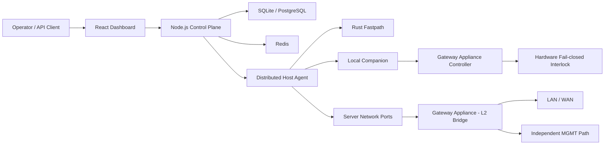

# CLAUDE.md

This file provides guidance to Claude Code (claude.ai/code) when working with code in this repository.

## Project Overview

AetherGuard is an intelligent server security platform: a Node.js control plane, distributed host agents, a React dashboard, a Rust fastpath sidecar, and hardware-backed safety gates for dangerous operations.

Product claim: **“AetherGuard 完全最后防线”**. Engineering definition: **Final Defense Mode** is a detectable, auditable, fail-closed mode where the control plane can request and audit dangerous actions, but the final grant is enforced by hardware. The **root-resistant** variant moves the final network release decision outside the protected server into the self-developed **AetherGuard Root-Resistant Gateway Appliance** — an industrial multi-port gateway appliance with independent STM32H5/U5 security controller, Secure Element / TPM, and hardware-level fail-closed interlock.

## Common Commands

### All services with Docker Compose

```bash
# From repo root. Requires JWT_SECRET, REDIS_PASSWORD, DEVICE_COMMAND_SECRET, AUDIT_LOG_SECRET.
docker-compose up -d --build

# Docker access points:
# Frontend: http://localhost:8080
# Backend API: http://localhost:3005
# Default dev credentials: admin / admin123

docker-compose logs -f backend
docker-compose logs -f frontend
docker-compose down
```

### Backend (`backend/`)

```bash
cd backend
npm install
npm run dev                         # Local API on :8080 unless PORT is set
npm run agent                       # Standalone distributed-agent CLI
npm run build
npm run typecheck                   # tsc --noEmit -p tsconfig.build.json
npm run lint
npm audit --audit-level=high

npm test                            # All Jest tests except AI-agent tests excluded by config
npm run test:coverage
npm run test:agents                 # AI-agent tests
npm run test:core                   # Modular Jest config with TEST_MODULE=core
npm run test:security
npm run test:scanner
npm run test:websocket
npm run test:services
npm run test:agent
npm run test:utils
npm run test:routes
npm run test:controllers
npm run test:module                 # Uses jest.config.modular.js; set TEST_MODULE as needed

npm run test:all                    # Full suite via 4 shards — preferred over `npm test`, which OOMs in one process
npm run test:shard1                 # ...shard2 / shard3 / shard4 — each shard uses --maxWorkers=50% and 4GB heap

npx jest src/__tests__/agent-gateway.test.ts
npm test -- --testPathPattern="controller"
npx jest --verbose --testNamePattern="should detect attacks"
npx jest --watch

npm run seed
npm run seed:clear
npm run cleanup:demo:dry-run
npm run cleanup:demo
npm run eval:owasp
```

Focused checks for Final Defense / hardware-gated paths:

```bash
cd backend
npx jest src/__tests__/services/final-defense.service.test.ts
npx jest src/__tests__/services/hardware-authorization.service.test.ts
npx jest src/__tests__/services/deployment-run.service.test.ts
npx jest src/__tests__/services/device-control.service.test.ts
npx jest src/__tests__/companion/serial-device-companion.test.ts
```

### Frontend (`frontend/`)

```bash
cd frontend
npm install
npm run dev                         # Vite on :5173
npm run build                       # tsc && vite build
npm run typecheck
npm run lint
npm run preview
npm audit --audit-level=high
```

### E2E (`e2e/`)

```bash
cd e2e
npm install
npx playwright install --with-deps chromium
npm test
npm run test:release
npm run test:ui
npm run test:debug
```

### Rust fastpath (`rust-fastpath/`)

```bash
cd rust-fastpath
cargo test
cargo clippy -- -D warnings
cargo build --release
```

### Release guard scripts

```bash
# From repo root
node scripts/guards/check-route-db-access.mjs           # route handlers must go through services/repositories
node scripts/guards/check-no-direct-api-fetch.mjs       # frontend must route every backend call through services/api.ts
node scripts/guards/check-frontend-api-contract.mjs     # every frontend API call resolves to a registered backend route
node scripts/guards/check-repository-hygiene.mjs        # blocks committing runtime DBs, generated legal/video/PCB artifacts, QA screenshots, Playwright-MCP state
```

CI lives in `.github/workflows/ci.yml` (lint + build + tests on Node 18) and `.github/workflows/deploy.yml`. Treat those as the source of truth for what must pass on a PR — when in doubt about whether a check is required, read the workflow rather than guessing.

## Runtime and Environment Notes

- Node.js v18+ is expected; CI uses Node 18.
- Rust 1.85.0 is used for the fastpath component.
- Copy `.env.example` to `.env` for local configuration.
- Docker requires `JWT_SECRET`, `REDIS_PASSWORD`, `DEVICE_COMMAND_SECRET`, and `AUDIT_LOG_SECRET`.
- Production requires `AUDIT_LOG_SECRET`; agent CLI onboarding uses `AetherGuard_SERVER`, `AetherGuard_ONBOARDING_CODE`, then `AetherGuard_AGENT_ID`, `AetherGuard_AGENT_API_KEY`, and `AetherGuard_AGENT_SECRET_KEY`.

## High-Level Architecture



Primary components:

| Path | Purpose |
| --- | --- |
| `backend/` | Express API, Socket.IO gateways, services, repositories, companion logic, Jest tests |
| `frontend/` | React/Vite dashboard, typed API client, pages, context providers, demo data |
| `rust-fastpath/` | High-throughput traffic processing sidecar |
| `e2e/` | Playwright smoke, release, visual, and walkthrough tests |
| `hardware/aetherguard-network-isolation-gateway-v1/` | AetherGuard Root-Resistant Gateway Appliance hardware baseline (active primary hardware) |
| `hardware/kicad/aetherguard-network-isolation-gateway-v1/` | Gateway Appliance v1 KiCad design |
| `deployment/` | Production helper scripts and deploy bundles |
| `docs/` | Architecture, ADRs, product, readiness, and archive-index documents |

> Legacy ESP32 hardware (serial-deployer dongle, ESP32-S3 control board v1/v2, `aetherguard-gate` physical-confirmation board) and its firmware/bundle/specs were fully retired on 2026-06-13 and moved out of this repo to the external archive (see below). Only the Gateway Appliance hardware line remains in `hardware/`.

## Backend Architecture

Important entry points:

- `backend/src/index.ts` starts the server, database connection, and WebSocket integration.
- `backend/src/app.ts` configures the Express app and middleware.
- `backend/src/bootstrap/control-plane-app.ts` builds the control-plane app and registers API routes. **`createControlPlaneApp()` is the canonical app builder — tests and any embedding context must call it rather than constructing the Express app directly** (see the startup-entrypoint-unification ADR in `docs/adr/`).
- `backend/src/bootstrap/persistence.ts` prepares service-owned schema at startup.
- `backend/src/agent-cli.ts` runs the standalone distributed-agent CLI.

Key backend areas:

| Directory | Role |
| --- | --- |
| `agent/` | Host-agent attack detection, firewall control, log collection, traffic monitoring |
| `ai-agents/` | Multi-agent AI threat-analysis and investigation system |
| `api/routes/` | REST route handlers mounted under `/api` |
| `bootstrap/` | App construction and startup-time persistence preparation |
| `config/` | App mode, database abstraction, runtime capability config |
| `core/` | API envelope helpers, tenant context, runtime health abstractions |
| `modules/` | Feature modules with repositories/schema helpers for newer boundaries |
| `scanner/` | Nuclei-based vulnerability scanning |
| `security/` | Input validation, auth helpers, command signing, audit logging |
| `services/` | Integration-heavy business logic still being migrated behind module boundaries |
| `websocket/` | `AgentGateway` and `DeviceGateway` Socket.IO gateways |

Route modules are registered in `createControlPlaneApp()` on `apiRouter` under `/api`. Health endpoints (`/health`, `/health/live`, `/health/ready`) are registered directly and are not gated by `apiEnabled`.

## Frontend Architecture

- `frontend/src/services/api.ts` is the single API-client layer. All backend calls must go through it.
- `fetchWithCredentials()` sends `credentials: 'include'`; auth tokens are stored in httpOnly cookies, not client-side headers.
- `unwrapApiEnvelope<T>()` extracts `.data` from the standard backend envelope.
- `extractErrorMessage()` centralizes error parsing; error-prefix convention includes values such as `FG-AUTH-LOGIN-401`.
- API functions accept an optional `AbortSignal` where practical.
- Demo-mode branches use `shouldUseDemoData()` and demo-data generators.
- Context providers are composed in `App.tsx`: WebSocket, Theme, Language, Demo, LiveMode, and AttackStatus.

## Database and Persistence

`backend/src/config/database.ts` exposes a unified `prepare()` / `run()` / `all()` / `get()` API over:

1. **sql.js**: loads the DB into memory, saves to disk every 30 seconds, and saves on close.
2. **better-sqlite3** fallback: opens the file directly with WAL and `foreign_keys = ON`.

Because sql.js is in-memory, direct file edits made while the backend is running can be overwritten by the next save. Stop the backend before editing the SQLite file directly, or mutate state through the running API/service layer.

`DB_MODE=postgres` is documented as production-required, but the current `database.ts` write path is still SQLite-oriented; check ADRs and implementation before assuming Postgres parity.

## Required Codebase Constraints

- Route handlers under `backend/src/api/routes/` must not access the database directly; use services or repositories.
- Do not call `ensureSchema()` in request handlers or WebSocket processors. Prepare service-owned tables in `backend/src/bootstrap/persistence.ts`.
- Route handlers must use `sendSuccess()` and `sendError()` from `backend/src/core/http/api-response.ts`.
- Backend API envelope:
  - Success: `{ success: true, data, error: null, meta? }`
  - Failure: `{ success: false, data: null, error, code, message, meta? }`
- Frontend code must not call `fetch('/api...')` directly; add or reuse functions in `frontend/src/services/api.ts`.
- `DISABLE_REDIS` must not be enabled in production.
- Demo/pitch-only frontend routes, such as `/aetherguard-deck`, are disabled by default. Use `VITE_ENABLE_PITCH_ROUTES=true` only for local demo builds.
- Do not commit generated outputs, KiCad scratch trees, router exchange files, probe reports, generated PPTX decks, or archived hardware experiment intermediates.

## WebSockets and Agents

`backend/src/websocket/agent-gateway.ts` handles bidirectional Socket.IO communication with distributed agents, including JWT/API-key authentication, Redis-backed rate limiting with memory fallback, HMAC command signing, and events such as `agent:register`, `traffic:analyze`, `agent:command`, and `threat:alert`.

`backend/src/websocket/device-gateway.ts` handles Gateway Appliance/device registration, management, and broadcast/status paths.

Agent API key patterns include `AetherGuard_test_key_*` and `agent_*`. Device API key patterns include `device_key_*` and `AetherGuard-device-*`.

## AI Agents and Detection Pipeline

The `backend/src/ai-agents/` module implements a seven-layer multi-agent decision system:

| Layer | Name | Purpose |
| --- | --- | --- |
| L1 | Collaboration | Traffic routing to specialized agents |
| L2 | Role Playing | Socrates (Red Team), Plato (Blue Team), Aristotle (Analyst) |
| L3 | Scene Traversal | Distributed tracing and attack narrative |
| L4 | Capability | Safe tool execution |
| L5 | Debate | Multi-agent debate with arbitrator |
| L6 | Heterogeneous Model | Local Ollama plus cloud GLM/Zhipu model collaboration |
| L7 | Synthesis | Case files and self-evolution |

`backend/src/services/detection-pipeline.service.ts` and `backend/src/services/detection-engine.ts` implement rule-based threat detection, attack-family classification, AI escalation, and candidate rule suggestions.

The dataset harness in `backend/src/__tests__/dataset/dataset-evaluation.test.ts` evaluates the `aetherguard-security-dataset` clone under `backend/test-data/aetherguard-security-dataset/`. If the clone is missing, the test self-skips. Recent detection heuristics are tuned with a hard constraint of 0% false-positive rate on normal traffic.

## Final Defense Mode

High-risk actions (`host_remove`, `wipe_data`, `factory_reset`, `recovery_flash`, `critical_config_change`) must satisfy all of:

- Local companion reads a signed local policy from `/etc/aetherguard/final-defense-policy.json`.
- Action, target, script path, release window, and interlock target are allowed by local policy.
- Hardware grant signature verifies against the provisioned hardware public key.
- Grant message includes and matches `policyDigest`, `challenge`, `breakerTarget`, `interlockAction`, payload hash, expiry, and monotonic counter.
- Interlock feedback is healthy and matches the expected state.

Interlock states normalize to `'isolated' | 'armed' | 'released' | 'fault' | 'disabled' | 'unknown'`; legacy `asserted` maps to `isolated`. Failure is fail-closed: signature failure, counter rollback, policy digest mismatch, expired grant, missing external DC, feedback mismatch, controller disconnect, or heartbeat loss returns the management link to `isolated`.

Final Defense API routes:

- `GET /api/final-defense/status`
- `POST /api/final-defense/policies`
- `POST /api/final-defense/actions`
- `POST /api/final-defense/gateways/status/report`
- `POST /api/final-defense/gateways/actions`

## Root-Resistant Final Defense and Hardware

Root-resistant mode assumes the protected server OS, local agent, local companion, scripts, and host logs may be controlled by an attacker with root. The trusted boundary is the external **AetherGuard Root-Resistant Gateway Appliance**: a dual 1GbE RJ45 transparent L2 bridge with `SERVER`, `LAN/WAN`, and independent `MGMT` ports. The `SERVER` ↔ `LAN/WAN` bridge is fail-closed; `isolated` blocks protected-server forwarding while preserving the appliance's own management channel.

UI may show “root-resistant active” only when all are true: the appliance present, policy digest match, firmware digest plus attestation, secure element provisioned, both data ports linked, independent management path, and healthy `armed` or `isolated` bridge state. The claim only covers links physically cabled through the appliance; out-of-band BMC, Wi-Fi, spare NICs, local console, direct storage damage, and host disk encryption by root are outside v1 protection.

Hardware roles:

| Hardware | Status | Role |
| --- | --- | --- |
| AetherGuard Root-Resistant Gateway Appliance | **Active — primary hardware** | Self-developed industrial multi-port gateway appliance: dual 1GbE L2 bridge (SERVER, LAN/WAN) + MGMT, STM32H5/U5 security controller, Secure Element / TPM, hardware fail-closed interlock with feedback |
| Legacy ESP32 serial deployment dongle | Archived | Former physical confirmation for local deployment/removal over USB-TTL serial using `AG:REQ:*` protocol. Replaced by Gateway Appliance. |
| Legacy Control Board v1 | Archived | Former ESP32-S3 plus ATECC608C control board for hardware grants. Replaced by Gateway Appliance Controller. |

Gateway Appliance controller protocol is newline-delimited JSON: companion sends `hello`, `command physical_confirmation_required`, `command interlock_assert`, and `command interlock_release`; controller sends `state`, `heartbeat`, `alert`, `physical_confirmation_ack`, and `interlock_result`. The legacy ESP32 deployment dongle protocol (`AG:REQ:*`) is archived.

## ADRs and Artifact Archive

Architecture decision records live in `docs/adr/`, including API envelope compatibility, module boundaries/bootstrap, Postgres primary write path, startup entrypoint unification, and legacy serial deployer wiring baseline (archived).

The full legacy ESP32 hardware line — the top-level `esp32/` firmware tree, `deployment/esp32-serial-deployer-bundle/`, `hardware/aetherguard-control-board-v1/` and `hardware/aetherguard-gate/` docs, the `hardware/kicad/aetherguard-control-board-v1|v2/`, `hardware/kicad/aetherguard-serial-deployer-v2/`, and `hardware/kicad/esp32-serial-deployer-pcb/` KiCad projects (incl. the freerouting autorouter scratch trees), the `hardware/factory/aetherguard-serial-deployer-ev1*/` factory packages, the retired host-helper scripts, `scripts/esp32_*`, and the `.kiro`/`.trae` ESP32 specs — was retired on 2026-06-13 and moved to `X:\repos\Networksafe-archive\20260513-pre-cleanup`; see `docs/artifact-archive-index.md` for the manifest. If a path referenced in old docs is no longer present here, check the archive before assuming it was deleted.

## Companion Docs

- `AGENTS.md` — OpenCode-facing twin of this file. Hardware/product framing must stay in sync between the two.
- `README.md` — externally visible product framing; the engineering qualifications on the "完全最后防线" claim live in `Final Defense Mode` / `Root-Resistant Final Defense` here, not in the README.
- `docs/adr/` — binding architectural decisions (API envelope compatibility, module boundaries/bootstrap, Postgres primary write path, startup-entrypoint unification, legacy serial deployer wiring baseline [archived]).
