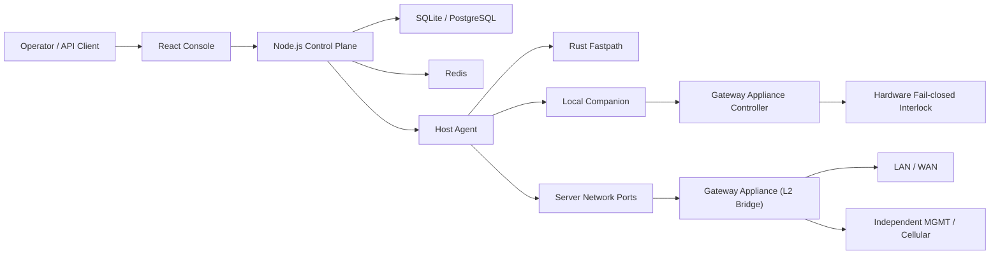

# AetherGuard

AetherGuard is a server security platform with a control plane, distributed host agents, a Rust fastpath sidecar, and hardware-backed safety gates for dangerous operations.

Product claim: **AetherGuard 完全最后防线**. Engineering definition: Final Defense Mode is a detectable, auditable, fail-closed mode where the control plane can request and audit dangerous actions, but the final grant is enforced by hardware. The root-resistant variant moves that final network release decision outside the protected server into the self-developed **AetherGuard Root-Resistant Gateway Appliance** — an industrial multi-port gateway appliance integrating an independent security authorization controller, Secure Element / TPM, and hardware-level fail-closed interlock.

## Quick Start

One-shot setup — generates `.env` (Docker) and `backend/.env` (local dev) from the `.env.example` templates with cryptographically random secrets. Existing files are never overwritten:

```bash
node scripts/setup.mjs              # add --install to also npm-install backend/ + frontend/
                                    # bash-only alternative: bash deployment/production/setup-env.sh
```

Docker, all services (requires Docker Compose v2.24+; the legacy `docker-compose` v1 binary cannot parse this compose file):

```bash
node scripts/setup.mjs
docker compose up -d --build

# Console + API proxy: http://127.0.0.1:8080
# Backend/Redis/Postgres/MinIO are internal-only in production Compose.
# Login: ADMIN_EMAIL / ADMIN_PASSWORD from .env — setup prints the generated password once
```

Fresh Linux host, one command (installs Docker if missing, generates `.env`, builds and starts, waits for backend health):

```bash
sudo bash scripts/install.sh
```

Air-gapped customer host (no internet, optionally no preinstalled Docker): build a self-contained bundle on a connected machine, transfer it, install fully offline — details in `deployment/offline/README.md`:

```bash
node scripts/release/build-offline-bundle.mjs --include-docker    # online build machine
# transfer dist/offline/aetherguard-offline-<ver>-<arch>.tar.gz to the customer host, then:
tar -xzf aetherguard-offline-*.tar.gz -C /opt/aetherguard
cd /opt/aetherguard && sudo bash install.sh
```

Local development — the backend refuses to start without `JWT_SECRET` and `AUDIT_LOG_SECRET`, so create `backend/.env` first (the setup script writes it with dev-safe defaults, including `DISABLE_REDIS=true`, which is dev-only and rejected in production):

```bash
node scripts/setup.mjs

cd backend
npm install
npm run dev

cd frontend
npm install
npm run dev
```

Optional components: `simulator/` and `e2e/` are separate npm packages (`node scripts/setup.mjs --all` installs them too); `rust-fastpath/` needs Rust 1.85 (`cargo build --release`); firmware host-side tests need gcc (`make -f test/Makefile test` from `firmware/controller-stm32h5/`).

Release-relevant checks:

```bash
cd backend && npm run typecheck
cd frontend && npm run typecheck
node scripts/guards/check-route-db-access.mjs
node scripts/guards/check-no-direct-api-fetch.mjs
```

## Current Software Validation

The latest software-only local validation is recorded in:

- `docs/reports/software-validation-status-2026-07-27.md`
- `docs/reports/software-validation-status-2026-07-27.json`
- `backend/test-data/dataset-eval-report.json`

Current evidence on the tested x86_64 Linux host:

- Backend: 248 Jest suites and 3,291 tests passed. Coverage is 65.90% statements, 51.41% branches, 65.90% functions, and 66.21% lines. Tests ran with Redis disabled and do not substitute for live external-service integration.
- Synthetic dataset: 4,500 samples produced 63.97% attack detection and 0% false positives on the 1,200 tracked synthetic normal samples. These are corpus results, not production detection or FPR claims.
- Rust fastpath: tests, Clippy, and release build passed. The latest fixed-key loopback reproduction measured 56.6k–61.6k QPS across three rounds, with a short concurrency-sweep peak of 75.1k QPS and no request errors. A stable 100k QPS result was not reproduced in this run.
- Chromium release subset: 8 of 10 runnable tests passed, 2 failed, and 1 pitch-enabled-only test was skipped. The failures are documented; do not describe the E2E suite as fully passing.
- Rescue and gateway simulator fail-closed checks passed as software tests only; they do not validate physical hardware.
- Local AI latency, live PostgreSQL/Redis/S3/IdP/notification integrations, ARM64/cross-OS support, agent resource targets, and production network capacity remain unvalidated in this environment.

The historical March 2026 Docker report remains useful as a dated snapshot, but it is not the source of truth for current software performance or dataset claims.

Focused Final Defense checks:

```bash
cd backend
npx jest src/__tests__/services/final-defense.service.test.ts
npx jest src/__tests__/services/hardware-authorization.service.test.ts
npx jest src/__tests__/services/deployment-run.service.test.ts
npx jest src/__tests__/services/device-control.service.test.ts
npx jest src/__tests__/companion/serial-device-companion.test.ts
```

## Architecture



Primary components:

| Path | Purpose |
| --- | --- |
| `backend/` | Express API, Socket.IO gateways, services, repositories, companion logic, tests |
| `frontend/` | React console, typed API client, pages, demo data |
| `rust-fastpath/` | High-throughput traffic processing sidecar |
| `e2e/` | Playwright release and UI verification |
| `deployment/` | Production helper scripts and deploy bundles |
| `hardware/aetherguard-network-isolation-gateway-v1/` | AetherGuard Root-Resistant Gateway Appliance hardware baseline (active primary hardware) |
| `hardware/factory/aetherguard-serial-deployer-ev1/` | Archived — legacy serial deployer factory package |
| `hardware/kicad/esp32-serial-deployer-pcb/` | Archived — KiCad source for the legacy serial deployer PCB |
| `docs/` | Architecture, product, readiness, and archive index documents |

## Final Defense Mode

Final Defense Mode treats the backend, database, and API request as potentially untrusted for high-risk actions.

High-risk actions such as `host_remove`, `wipe_data`, `factory_reset`, `recovery_flash`, and `critical_config_change` must satisfy all of the following:

- The local companion reads a signed local policy from `/etc/aetherguard/final-defense-policy.json`.
- The requested action, target, script path, release window, and interlock target are in the local policy allow-list.
- The hardware grant signature verifies against the provisioned hardware public key.
- The grant message includes and matches `policyDigest`, `challenge`, `breakerTarget`, `interlockAction`, payload hash, expiry, and monotonic counter.
- Interlock feedback is healthy and matches the expected state.

Interlock states are normalized as:

```ts
type InterlockState = 'isolated' | 'armed' | 'released' | 'fault' | 'disabled' | 'unknown';
```

Legacy `asserted` is mapped to `isolated`.

Failure behavior is closed by default: signature failure, counter rollback, policy digest mismatch, expired grant, missing external DC, feedback mismatch, board disconnect, or heartbeat loss keeps or returns the management link to `isolated`.

The external product statement is conditional. “完全最后防线” is only valid when the management link is actually wired through the interlock, Final Defense Mode is enabled, the local policy is signed, the secure element is provisioned, and companion plus board health are confirmed. v1 controls the low-voltage network or management link only; it does not switch mains power or directly cut production host power.

## Root-Resistant Final Defense

Root-resistant mode assumes the protected server OS, local agent, local companion, scripts, and host logs may be fully controlled by an attacker with root. In that threat model, the trusted boundary is no longer the host companion. It is the **AetherGuard Root-Resistant Gateway Appliance**:

- Dual 1GbE RJ45 transparent L2 bridge with `SERVER`, `LAN/WAN`, and independent `MGMT` ports; cellular is an optional management path.
- The `SERVER` to `LAN/WAN` bridge is fail-closed. `isolated` blocks protected server forwarding while preserving the gateway's own management channel.
- The appliance holds signed policy state, hardware identity, firmware measurement, and secure-element backed release grants outside the protected server.
- Strong “root-resistant active” status requires the appliance present, policy digest match, firmware digest plus attestation, secure element, both data ports linked, independent management path, and a healthy `armed` or `isolated` bridge state.
- The claim only covers network links physically cabled through the appliance. Out-of-band BMC, Wi-Fi, spare NICs, local console, direct storage damage, and host disk encryption by root are outside v1 protection unless separately controlled.

## Hardware Shapes

| Hardware | Status | Role |
| --- | --- | --- |
| AetherGuard Root-Resistant Gateway Appliance | **Active — primary hardware** | Self-developed industrial multi-port gateway appliance: dual 1GbE transparent L2 bridge (SERVER, LAN/WAN) + independent MGMT port, STM32H5/U5 security authorization controller, Secure Element / TPM (OPTIGA Trust M / SE050 / ATECC608B), hardware-level fail-closed interlock with feedback verification. Controls protected server network release outside the host. |
| Legacy ESP32 serial deployment dongle | Archived (superseded) | Former physical confirmation device for local deployment/removal over USB-TTL serial. Replaced by Gateway Appliance. |
| Legacy Control Board v1 | Archived (superseded) | Former ESP32-S3 + ATECC608C control board for hardware grants. Replaced by Gateway Appliance Controller. |

Gateway Appliance controller protocol is newline-delimited JSON:

- Companion to controller: `hello`, `command physical_confirmation_required`, `command interlock_assert`, `command interlock_release`
- Controller to companion: `state`, `heartbeat`, `alert`, `physical_confirmation_ack`, `interlock_result`

The legacy ESP32 deployment dongle protocol (`AG:REQ:*` allow-list) is archived and no longer active.

## API Surface

Final Defense API routes:

- `GET /api/final-defense/status`
- `POST /api/final-defense/policies`
- `POST /api/final-defense/actions`
- `POST /api/final-defense/gateways/status/report`
- `POST /api/final-defense/gateways/actions`

Route handlers must use `sendSuccess()` and `sendError()` from `backend/src/core/http/api-response.ts`. Route files under `backend/src/api/routes/` must not access the database directly; use services or repositories.

Frontend API calls must go through `frontend/src/services/api.ts`.

## Validation Status

Validated in the current production baseline:

- Backend and frontend typechecks for the Final Defense implementation.
- Route DB access guard.
- Frontend direct API fetch guard.
- Focused Jest coverage for hardware grant signing, Final Defense service policy checks, companion denial of untrusted scripts, deployment run, and device control paths.
- UI status model for root-resistant “Final Defense Active” only when an external AetherGuard Root-Resistant Gateway Appliance reports secure element, matching policy digest, firmware attestation, linked data ports, independent management path, and healthy bridge state.

Not yet validated in this workspace:

- Real Gateway Appliance hardware-in-the-loop release and feedback test.
- Secure element provisioning ceremony on physical OPTIGA Trust M / ATECC608B.
- Real Gateway Appliance hardware-in-the-loop bridge isolation and release test.
- Secure boot / measured boot chain for physical gateway firmware.

## Production Rules

- Do not call `ensureSchema()` in request handlers or WebSocket processors. Prepare service-owned tables in `backend/src/bootstrap/persistence.ts`.
- `DB_MODE=postgres` is required for production.
- `DISABLE_REDIS` must not be enabled in production.
- Do not commit generated outputs, KiCad scratch trees, router exchange files, probe reports, or generated PPTX decks.
- Demo and pitch-only frontend routes such as `/aetherguard-deck` are disabled by default. Set `VITE_ENABLE_PITCH_ROUTES=true` only for local demo builds.

## Artifact Archive

Large generated artifacts and hardware experiment intermediates were moved out of the repository to:

```text
X:\repos\Networksafe-archive\20260513-pre-cleanup
```

See `docs/artifact-archive-index.md` for the archive categories and file-level manifest location.

## License

MIT. See `LICENSE`.
