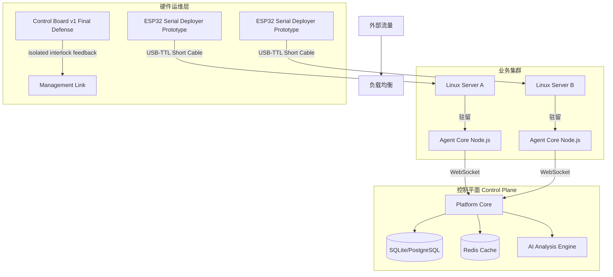

# AetherGuard - 智能服务器安全防御平台

## Validated Status (2026-03-08)

This repository now includes a stronger capability baseline, but the validated status is mixed rather than "all strong claims passed".

- Verified in the current workspace: Docker runtime, object-lock audit archive, notification outbox with retry tracking, persistent AI endpoint/config routing, `caddy` / `docker_compose` / `binary_agent` / `k8s_daemonset` bundle generation, Rust fastpath sidecar wiring, and backend `/ws/device` plus `/ws/status` simulation compatibility with OTA plus physical-confirmation smoke flow for `esp32-smoke`.
- Current benchmark evidence in this workspace does not justify the historical strongest claims. Latest smoke benchmark recorded about `1329.79 QPS`, `p95 21ms`, `agent CPU 6.22%`, `agent memory 99.64MB`, and no local Ollama latency because `127.0.0.1:11434` was unavailable.
- Physical ESP32 board flashing, external Linux binary install/rollback, and `100,000+ QPS` / `<10ms local AI` / `<2% CPU` / `<50MB` remain unvalidated here.

See [`docs/reports/validated-capability-status-2026-03-08.md`](docs/reports/validated-capability-status-2026-03-08.md) for the current evidence-backed status.

[](https://opensource.org/licenses/MIT)
[]()
[]()

🚀 **下一代基于 Agent 的分布式服务器安全防御系统**

AetherGuard 彻底重构了传统防火墙架构，采用创新的 **"中心化控制 + 分布式执行 + 硬件级部署"** 三位一体防御体系。它不仅是一个软件，更是一套结合了 AI 威胁分析与 ESP32 硬件运维的完整服务器安全解决方案。

**AetherGuard 完全最后防线**：即使控制平面沦陷，危险动作仍需本地硬件放行。工程上这对应 **Final Defense Mode**：控制平面只发起请求和记录审计，最终授权由本地主机 companion、签名本地策略、ATECC608C 硬件签名 grant、单调计数器、payload hash、策略摘要和 interlock 反馈共同决定。

该承诺是条件式安全边界：管理链路必须实际接入 Control Board v1 interlock，Final Defense Mode 必须启用，本地策略必须离线签名，硬件安全芯片必须完成 provision，外部 DC、反馈回路和 companion 心跳都必须健康。第一版物理断路只控制低压网络/管理链路，不切换市电或业务主机电源。

---

## 📸 功能概览

### 1. 全局态势感知 (Dashboard)
系统的核心指挥中心。实时可视化展示全球攻击源分布、当前流量压力、以及各服务器节点的健康状态。
- **流量分析**: 区分正常用户访问与恶意扫描流量。
- **实时日志**: 毫秒级展示被拦截的入侵请求详情。


### 2. 分布式 Agent 集群 (Agents)
集中管理成百上千个分布式 Agent 节点。
- **主机层防御**: 每一个 Agent 直接驻留于业务服务器，提供操作系统级别的防护。
- **状态监控**: 实时监控服务器 CPU/内存资源占用与运行健康度。


### 3. 受保护站点列表 (Sites)
管理所有接入防护的域名与业务服务。
- **策略下发**: 针对不同业务线配置独立的防护策略与 AI 敏感度。
- **一键开关**: 紧急情况下可快速开启/关闭特定服务器的防护模块。


### 4. 自动化部署向导 (Deployment)
傻瓜式生成安装脚本，支持多种 Linux 发行版环境。
- **多系统支持**: 自动生成适用于 Ubuntu, CentOS, Debian 的 Agent 安装指令。
- **一键复制**: 运维人员只需复制一行命令即可完成服务器接入。


### 5. 硬件最后防线 (Devices)
管理 **ESP32 Serial Deployer Prototype** 的 legacy 部署流程，以及 **AetherGuard Control Board v1** 的 Final Defense Mode 状态。
- **面包板跳线原型**: 采用 ESP32 开发板、面包板、杜邦线和外接模块快速搭建本地部署器。
- **本地串口部署**: 运维人员将外部 CP2102 切到部署模式后接入目标服务器，离线完成环境检测、备份与安装确认。
- **物理安全确认**: 通过 OLED、三键、RGB 和蜂鸣器完成高风险操作的本地确认，避免误触发卸载。
- **完全最后防线**: Control Board v1 使用 ESP32-S3 + ATECC608C + 隔离 interlock 输出/反馈，只有 secure element、策略摘要、外部电源、反馈、companion 和 interlock 全部健康时，控制台才显示 “Final Defense Active / 完全最后防线已启用”。


### 6. 主动漏洞扫描 (Monitoring)
内置轻量级漏洞扫描引擎 (基于 Nuclei)。
- **被动监测**: 持续分析过往流量中的异常模式，发现潜在后门。
- **主动探测**: 定期扫描目标服务器的常见 CVE 漏洞与配置缺陷。


### 7. 审计与历史记录 (History)
详细记录每一次安全事件与 AI 自动修复操作。
- **取证溯源**: 保留完整的攻击链路数据供后续审计合规。
- **自动化报告**: 记录 AI 自动封禁 IP 或修补系统漏洞的操作流水。


### 8. 实时告警中心 (Alerts)
聚合来自所有节点的安全告警。
- **分级告警**: 区分 INFO, WARN, CRTICIAL 不同级别的系统威胁。
- **多渠道推送**: 支持邮件、Slack、Webhook 推送至运维群。


### 9. AI 智能配置 (Settings)
灵活配置 AI 大脑的思考模式。
- **多模型切换**: 支持拖拽排序，自由组合 Ollama 本地模型与云端 GPT-4/DeepSeek 模型。
- **隐私优先**: 可设置仅在本地服务器处理敏感数据，保障数据主权。


### 10. 超级管理员控制台 (Admin)
系统级配置与多租户管理。
- **密钥管理**: 为不同运维团队颁发独立的访问密钥。
- **性能配额**: 这里可以限制每个租户的系统资源调用频率。


---

## 🏗️ 核心架构

AetherGuard 采用 **TypeScript (Node.js) + React** 全栈架构，结合 ESP32 硬件层，追求开发效率与安全性的平衡。



---

## 🛠️ ESP32 部署工具 (Deployment Dongle)

AetherGuard 当前的硬件基线是 **面包板跳线版 ESP32 串口部署器原型**，而不是量产外壳或双桥单板。

### 硬件清单 (BOM)
- **主控**: ESP32 开发板
- **显示**: 0.96寸 OLED (SSD1306, 4-pin I2C)
- **交互**: 3x 按键 (OK/Next/Back), 1x 共阴 RGB 模块, 1x 低电平触发有源蜂鸣器模块
- **连接**: 1x 外部 CP2102, 杜邦线, 面包板
- **按键引脚**: `GPIO18 / GPIO19 / GPIO23` (避开启动配置脚)
- **发布构建**: `esp32/platformio.ini` 默认环境为 `serial_deployer_release`

### 使用流程
1. **搭线**: OLED 接 `GPIO21/22`，按键接 `GPIO18/19/23` 到 `GND`，RGB 接 `GPIO25/26/27`，蜂鸣器模块接 `GPIO14`。
2. **烧录/调试**: 优先使用 ESP32 开发板自带 USB；若板载 USB 不可用，再把外部 CP2102 临时接到 `GPIO3/1/GND`。
3. **切到部署模式**: 断电后把外部 CP2102 改接到 `GPIO16/17/GND`，只接 `TXD/RXD/GND`，不要把 `VCC/5V/3V3` 反灌给 ESP32。
4. **运行**: ESP32 发送 `AG:REQ:*` allow-list 请求，预装在 Linux 主机上的 serial helper 返回 `AG:BEGIN/*`、`AG:STEP/*`、`AG:OK/*`、`AG:ERR/*` 并执行部署。

> 当前硬件基线是 **单颗外部 CP2102 的 USB-TTL 串口部署器原型**。同一时刻只能处于“烧录/调试”或“部署”其中一种模式，切换前必须断电或拔 USB。
>
> 仓库中的 `/ws/device`、OTA、physical-confirmation smoke 仅用于后端模拟链路与后续联网设备实验，不代表当前 ESP32 固件已支持远程网关模式。

---

## 🛡️ Final Defense Mode / 完全最后防线

Control Board v1 是新增的最终防护硬件形态，目标基线位于 `hardware/aetherguard-control-board-v1`。它保留 legacy ESP32 串口部署器的物理确认价值，但把最终放行权从后端转移到 **本地主机 companion + 硬件安全板**。

- 控制平面不再是危险操作的最终授权源，只负责发起请求和写审计。
- Companion 读取 `/etc/aetherguard/final-defense-policy.json`，只执行本地签名策略 allow-list 中的动作和脚本路径。
- 硬件 grant 由 ATECC608C 不可导出私钥签名，签名消息包含 `policyDigest`、`challenge`、`breakerTarget`、`interlockAction`。
- Interlock 状态统一为 `isolated`、`armed`、`released`、`fault`、`disabled`、`unknown`，legacy `asserted` 映射为 `isolated`。
- 默认失败关闭：签名失败、计数器回退、策略摘要不匹配、grant 过期、外部 DC 丢失、反馈异常或 board 心跳丢失时，companion 会自动 `interlock_assert`，管理链路保持或回到 `isolated`。

第一版只断开低压网络/管理链路。攻击者具备实体拆线、替换硬件或 root 后破坏本地执行器的场景，需要后续 secure boot、TPM attestation 和 OS hardening 阶段继续增强。

---

## 🚀 快速启动 (Docker)

```bash
# 1. 克隆仓库
git clone https://github.com/your-repo/aetherguard.git

# 2. 启动服务
docker compose up -d --build

# 3. 访问控制台
# 前端: http://localhost:8080
# 后端: http://localhost:3005

### 🔐 默认账号
- **用户名**: admin (或 admin@aetherguard.com)
- **密码**: admin123
- **说明**: 首次启动时会自动创建该管理员账号。请登录后立即修改密码。
```

---

## 📄 许可证

本项目采用 [MIT 许可证](LICENSE) 开源。

> 杭州视界奇点科技有限公司 · Aether Studio 出品


CI/CD 配置时间: 2026-03-15 10:36:41
