# AetherGuard - 智能服务器安全防御平台

## Validated Status (2026-03-08)

This repository now includes a stronger capability baseline, but the validated status is mixed rather than "all strong claims passed".

- Verified in the current workspace: Docker runtime, object-lock audit archive, notification outbox with retry tracking, persistent AI endpoint/config routing, `caddy` / `docker_compose` / `binary_agent` / `k8s_daemonset` bundle generation, Rust fastpath sidecar wiring, `/ws/device` plus `/ws/status` compatibility, OTA plus physical-confirmation smoke flow for `esp32-smoke`.
- Current benchmark evidence in this workspace does not justify the historical strongest claims. Latest smoke benchmark recorded about `1329.79 QPS`, `p95 21ms`, `agent CPU 6.22%`, `agent memory 99.64MB`, and no local Ollama latency because `127.0.0.1:11434` was unavailable.
- Physical ESP32 board flashing, external Linux binary install/rollback, and `100,000+ QPS` / `<10ms local AI` / `<2% CPU` / `<50MB` remain unvalidated here.

See [`docs/reports/validated-capability-status-2026-03-08.md`](docs/reports/validated-capability-status-2026-03-08.md) for the current evidence-backed status.

[](https://opensource.org/licenses/MIT)
[]()
[]()

🚀 **下一代基于 Agent 的分布式服务器安全防御系统**

AetherGuard 彻底重构了传统防火墙架构，采用创新的 **"中心化控制 + 分布式执行 + 硬件级部署"** 三位一体防御体系。它不仅是一个软件，更是一套结合了 AI 威胁分析与 ESP32 硬件运维的完整服务器安全解决方案。

---

## 📸 功能概览

### 1. 全局态势感知 (Dashboard)
系统的核心指挥中心。实时可视化展示全球攻击源分布、当前流量压力、以及各服务器节点的健康状态。
- **流量分析**: 区分正常用户访问与恶意扫描流量。
- **实时日志**: 毫秒级展示被拦截的入侵请求详情。
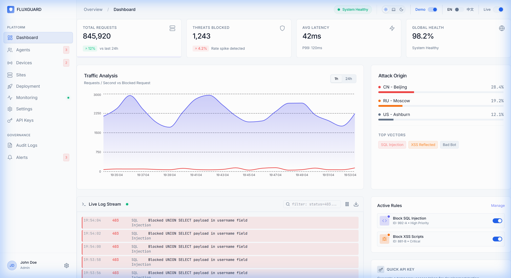

### 2. 分布式 Agent 集群 (Agents)
集中管理成百上千个分布式 Agent 节点。
- **主机层防御**: 每一个 Agent 直接驻留于业务服务器，提供操作系统级别的防护。
- **状态监控**: 实时监控服务器 CPU/内存资源占用与运行健康度。
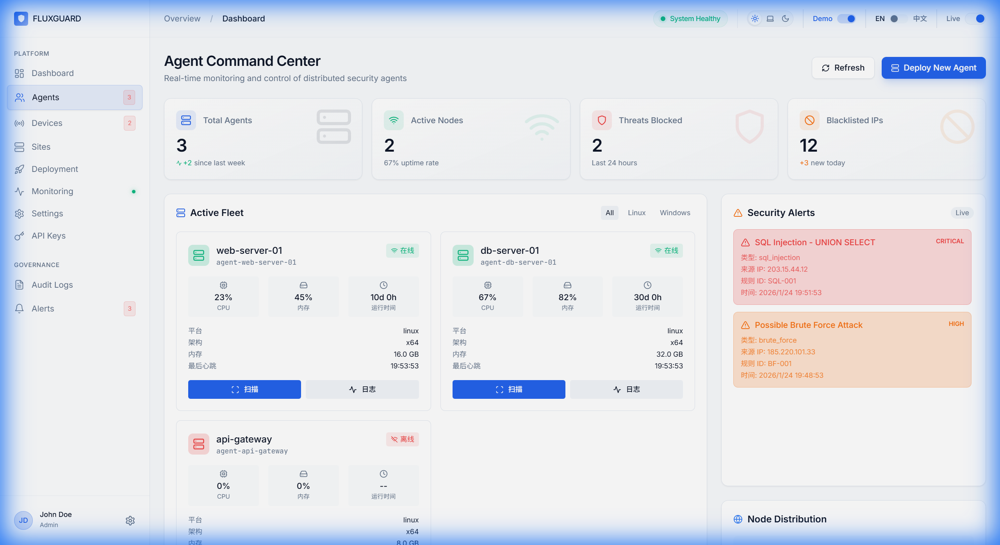

### 3. 受保护站点列表 (Sites)
管理所有接入防护的域名与业务服务。
- **策略下发**: 针对不同业务线配置独立的防护策略与 AI 敏感度。
- **一键开关**: 紧急情况下可快速开启/关闭特定服务器的防护模块。
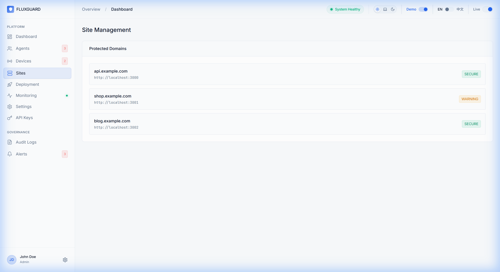

### 4. 自动化部署向导 (Deployment)
傻瓜式生成安装脚本，支持多种 Linux 发行版环境。
- **多系统支持**: 自动生成适用于 Ubuntu, CentOS, Debian 的 Agent 安装指令。
- **一键复制**: 运维人员只需复制一行命令即可完成服务器接入。
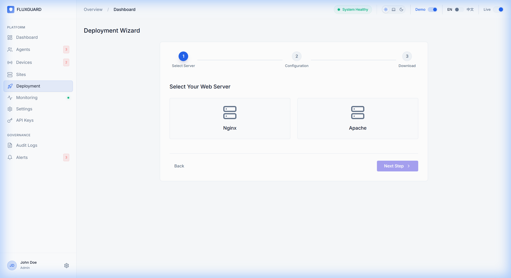

### 5. 硬件网关与 ESP32 工具 (Devices)
管理 **ESP32 Deployment Dongle** 和其他硬件安全节点。
- **自动注册**: 运维人员插入 U 盘后，设备自动注册上线。
- **远程管理**: 支持对分布在各个机房的 ESP32 设备进行远程管理。
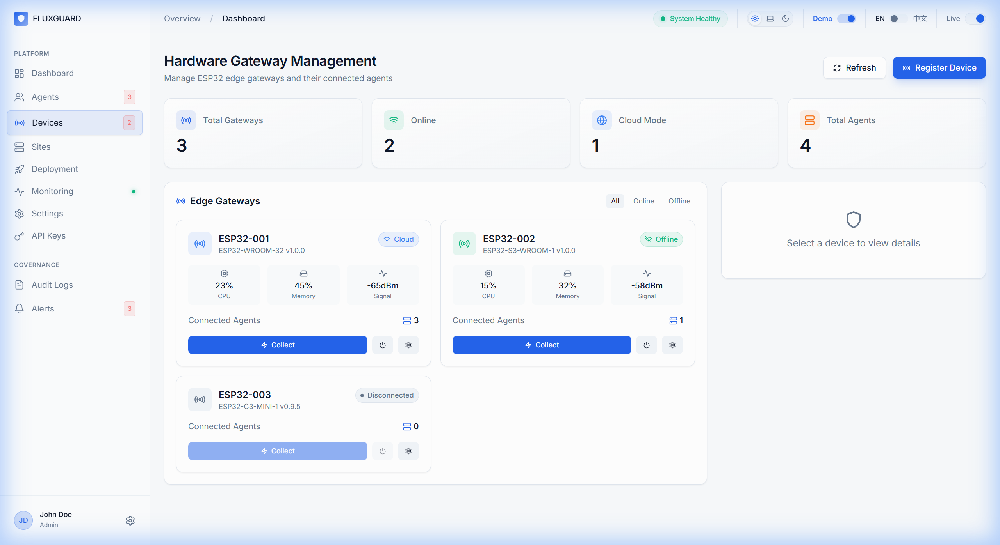

### 6. 主动漏洞扫描 (Monitoring)
内置轻量级漏洞扫描引擎 (基于 Nuclei)。
- **被动监测**: 持续分析过往流量中的异常模式，发现潜在后门。
- **主动探测**: 定期扫描目标服务器的常见 CVE 漏洞与配置缺陷。
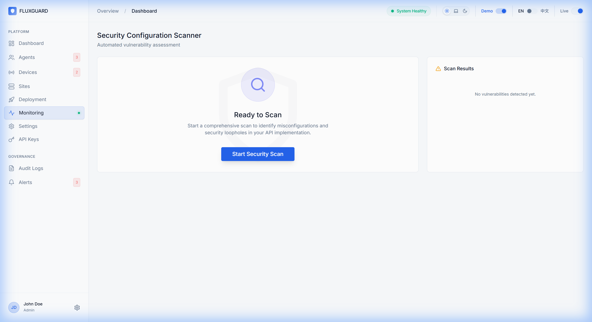

### 7. 审计与历史记录 (History)
详细记录每一次安全事件与 AI 自动修复操作。
- **取证溯源**: 保留完整的攻击链路数据供后续审计合规。
- **自动化报告**: 记录 AI 自动封禁 IP 或修补系统漏洞的操作流水。
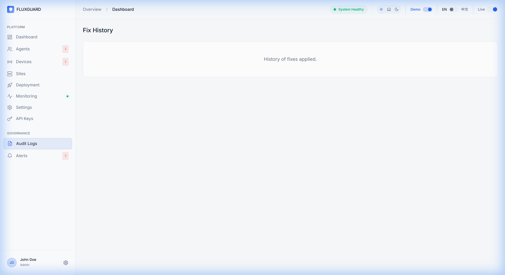

### 8. 实时告警中心 (Alerts)
聚合来自所有节点的安全告警。
- **分级告警**: 区分 INFO, WARN, CRTICIAL 不同级别的系统威胁。
- **多渠道推送**: 支持邮件、Slack、Webhook 推送至运维群。
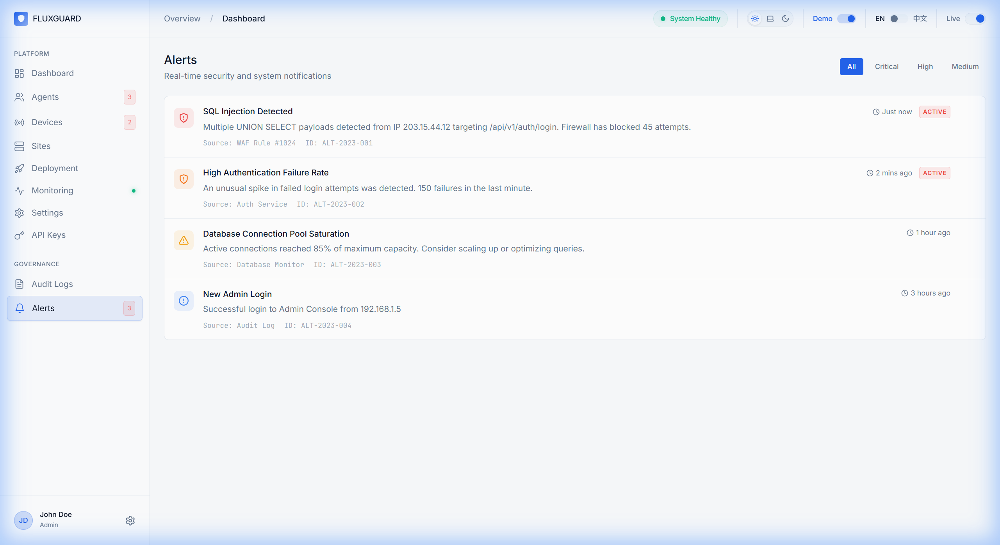

### 9. AI 智能配置 (Settings)
灵活配置 AI 大脑的思考模式。
- **多模型切换**: 支持拖拽排序，自由组合 Ollama 本地模型与云端 GPT-4/DeepSeek 模型。
- **隐私优先**: 可设置仅在本地服务器处理敏感数据，保障数据主权。
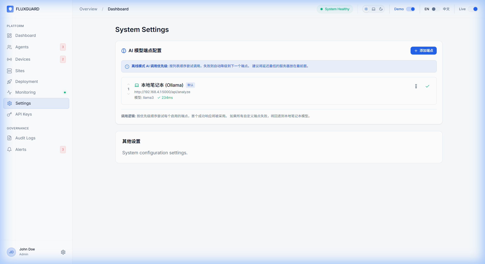

### 10. 超级管理员控制台 (Admin)
系统级配置与多租户管理。
- **密钥管理**: 为不同运维团队颁发独立的访问密钥。
- **性能配额**: 这里可以限制每个租户的系统资源调用频率。
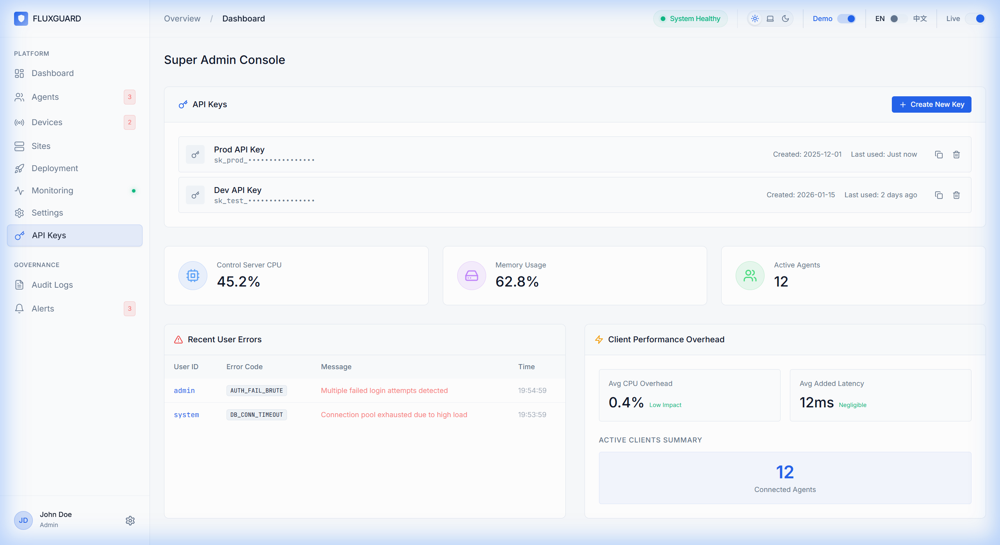

---

## 🏗️ 核心架构

AetherGuard 采用 **TypeScript (Node.js) + React** 全栈架构，结合 ESP32 硬件层，追求开发效率与安全性的平衡。

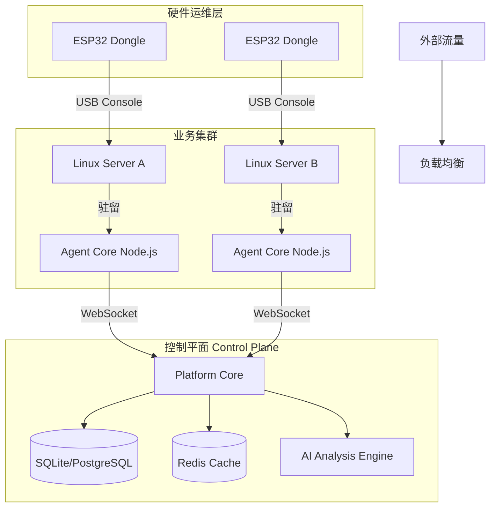

---

## 🛠️ ESP32 部署工具 (Deployment Dongle)

AetherGuard 独有的硬件部署方案，让安全运维变得触手可及。

### 硬件清单 (BOM)
- **主控**: ESP32-WROOM-32 (Type-C)
- **显示**: 0.96寸 OLED (SSD1306)
- **交互**: 3x 按键 (OK/Next/Back), 1x RGB LED, 1x 蜂鸣器
- **通信**: CP2102 USB-TTL

### 使用流程
1. **插入**: 将 Dongle 插入服务器 USB 口。
2. **识别**: 设备自动识别 Linux/Windows 环境 (蓝灯亮起)。
3. **确认**: 使用屏幕与按键确认安装操作 (防误触设计)。
4. **运行**: 自动执行 Shell 脚本完成 Agent 部署 (绿灯呼吸)。

---

## 🚀 快速启动 (Docker)

```bash
# 1. 克隆仓库
git clone https://github.com/your-repo/aetherguard.git

# 2. 启动服务
docker compose up -d --build

# 3. 访问控制台
# 前端: http://localhost:8080
# 后端: http://localhost:3005

### 🔐 默认账号
- **用户名**: admin (或 admin@aetherguard.com)
- **密码**: admin123
- **说明**: 首次启动时会自动创建该管理员账号。请登录后立即修改密码。
```

---

## 📄 许可证

本项目采用 [MIT 许可证](LICENSE) 开源。

> 杭州视界奇点科技有限公司 · Aether Studio 出品


CI/CD 配置时间: 2026-03-15 10:36:41
