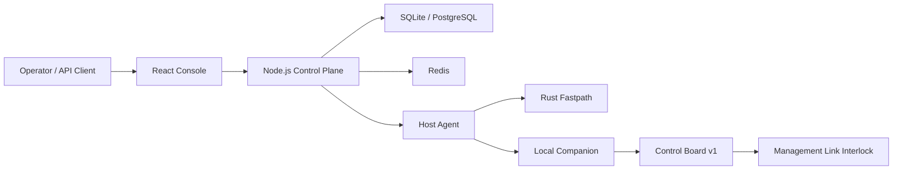

# AetherGuard

AetherGuard is a server security platform with a control plane, distributed host agents, a Rust fastpath sidecar, and hardware-backed safety gates for dangerous operations.

Product claim: **AetherGuard 完全最后防线**. Engineering definition: Final Defense Mode is a detectable, auditable, fail-closed mode where the control plane can request and audit dangerous actions, but the final grant is enforced locally by a host companion and hardware security board.

## Quick Start

```bash
# Docker, all services
docker-compose up -d --build

# Frontend: http://localhost:8080
# Backend:  http://localhost:3005
# Development credentials: admin / admin123
```

Local development:

```bash
cd backend
npm install
npm run dev

cd frontend
npm install
npm run dev
```

Release-relevant checks:

```bash
cd backend && npm run typecheck
cd frontend && npm run typecheck
node scripts/guards/check-route-db-access.mjs
node scripts/guards/check-no-direct-api-fetch.mjs
```

Focused Final Defense checks:

```bash
cd backend
npx jest src/__tests__/services/final-defense.service.test.ts
npx jest src/__tests__/services/hardware-authorization.service.test.ts
npx jest src/__tests__/services/deployment-run.service.test.ts
npx jest src/__tests__/services/device-control.service.test.ts
npx jest src/__tests__/companion/serial-device-companion.test.ts
```

## Architecture



Primary components:

| Path | Purpose |
| --- | --- |
| `backend/` | Express API, Socket.IO gateways, services, repositories, companion logic, tests |
| `frontend/` | React console, typed API client, pages, demo data |
| `rust-fastpath/` | High-throughput traffic processing sidecar |
| `e2e/` | Playwright release and UI verification |
| `esp32/` | Legacy ESP32 serial deployment firmware |
| `deployment/` | Production helper scripts and deploy bundles |
| `hardware/aetherguard-control-board-v1/` | Final Defense hardware baseline |
| `hardware/factory/aetherguard-serial-deployer-ev1/` | Legacy serial deployer factory package |
| `hardware/kicad/esp32-serial-deployer-pcb/` | KiCad source for the legacy serial deployer PCB |
| `docs/` | Architecture, product, readiness, and archive index documents |

## Final Defense Mode

Final Defense Mode treats the backend, database, and API request as potentially untrusted for high-risk actions.

High-risk actions such as `host_remove`, `wipe_data`, `factory_reset`, `recovery_flash`, and `critical_config_change` must satisfy all of the following:

- The local companion reads a signed local policy from `/etc/aetherguard/final-defense-policy.json`.
- The requested action, target, script path, release window, and interlock target are in the local policy allow-list.
- The hardware grant signature verifies against the provisioned hardware public key.
- The grant message includes and matches `policyDigest`, `challenge`, `breakerTarget`, `interlockAction`, payload hash, expiry, and monotonic counter.
- Interlock feedback is healthy and matches the expected state.

Interlock states are normalized as:

```ts
type InterlockState = 'isolated' | 'armed' | 'released' | 'fault' | 'disabled' | 'unknown';
```

Legacy `asserted` is mapped to `isolated`.

Failure behavior is closed by default: signature failure, counter rollback, policy digest mismatch, expired grant, missing external DC, feedback mismatch, board disconnect, or heartbeat loss keeps or returns the management link to `isolated`.

The external product statement is conditional. “完全最后防线” is only valid when the management link is actually wired through the interlock, Final Defense Mode is enabled, the local policy is signed, the secure element is provisioned, and companion plus board health are confirmed. v1 controls the low-voltage network or management link only; it does not switch mains power or directly cut production host power.

## Hardware Shapes

| Hardware | Status | Role |
| --- | --- | --- |
| ESP32 serial deployment dongle | Legacy supported | Physical confirmation for local deployment and removal workflows over USB-TTL serial |
| Control Board v1 | Final Defense target | ESP32-S3, ATECC608C, isolated interlock output and feedback for local hardware grants |

Board protocol for Control Board v1 is newline-delimited JSON:

- Companion to board: `hello`, `command physical_confirmation_required`, `command interlock_assert`, `command interlock_release`
- Board to companion: `state`, `heartbeat`, `alert`, `physical_confirmation_ack`, `interlock_result`

The legacy ESP32 deployment dongle uses the `AG:REQ:*` allow-list protocol and remains separate from Control Board v1.

## API Surface

Final Defense API routes:

- `GET /api/final-defense/status`
- `POST /api/final-defense/policies`
- `POST /api/final-defense/actions`

Route handlers must use `sendSuccess()` and `sendError()` from `backend/src/core/http/api-response.ts`. Route files under `backend/src/api/routes/` must not access the database directly; use services or repositories.

Frontend API calls must go through `frontend/src/services/api.ts`.

## Validation Status

Validated in the current production baseline:

- Backend and frontend typechecks for the Final Defense implementation.
- Route DB access guard.
- Frontend direct API fetch guard.
- Focused Jest coverage for hardware grant signing, Final Defense service policy checks, companion denial of untrusted scripts, deployment run, and device control paths.
- UI status model for strong “Final Defense Active / 完全最后防线已启用” only when secure element, policy digest, external DC, feedback, companion, and interlock health are all present.

Not yet validated in this workspace:

- Real Control Board v1 hardware-in-the-loop release and feedback test.
- Secure element provisioning ceremony on physical ATECC608C.
- OS hardening against a fully root-compromised host destroying the local companion.
- TPM attestation and secure boot integration.

## Production Rules

- Do not call `ensureSchema()` in request handlers or WebSocket processors. Prepare service-owned tables in `backend/src/bootstrap/persistence.ts`.
- `DB_MODE=postgres` is required for production.
- `DISABLE_REDIS` must not be enabled in production.
- Do not commit generated outputs, KiCad scratch trees, router exchange files, probe reports, or generated PPTX decks.
- Demo and pitch-only frontend routes such as `/aetherguard-deck` are disabled by default. Set `VITE_ENABLE_PITCH_ROUTES=true` only for local demo builds.

## Artifact Archive

Large generated artifacts and hardware experiment intermediates were moved out of the repository to:

```text
X:\repos\Networksafe-archive\20260513-pre-cleanup
```

See `docs/artifact-archive-index.md` for the archive categories and file-level manifest location.

## License

MIT. See `LICENSE`.
