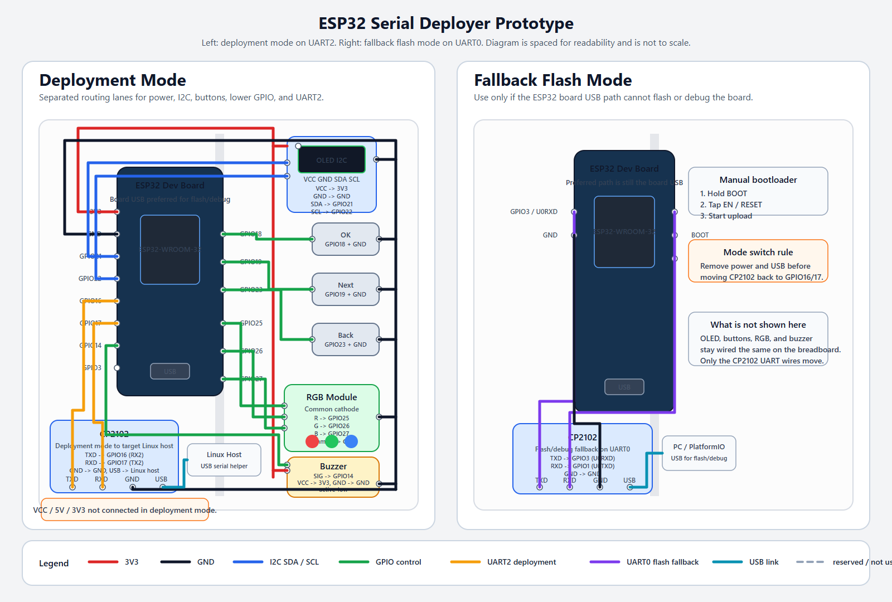
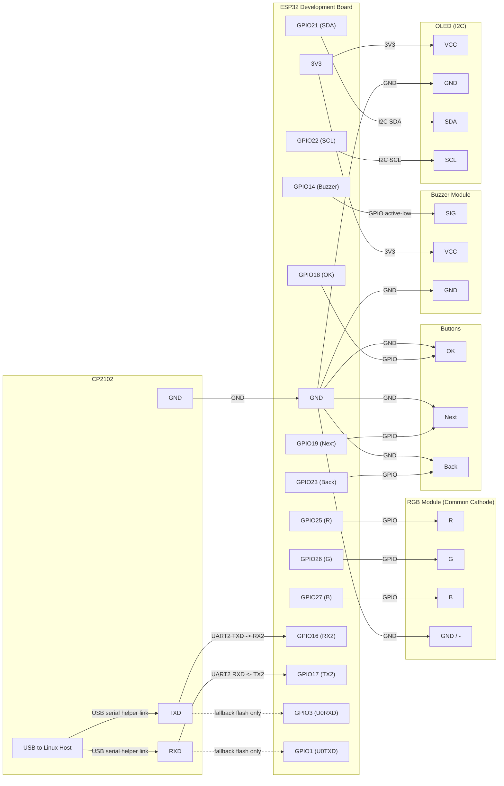

# ESP32 Jumper-Prototype Wiring Guide

This document is the single wiring reference for the ESP32 serial deployer breadboard prototype.

It covers:

- the jumper wiring checklist you can follow by hand
- the two CP2102 wiring modes
- a breadboard-style prototype view
- a simple logic diagram
- the legend and silkscreen checks that prevent common wiring mistakes

Left panel: deployment mode on `GPIO16` / `GPIO17`. Right panel: fallback flash mode on `GPIO3` / `GPIO1`. The picture is a practical wiring map, spaced for readability, not a scale drawing.
The prototype view now includes per-component pin-to-pin labels so the SVG can be used directly for hand wiring.

## 0. Verified Firmware Baseline

The current firmware baseline was checked before producing this diagram:

- `serial_deployer_release` compiles successfully
- `experimental_cloud_smoke` compiles successfully
- static review of `main.cpp`, `deployment.h`, and `config.h` found no blocking issues that change the jumper wiring baseline

This is not a substitute for hardware bring-up. The remaining risks are physical wiring mistakes and host-helper integration on the Linux target.

## 1. Hardware Baseline And Assumptions

This guide applies only to the current jumper-wire prototype:

- ESP32 development board
- 0.96 inch 4-pin I2C OLED
- 3 momentary push buttons
- common-cathode RGB LED module
- active-low buzzer module
- 1 external CP2102 USB-to-TTL module
- breadboard and Dupont wires

Do not use this guide if your OLED is an SPI module. A matching I2C OLED usually has exactly these four pins:

- `VCC`
- `GND`
- `SCL`
- `SDA`

If the OLED silkscreen instead shows pins such as `D0`, `D1`, `RES`, `DC`, or `CS`, stop. That is an SPI module and this guide does not apply.

## 2. Wiring Rules

- Power all peripherals from the ESP32 board `3V3` and `GND`.
- In deployment mode, the external CP2102 must connect only `TXD`, `RXD`, and `GND`.
- In deployment mode, leave `VCC`, `5V`, and `3V3` on the CP2102 disconnected.
- Set the CP2102 TTL voltage to `3.3V` if the module has a voltage selector.
- The single external CP2102 can only be in one role at a time:
  - flash/debug fallback
  - deployment mode
- Always remove power and unplug USB before moving CP2102 wires.
- Prefer the ESP32 board USB port for flashing and serial logs. Use the external CP2102 for flashing only if the board USB path is unavailable.

## 3. Deployment Mode Wiring

Use this wiring for normal host deployment work.

### ESP32 peripherals

| Module | Pin | Connects To |
| --- | --- | --- |
| OLED | `VCC` | `ESP32 3V3` |
| OLED | `GND` | `ESP32 GND` |
| OLED | `SDA` | `ESP32 GPIO21` |
| OLED | `SCL` | `ESP32 GPIO22` |
| Button `OK` | one side | `ESP32 GPIO18` |
| Button `OK` | other side | `ESP32 GND` |
| Button `Next` | one side | `ESP32 GPIO19` |
| Button `Next` | other side | `ESP32 GND` |
| Button `Back` | one side | `ESP32 GPIO23` |
| Button `Back` | other side | `ESP32 GND` |
| RGB | `R` | `ESP32 GPIO25` |
| RGB | `G` | `ESP32 GPIO26` |
| RGB | `B` | `ESP32 GPIO27` |
| RGB | common `GND/-` | `ESP32 GND` |
| Buzzer | `SIG` | `ESP32 GPIO14` |
| Buzzer | `VCC` | `ESP32 3V3` |
| Buzzer | `GND` | `ESP32 GND` |

### CP2102 deployment wiring

| CP2102 Pin | Connects To | Notes |
| --- | --- | --- |
| `TXD` | `ESP32 GPIO16 (RX2)` | Host-to-ESP32 receive path |
| `RXD` | `ESP32 GPIO17 (TX2)` | ESP32-to-host transmit path |
| `GND` | `ESP32 GND` | Ground reference is required |
| `USB` side | target Linux host | Helper runs on this host |
| `VCC` / `5V` / `3V3` | not connected | Prevent back-power and role confusion |

## 4. Flash / Debug Wiring

### Preferred path

Use the ESP32 development board USB port directly for firmware upload and serial debugging.

No external CP2102 rewiring is needed in this path.

### Fallback CP2102 flash path

Only use this if the ESP32 board USB path is unavailable.

| CP2102 Pin | Connects To |
| --- | --- |
| `TXD` | `ESP32 GPIO3 (U0RXD)` |
| `RXD` | `ESP32 GPIO1 (U0TXD)` |
| `GND` | `ESP32 GND` |

Manual bootloader sequence:

1. Hold `BOOT`.
2. Tap `EN/RESET`.
3. Start the upload.

Before returning to deployment mode, remove power, unplug USB, and move the CP2102 back to `GPIO16`, `GPIO17`, and `GND`.

## 5. Logic Diagram

## 6. Legend And Silkscreen Checks

### Legend

- In the `SVG` prototype view:
  - red wires = `3V3`
  - black wires = `GND`
  - blue wires = `I2C`
  - green wires = local GPIO control wires
  - amber wires = deployment `UART2`
  - violet wires = fallback flash `UART0`
  - dashed gray wires = intentionally unused in the current mode
- `3V3`: the regulated 3.3 V power rail from the ESP32 board
- `GND`: common ground
- `I2C`: two-wire display bus, here on `GPIO21` and `GPIO22`
- `UART2`: deployment serial link on `GPIO16` and `GPIO17`
- `UART0`: fallback flash/debug serial link on `GPIO3` and `GPIO1`
- `active-low`: the buzzer is considered on when `GPIO14` is driven low
- `common cathode`: the RGB module common pin goes to `GND`
- Read the two panels as mode-specific overlays:
  - deployment mode keeps the CP2102 on `GPIO16` / `GPIO17`
  - fallback flash mode moves only the CP2102 UART wires to `GPIO3` / `GPIO1`
  - OLED, buttons, RGB, and buzzer stay on the same pins in both modes

### Silkscreen checks before wiring

- OLED:
  - correct: `VCC`, `GND`, `SCL`, `SDA`
  - wrong for this guide: `D0`, `D1`, `RES`, `DC`, `CS`
- CP2102:
  - confirm `TXD`, `RXD`, `GND`
  - if present, set logic voltage to `3.3V`
- RGB module:
  - confirm the common pin is marked `GND`, `-`, or equivalent
  - if the common pin is `VCC` or `+`, that is a common-anode module and this guide does not apply
- Buzzer module:
  - confirm the pins are `SIG`, `VCC`, `GND`
  - this guide assumes the module is low-level trigger

## 7. Pre-Power Checklist

Before applying power:

1. Confirm the OLED is a 4-pin I2C module.
2. Confirm every button has one side on `GND` and only the other side on its GPIO.
3. Confirm the RGB module common pin is on `GND`.
4. Confirm the buzzer `SIG` is on `GPIO14`.
5. Confirm the CP2102 is wired for only one mode at a time.
6. In deployment mode, confirm CP2102 `VCC`, `5V`, and `3V3` are not connected.
7. Confirm all CP2102 TTL wiring is `3.3V` logic.
8. Confirm the ESP32 board USB and the external CP2102 are not fighting over the same UART pins.

## 8. Expected Bring-Up Results

- Power-on shows the OLED splash screen.
- Idle state does not keep the buzzer continuously active.
- `OK`, `Next`, and `Back` each register one press at a time.
- RGB colors map to the current firmware state machine.
- In deployment mode, the target Linux host enumerates the CP2102 serial device and the helper responds with `AG:ENV:LINUX`.
- Without the helper installed, the ESP32 reports `Host helper not ready`.
