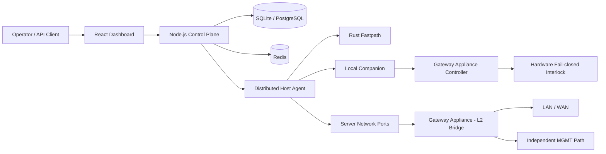

# AetherGuard 产品需求文档（PRD）

> 版本：v1.0
> 日期：2026-06-12
> 阶段：平台级产品定义 / 企业 PoC
> 文档性质：AetherGuard 平台顶层 PRD（父文档）
> 关联文档：`docs/root-resistant-gateway-prd.md`（网关一体机子 PRD，v0.3）、`docs/product_whitepaper.md`、`docs/product_manual.md`、`docs/reports/validated-capability-status-2026-03-08.md`

---

## 0. 阅读说明与证据纪律

本 PRD 区分三类陈述：

- **已验证**：在当前工作区有可复现证据（来源见 `docs/reports/validated-capability-status-2026-03-08.md`）。这类陈述可直接对外。
- **已实现待验证**：代码已存在，但尚未在真实外部环境取得性能或落地证据。这类陈述须标注"待验证"。
- **方向性**：产品愿景与 roadmap，不属于已完成能力。

性能强主张（100,000+ QPS、<10ms 本地 AI、<2% CPU、<50MB 内存、真板量产）目前**均未在本工作区验证**，不得作为已完成能力陈述。当前 smoke 实测见第 11 节。

对外口径遵循第 14 节"宣传口径纪律"：不使用"绝对安全 / 永不失陷 / 无法绕过 / 完全防勒索 / 替代防火墙或 EDR / 自研硬件已量产 / 通过所有安全认证 / 任何 root 攻击都无效"等表述。

---

## 1. 产品概述

### 1.1 产品名称与定位

**AetherGuard** —— 智能服务器安全平台。

一句话定位：

> AetherGuard 是一套"应用内驻留 + 外部硬件兜底"的服务器安全平台：分布式 agent 在主机内部检测与响应，控制平面统一编排与审计，自研 Gateway Appliance 在服务器失陷后作为可审计、默认隔离的硬件最后防线。

工程级核心主张：

> **AetherGuard 完全最后防线**——即使控制平面沦陷、被保护服务器被获取 root，危险动作仍需本地硬件放行；关键网络释放权被移出被保护服务器，交由外部自研硬件执行。

该主张成立的前提是 Final Defense Mode 已启用、本地策略已签名、安全芯片已 provision、外部 DC 与反馈回路与 companion 心跳健康、且被保护链路物理接入 Gateway Appliance。这些前提必须在任何对外陈述中一并说明（详见第 8 节与网关子 PRD）。

### 1.2 产品组成

AetherGuard 由六个协同组件构成：

| 组件 | 角色 | 代码位置 |
| --- | --- | --- |
| 控制平面（Control Plane） | Express API + Socket.IO 网关，编排、策略下发、审计、租户隔离 | `backend/` |
| 分布式 Host Agent | 主机内攻击检测、防火墙控制、日志采集、流量监控 | `backend/src/agent/`、`backend/src/agent-cli.ts` |
| Rust Fastpath | 高吞吐流量处理旁路 | `rust-fastpath/` |
| 前端 Dashboard | React/Vite 运营与运维控制台 | `frontend/` |
| Final Defense 服务链 | 高危动作的硬件授权、本地策略、单调计数器、interlock 校验 | `backend/src/services/final-defense.service.ts` 等 |
| Gateway Appliance | 外部硬件最后防线一体机（root-resistant 变体的信任边界） | `hardware/`，详见网关子 PRD |

### 1.3 防御纵深分层

AetherGuard 的防御分两层，二者不可互替：

第一层是**主机内检测与响应**——agent 在业务服务器内部 hook、检测、阻断，覆盖传统 WAF 难以触达的业务逻辑层。

第二层是**外部硬件兜底**——当第一层所在的主机软件环境被 root 攻陷，Gateway Appliance 在服务器外部维持一条可审计、默认隔离的最终控制边界。

产品的独特性在于第二层：把"最终释放权"从可被攻破的软件环境移出，交给独立硬件。

---

## 2. 背景与问题

传统服务器安全产品主要运行在被保护服务器内部或同一软件信任边界中——Agent、EDR、WAF、自动化脚本、运维平台。当攻击者获得服务器 root 权限后，常见后果包括：停止安全 agent、篡改日志、修改本机防火墙规则、绕过本机隔离策略、伪造健康状态、重新打开网络连接、执行破坏性运维操作。

AetherGuard 的目标不是阻止所有入侵（第一层负责尽量早地检测与阻断），而是在**入侵已发生后**提供一条外部、可审计、默认隔离的硬件最后防线（第二层）。

---

## 3. 目标用户与核心场景

### 3.1 目标用户

- **企业安全负责人（CISO / 安全主管）**：关注失陷后的止损能力与可审计证据链。
- **运维与 SRE**：关注高危操作（主机移除、数据擦除、工厂复位、recovery flash、关键配置变更）的安全授权流程。
- **合规与审计**：关注不可篡改的审计归档与授权留痕。
- **技术评审 / 路演评委**：关注安全模型的可验证性与 fail-closed 语义。

### 3.2 核心场景

1. 全局态势感知：Dashboard 实时呈现站点、agent、设备、告警与审计。
2. 分布式 agent 部署与监控：通过部署向导生成多种部署包，agent 上线后持续检测与上报。
3. 主动漏洞扫描：基于 nuclei 的扫描器发现暴露面。
4. 高危操作的硬件授权：运维发起危险动作，控制平面只请求与审计，最终放行由硬件执行。
5. 服务器被 root 后的止损：攻击者无法仅凭主机 root 恢复关键网络连接。

---

## 4. 产品目标与非目标

### 4.1 产品目标（PoC 阶段）

- 建立可演示、可审计、fail-closed 的 Final Defense 控制回路。
- 验证 root-resistant 变体：关键网络释放决策由外部 Gateway Appliance 执行。
- 提供覆盖多攻击族的检测管线，正常流量 0% 误报。
- 提供不可篡改的审计归档（对象锁 + 链式校验）。

### 4.2 非目标（明确不做的）

- 不替代防火墙、EDR 或堡垒机——AetherGuard 是它们失陷后的补充防线。
- 不声称"绝对安全 / 无法绕过 / 任何 root 攻击都无效"。
- v1 物理断路只控制低压网络 / 管理链路，不切换市电、不直接切断业务主机电源。
- 不覆盖未物理接入 Gateway Appliance 的带外通道（BMC、Wi-Fi、空闲网卡、本地控制台、直连存储破坏、主机磁盘被 root 加密）。
- 不自研硬件已量产——当前为工业硬件原型。

---

## 5. 核心价值主张

| 传统 WAF / EDR | AetherGuard | 价值提升 |
| --- | --- | --- |
| 黑盒流量清洗 | 应用内 hook（白盒）直达业务逻辑 | 触达深层逻辑，降低误报 |
| 运行在被保护主机内的软件防护 | 软件防护 + 外部硬件兜底 | 主机被 root 后仍有外部边界 |
| 软件授权 | 危险动作需本地硬件 grant | 最终释放权移出可被攻破的环境 |
| 事后日志 | 对象锁 + 链式审计归档 | 审计可验证、难篡改 |
| 静态规则 | 多 agent AI 检测管线 | 应对新型与业务逻辑攻击 |

价值主张的诚实表述：AetherGuard 降低 root 攻击者恢复网络连接的能力，把最终释放权移出被保护服务器，实现默认隔离、授权释放、异常回落、可检测、可审计、可验证。

---

## 6. 系统架构

控制平面 `createControlPlaneApp()` 是唯一规范的 app 构造入口（见 `docs/adr/` 启动入口统一 ADR）。数据库统一抽象在 `prepare() / run() / all() / get()` 之上，支持 sql.js 与 better-sqlite3。`DB_MODE=postgres` 为生产目标写路径，但当前写路径仍以 SQLite 为准，Postgres 对等性需在实现前核对 ADR。

---

## 7. 功能模块

平台对外功能模块（前端入口与白皮书一致）：

- **Dashboard（全局态势感知）**：站点、agent、设备、告警、审计的实时总览。
- **Agents（分布式 agent 集群）**：agent 注册、心跳、检测上报、命令下发（HMAC 签名）。
- **Sites（站点与策略管理）**：多站点策略与租户隔离。
- **Deployment（自动化部署向导）**：生成 nginx / apache / caddy / docker_compose / binary_agent / k8s_daemonset 部署包。
- **Devices / Gateway Appliance（设备与硬件网关）**：设备注册、管理、广播与状态路径；root-resistant 判定见第 8 节与网关子 PRD。
- **Scanner（主动漏洞扫描）**：基于 nuclei。
- **History / Audit（审计与历史）**：对象锁审计归档 + 链式校验。
- **Alerts（实时告警中心）**：通知 outbox + 重试跟踪（smtp / slack_webhook / generic_webhook）。
- **AI Settings（AI 智能配置）**：可配置的 AI 路由（本地 Ollama + 云 GLM/Zhipu）与隐私模式。
- **Admin（超级管理员控制台）**。

---

## 8. Final Defense Mode（与网关子 PRD 的衔接）

Final Defense Mode 是平台第二层的核心。高危动作（`host_remove`、`wipe_data`、`factory_reset`、`recovery_flash`、`critical_config_change`）必须同时满足以下条件才放行：

- 本地 companion 读取 `/etc/aetherguard/final-defense-policy.json` 中的已签名本地策略。
- 动作、目标、脚本路径、释放窗口、interlock 目标均被本地策略允许。
- 硬件 grant 签名通过已 provision 的硬件公钥校验。
- grant 消息包含并匹配 `policyDigest`、`challenge`、`breakerTarget`、`interlockAction`、payload hash、有效期与单调计数器。
- interlock 反馈健康且与预期状态一致。

失败即 fail-closed：签名失败、计数器回滚、策略摘要失配、grant 过期、缺少外部 DC、反馈失配、控制器断连或心跳丢失，都会让管理链路回落到 `isolated`。interlock 状态归一为 `isolated | armed | released | fault | disabled | unknown`，遗留 `asserted` 映射为 `isolated`。

Final Defense API 路由：`GET /api/final-defense/status`、`POST /api/final-defense/policies`、`POST /api/final-defense/actions`、`POST /api/final-defense/gateways/status/report`、`POST /api/final-defense/gateways/actions`。

**root-resistant 变体**把最终网络释放决策移出被保护服务器，交由外部自研 **AetherGuard Root-Resistant Gateway Appliance**——双 1GbE RJ45 透明 L2 桥（SERVER、LAN/WAN）+ 独立 MGMT 口，配 STM32H5/U5 安全控制器、Secure Element / TPM 与硬件级 fail-closed interlock。硬件细节、interlock 协议、root-resistant active 判定条件与 roadmap 见**网关子 PRD** `docs/root-resistant-gateway-prd.md`。

UI 显示"root-resistant active"必须同时满足：appliance 在位、策略摘要匹配、固件摘要 + attestation、secure element 已 provision、双数据口 linked、独立管理通道、bridge 状态为健康 `armed` 或 `isolated`。该保护只覆盖物理接入 appliance 的链路。

---

## 9. 检测与 AI 管线

第一层检测由 `backend/src/services/detection-pipeline.service.ts` 与 `detection-engine.ts` 实现：规则化威胁检测、攻击族分类、AI 升级、候选规则建议。多 agent 决策系统（`backend/src/ai-agents/`）为七层结构：

| 层 | 名称 | 职责 |
| --- | --- | --- |
| L1 | Collaboration | 流量路由到专门 agent |
| L2 | Role Playing | Socrates（红队）/ Plato（蓝队）/ Aristotle（分析） |
| L3 | Scene Traversal | 分布式追踪与攻击叙事 |
| L4 | Capability | 安全工具执行 |
| L5 | Debate | 多 agent 辩论 + 仲裁 |
| L6 | Heterogeneous Model | 本地 Ollama + 云 GLM/Zhipu 协同 |
| L7 | Synthesis | 案件归档与自演化 |

检测启发式以**正常流量 0% 误报**为硬约束调参。数据集 harness（`backend/src/__tests__/dataset/dataset-evaluation.test.ts`）在 `backend/test-data/aetherguard-security-dataset/` 克隆存在时评估检测率与误报率，克隆缺失则自跳过。截至当前分支，数据集检测率约 64%，正常流量 FPR 0%。

---

## 10. 关键技术约束

以下约束是产品定义的一部分，违反即为缺陷：

- 路由处理器不得直接访问数据库，必须走 service / repository。
- 不得在请求处理器或 WebSocket 处理器中调用 `ensureSchema()`；服务拥有的表在 `backend/src/bootstrap/persistence.ts` 中准备。
- 路由处理器必须使用 `sendSuccess()` / `sendError()`，遵循标准信封（成功 `{success, data, error:null, meta?}`；失败 `{success:false, data:null, error, code, message, meta?}`）。
- 前端所有后端调用必须经 `frontend/src/services/api.ts`，不得直接 `fetch('/api...')`。
- 生产不得启用 `DISABLE_REDIS`。
- 仓库卫生守卫（`scripts/guards/check-repository-hygiene.mjs` 等）阻断运行期 DB、生成产物、QA 截图、Playwright-MCP 状态入库。

---

## 11. 非功能需求与当前验证状态

### 11.1 安全需求

- 硬件授权状态机 fail-closed；interlock 反馈闭环。
- 对象锁审计归档 + 链式校验（segment 校验含 `valid / chainValid / contentValid / linkageValid / objectLockValid`）。
- 多租户隔离；命令 HMAC 签名；JWT/API-key 双轨认证；WebSocket 限流（Redis + 内存回退）。

### 11.2 当前已验证（2026-03-08 工作区证据）

- Docker 运行时（backend / frontend / fastpath / postgres / redis）健康。
- 六类部署包生成与静态校验（nginx / apache / caddy / docker_compose / binary_agent / k8s_daemonset），含 install/upgrade/rollback/healthcheck 与 manifest。
- 审计归档对象锁 + 链式校验通过。
- 通知 outbox 与重试跟踪（webhook smoke 观察到 retrying）。
- AI 路由与 fastpath 配置经 `/api/config` 暴露；fastpath 接入 API 与 socket 限流。
- 设备流 `/ws/device` + `/ws/status` 双通道；模拟设备完成 register / heartbeat / OTA / 物理确认 / reboot 全流程。

### 11.3 性能（当前 smoke 实测，非强主张）

| 指标 | 当前 smoke | 历史强主张（未验证） |
| --- | ---: | ---: |
| Fastpath QPS | 1329.79 | 100,000+ |
| p95 延迟 | 21 ms | < 10 ms |
| Agent 代理 CPU | 6.22% | < 2% |
| Agent 代理内存 | 99.64 MB | < 50 MB |
| 本地 AI 延迟 | 不可用（Ollama 未运行） | < 10 ms |

对外陈述性能时，以"当前 smoke 实测"为准；强主张须取得更强证据后再使用。

### 11.4 尚未在本工作区验证

- 100,000+ QPS、<10ms 本地 AI、<2% CPU、<50MB 内存。
- 真实 Gateway Appliance（STM32H5/U5 安全控制器）板载固件烧录与真板 rollout；前代 ESP32-WROOM-32 硬件方案已于 2026-06-13 退役并归档至 `X:\repos\Networksafe-archive\20260513-pre-cleanup`，不再作为目标硬件。
- 真实外部 Linux 主机上 binary_agent 的 install/upgrade/rollback。
- Caddy / Apache / Kubernetes 部署包在真实外部基础设施的生产执行。

---

## 12. 成功指标

技术成功指标：Final Defense 控制回路可演示 fail-closed；数据集检测率持续提升且正常流量 0% 误报；审计链校验持续通过；六类部署包静态校验通过。

演示成功指标：路演中可完整展示"服务器被 root → 关键网络不可恢复 → 硬件授权才释放"的闭环；UI 的 root-resistant active 仅在所有前提满足时点亮。

商业验证指标：企业 PoC 落地至少一个真实关键服务器场景；高危操作全部留痕可审计。

---

## 13. 风险与对策

- **信任边界假设被突破**：若 appliance 未物理接入或 BMC 等带外通道存在，保护不成立。对策：UI 严格判定 root-resistant active；文档明示不覆盖范围。
- **性能强主张被误用**：历史强主张未验证。对策：统一以 smoke 实测陈述，第 14 节禁用相应话术。
- **自研硬件过度承诺**：当前为原型。对策：统一口径"工业硬件原型，后续可产品化为一体化设备"。
- **Postgres 写路径对等性**：当前写路径 SQLite 取向。对策：生产切 Postgres 前核对 ADR 与实现。

---

## 14. Roadmap

| 阶段 | 目标 |
| --- | --- |
| 当前进度 | 平台级 PoC、Final Defense 控制回路、检测管线（64% / 0% FPR）、审计归档、六类部署包 |
| 近期 | 检测族扩展与误报回归；网关 appliance 台架（见网关子 PRD Phase 0–2） |
| 中期 | Secure Element 集成、root-resistant demo、企业 PoC 落地 |
| 远期 | 一体化硬件产品化评估；性能强主张的独立取证；真板 rollout |

硬件专项 roadmap（Phase 0–5：硬件采购与台架、Final Defense Control Loop、Gateway Network Isolation、Secure Element Integration、Root-resistant Demo、产品化评估）见网关子 PRD 第 13 节。

---

## 15. 宣传口径纪律

禁用表述：绝对安全、永不失陷、无法绕过、完全防勒索、替代防火墙 / EDR、自研硬件已经量产、通过所有安全认证、任何 root 攻击都无效。

推荐替换为：面向服务器失陷后的最后防线；降低 root 攻击者恢复网络连接的能力；最终释放权移出被保护服务器；默认隔离，授权释放，异常回落；可检测、可审计、可验证；当前为工业硬件原型，后续可产品化为一体化设备。

面向不同对象的话术与统一对外口径见网关子 PRD 第 2 节与第 16 节。

---

## 16. 关联文档

- `docs/root-resistant-gateway-prd.md` —— 网关一体机子 PRD（v0.3），本 PRD 第 8 节的展开。
- `docs/product_whitepaper.md`、`docs/product_manual.md`、`docs/technical_manual.md` —— 产品与使用文档。
- `docs/reports/validated-capability-status-2026-03-08.md` —— 验证状态来源（本 PRD 第 11 节依据）。
- `docs/security-audit/` —— 安全审计发现（2026-06 系列报告）。
- `docs/adr/` —— 架构决策记录（信封兼容、模块边界、Postgres 写路径、启动入口统一）。
- `CLAUDE.md` —— Final Defense Mode 与 root-resistant 的权威工程定义。