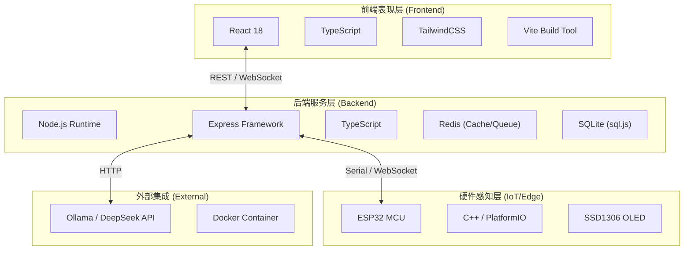

# AetherGuard 全栈技术深度解析

## 1. 总体架构概览

AetherGuard 采用现代化的 **"端-边-云"** 混合架构，融合了 Web 前后端开发、嵌入式系统与人工智能技术。系统设计遵循高内聚、低耦合原则，各层级技术栈选型如下：

---

## 2. 后端技术栈 (Backend)

后端作为系统的控制中枢，负责处理业务逻辑、数据持久化及 AI 任务调度。

### 2.1 核心框架
-   **Runtime**: **Node.js**: 选择其事件驱动、非阻塞 I/O 模型以处理高并发的流量转发与日志收集。
-   **Framework**: **Express 4.x**: 轻量级、灵活的 Web 框架，配合中间件机制实现请求拦截与处理。
-   **Language**: **TypeScript 5.x**: 提供静态类型检查，显著提升大型项目的代码健壮性与可维护性。

### 2.2 数据存储与缓存
-   **Primary DB**: **sql.js (SQLite)**: 采用内存/文件型数据库，无需繁重的安装配置，适合单机部署与快速读写配置数据。
-   **Cache/Queue**: **Redis (ioredis)**: 
    -   用于存储高频访问的黑/白名单 IP。
    -   作为消息队列缓冲海量 Agent 上报的日志，防止数据库削峰。
    -   管理 WebSocket 会话状态。

### 2.3 实时通信
-   **Socket.io**: 实现前端 Dashboard 的实时数据推送（如流量监控图表）。
-   **WebSocket (ws)**: 轻量级原生 WebSocket 实现，用于 Agent 与 Server 之间的长连接通信，降低协议开销。

### 2.4 安全与认证
-   **JWT (jsonwebtoken)**: 无状态身份认证，生成 Access Token 用于 API 鉴权。
-   **Bcryptjs**: 对管理员密码进行加盐哈希存储，防止彩虹表攻击。
-   **Helmet**: 设置 HTTP 安全标头（如 CSP, HSTS, X-Frame-Options）防御常见 Web 漏洞。
-   **Greenlock-express**: 自动申请与续期 Let's Encrypt SSL 证书，实现自动化 HTTPS 部署。

### 2.5 流量代理
-   **http-proxy-middleware**: 核心反向代理组件，拦截进出流量，执行 AI 防火墙策略后再转发至目标服务。

---

## 3. 前端技术栈 (Frontend)

前端旨在提供极致的用户体验与沉浸式的数据可视化交互。

### 3.1 核心框架
-   **React 18**: 利用 Hooks (useState, useEffect, useContext) 和 Concurrent Mode 构建高性能用户界面。
-   **Vite 5**: 新一代前端构建工具，利用 ES Modules 实现毫秒级热更新 (HMR) 与秒级生产构建。

### 3.2 样式与 UI
-   **TailwindCSS 3.4**: 实用优先（Utility-first）的 CSS 框架，极大提升样式编写效率与统一性。
-   **Framer Motion**: 强大的 React 动画库，用于实现路由切换、弹窗、列表展开等流畅的交互动画。
-   **Lucide React**: 统一的 SVG 图标库，风格简洁统一。

### 3.3 数据管理与路由
-   **React Router DOM 6**: 管理单页应用（SPA）的路由导航。
-   **Axios**: 统一封装 HTTP 请求，处理 Token 注入、响应拦截与错误统一处理。

### 3.4 数据可视化
-   **Recharts**: 基于 D3 的 React 图表库，用于绘制流量趋势图、攻击源饼图等复杂数据可视化组件。

---

## 4. 硬件与嵌入式技术栈 (IoT/Edge)

硬件部分负责物理层的安全部署与状态监控。

### 4.1 开发环境
-   **PlatformIO**: 专业的嵌入式开发 IDE 插件，提供统一的依赖管理与构建流程。
-   **C++ 11/17**: 嵌入式固件开发语言，兼顾性能与面向对象特性。

### 4.2 核心库与驱动
-   **Arduino Framework**: 基于 ESP32 Arduino Core，利用其丰富的生态库快速开发。
-   **U8g2 / Adafruit GFX**: 驱动 0.96寸 OLED 屏幕，实现字符与图形显示。
-   **WebSockets Client**: 在 ESP32 上实现 WebSocket 协议，保持与服务端的长连接通讯。

### 4.3 自研协议
-   **Codebook Protocol**: 自研的轻量级通讯协议（基于 `codebook.h`），通过映射表将复杂的指令压缩为短字节码，极大降低 USB 串口与无线传输对于带宽的占用。

---

## 5. AI 与智能分析 (Integration)

系统大脑，负责从海量日志中识别异常。

-   **Model Integration**: 支持通过 REST API 对接 **Ollama** (本地大模型) 或 **OpenAI / DeepSeek** (云端大模型)。
-   **Prompt Engineering**: 精心设计的提示词模板（System Prompts），引导 LLM 对 HTTP 请求载荷进行意图识别（如 SQL 注入判定、XSS 判定）。

---

## 6. DevOps 与基础设施

确保从开发到生产的平滑交付。

-   **Docker & Docker Compose**: 
    -   统一应用运行环境，消除“在我机器上能跑”的问题。
    -   `backend.Dockerfile`: 定义后端 Node.js 运行环境。
    -   `docker-compose.yml`:以此编排 Redis, Backend, Frontend 服务。
-   **ESLint & Prettier**: 强制统一代码风格与质量规范。
-   **Jest**: 单元测试框架，确保核心业务逻辑的正确性（如 `test:coverage` 脚本）。

---

## 总结

AetherGuard 通过整合 Web 开发的灵活性与底层硬件的可控性，构建了一个全链路的安全防御体系。
- **前端** 专注于数据可视与交互体验；
- **后端** 专注于高并发处理与策略分发；
- **硬件** 专注于物理接入与底层执行。
这种全栈组合使得系统既具备互联网软件的易用性，又拥有工业级硬件的可靠性。
