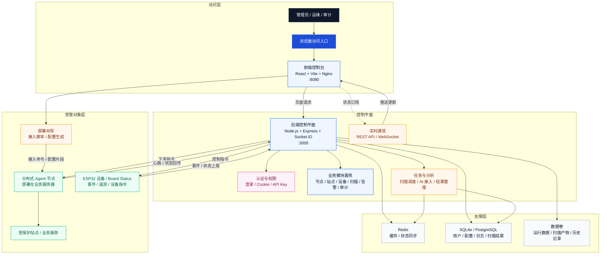

# AetherGuard 系统整体架构图

下图可直接用于用户手册、产品说明或导出到 Word/PDF 之前的结构确认。

## 图示说明

1. 用户通过浏览器访问前端控制台，前端负责展示登录、控制台、节点、站点、设备、扫描、告警和审计等页面。
2. 前端通过 HTTP 接口和实时订阅能力与后端控制平面通信，后端负责处理认证、业务逻辑和状态同步。
3. Redis 负责缓存与状态同步，数据库负责保存用户、配置、日志、扫描结果和历史记录。
4. 后端控制平面同时管理扫描任务与 AI 分析能力，并将结果回写到控制台页面。
5. 分布式 Agent 节点部署在业务服务器侧，通过 WebSocket、心跳和指令机制与控制平面保持连接，并作用于受保护站点。
6. ESP32 设备与板卡状态作为独立受管对象纳入系统，支持状态查看、事件记录和设备指令联动。

## 建议用途

- 用于插入 `docs/软件操作说明书.md` 的系统架构章节。
- 用于导出 Word/PDF 前先在支持 Mermaid 的环境中渲染后截图。
- 用于项目答辩、软著材料整理和产品演示时说明系统组成。
