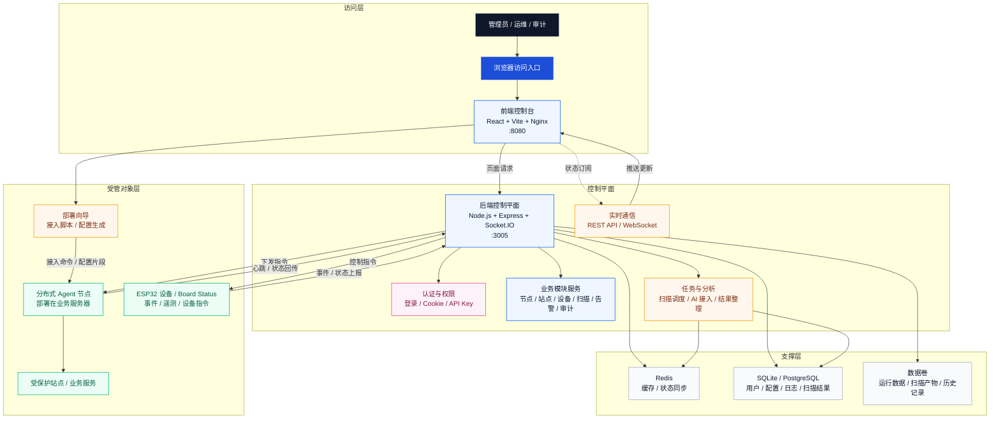

# AetherGuard
# 软件操作说明书

**软件全称**：AetherGuard  
**软件简称**：AetherGuard  
**版本号**：V1.0（待填写）  
**申请单位**：（待填写）  
**文档用途**：计算机软件著作权登记申报材料  
**文档类型**：用户操作手册与运行说明文档  
**截图采集日期**：2026年3月7日  
**运行环境说明**：本文截图来自本地实际运行环境，前端访问地址为 `http://127.0.0.1:8080`，后端健康检查地址为 `http://127.0.0.1:3005/api/health`。  

---

**目录**

1. 第1章 软件概述  
2. 第2章 系统要求  
3. 第3章 安装部署  
4. 第4章 功能介绍  
5. 第5章 操作指南  
6. 第6章 常见问题  
7. 第7章 技巧与最佳实践  
8. 第8章 附录  

---

## 第1章 软件概述

### 1.1 产品简介

AetherGuard 是一套面向智能体节点、站点资产、流量对象、硬件终端、扫描任务和审计记录的统一控制平台软件。系统以浏览器控制台为主要交互入口，通过前后端协同方式，将原本分散在登录鉴权、状态查看、站点治理、设备管理、扫描分析、告警收束和后台维护中的多个环节集中到同一个平台中，便于管理员、运维人员和审计人员在统一界面中完成持续操作。

与只提供单页展示或单点工具的软件不同，AetherGuard 已经形成了完整的页面组织结构和运行闭环。用户登录后可进入控制台首页查看总体状态，再按需切换至智能体、流量、站点、设备、扫描、告警、审计和系统管理等模块；对于需要深入查看的对象，还可以从列表继续进入详情页。软件不仅有总览页，也有列表页、详情页、历史页和高权限管理页，这说明其结构已经具备较强的完整性和连续性。

从软著申报材料的角度看，本软件的价值不在于展示某一张漂亮界面，而在于证明系统已经具备明确的用途、实际可运行的部署方式、稳定的模块边界、可解释的页面关系以及可复核的运行结果。本文在参考传统用户手册章节组织方式的基础上，保留了 AetherGuard 当前仓库和运行环境中的真实内容，不使用与本项目无关的技术事实，不伪造安装路径或第三方产品信息，确保文档与系统现状一致。

### 1.2 应用场景

AetherGuard 适合用于需要统一查看和管理多类对象的运行场景。第一类场景是日常运维巡检，管理员可通过控制台首页、智能体页面、设备页面和站点页面快速了解在线状态、风险摘要、资源情况和接入情况，并及时定位异常对象。第二类场景是安全治理和风险复核，使用者可借助扫描中心、扫描详情、告警中心和审计历史完成从发现问题、查看证据到记录处理过程的连续流程。第三类场景是实施交付和平台验收，部署人员可通过安装章节说明、部署向导页面和系统设置页面完成平台启动、环境检查和参数维护。

对于接入硬件终端或边缘设备的项目，本软件还支持将 ESP32 设备和板卡状态纳入统一管理，通过设备列表页和 Board Status 页面实现“设备发现、状态查看、事件跟踪、动作执行”的闭环；对于需要多角色分工和权限边界控制的项目，系统则提供 API 密钥管理和超级管理等页面，以体现不同角色之间的访问边界和管理深度。因而，本软件既可用于内部演示和软著申报，也可作为后续实施、验证和项目交付的文档基础。

### 1.3 技术架构

AetherGuard 采用“访问层 + 控制平面 + 支撑层 + 受管对象层”的分层架构。访问层对应浏览器和前端控制台，用于承载登录、导航、总览、列表、详情和后台配置等交互页面；控制平面对应后端接口服务，用于处理认证鉴权、接口调用、状态同步、任务执行和业务逻辑；支撑层对应 Redis、数据库和数据卷，用于缓存、状态同步、结构化记录保存和扫描产物持久化；受管对象层对应分布式 Agent 节点、受保护站点和 ESP32 设备，用于承载实际被管理的对象。

这种分层方式说明 AetherGuard 不是一套仅靠前端静态资源展示内容的演示程序，而是一套具备真实访问入口、后端接口、状态支撑和外部对象管理能力的平台型软件。前端通过 HTTP 接口和实时订阅能力与后端通信，后端再与 Redis、数据库和各类对象建立关系，最终将结果回传到控制台页面。这种结构使得系统能够同时承载安装部署、运行监控、对象管理、风险查看和高权限维护等多类任务。



*图1-1：AetherGuard 系统整体架构图*  
图示解读：图中展示了访问层、控制平面、支撑层和受管对象层之间的关系，说明系统具备统一入口、后端处理、状态支撑和对象管理能力，满足平台型软件的组织特征。

---

## 第2章 系统要求

### 2.1 硬件与运行环境要求

为保证 AetherGuard 可以稳定完成容器构建、服务启动、浏览器访问和截图采集，建议使用具备常规服务器或开发主机条件的宿主机环境。对于软著申报、内部验收和日常演示场景，只要宿主机能够稳定运行 Docker 和 Docker Compose，并允许浏览器访问 8080 端口，即可满足基础要求。若需要同时进行任务处理、日志保留和多页截图采集，则应保证宿主机具备连续运行能力和足够的磁盘可写空间。

| 项目 | 建议要求 |
| --- | --- |
| 宿主机类型 | 通用服务器、开发主机或支持 Docker 的工作站 |
| 处理器 | 具备稳定运行三个核心容器的 CPU 资源，建议双核及以上 |
| 内存 | 建议 8GB 及以上，以保证前端、后端和 Redis 同时稳定运行 |
| 磁盘空间 | 建议保留 20GB 及以上可用空间，用于镜像构建、数据卷和日志写入 |
| 网络连接 | 可访问 Docker 镜像源，浏览器可访问本机或目标主机的控制台地址 |
| 可选硬件 | 如需设备联动，可额外接入 ESP32 终端或相关板卡对象 |

上述要求并非限定某一种品牌或特定型号硬件，而是说明部署环境应当具备支撑平台运行的基本资源条件。对于实际项目实施，可根据节点数量、日志保留量和扫描任务规模继续提高配置。

### 2.2 软件与浏览器要求

AetherGuard 当前版本采用容器化方式部署，因此宿主机不要求预先安装本项目的前后端运行时依赖，但必须具备容器运行与浏览器访问条件。由于前端控制台通过浏览器交付，浏览器兼容性和网络连通性会直接影响用户能否进入系统和完成页面操作。

| 项目 | 要求说明 |
| --- | --- |
| 操作系统 | 支持 Docker 的 Linux 或 Windows 环境 |
| 容器运行环境 | 已安装 Docker，并可执行 `docker compose` 子命令 |
| 浏览器 | Chrome、Edge、Firefox 等现代浏览器，建议使用较新稳定版本 |
| 终端工具 | 建议具备 PowerShell、CMD 或 Shell 终端，用于执行安装与检查命令 |
| 其他要求 | 允许本地打开 `http://127.0.0.1:8080`，并能访问后端健康检查地址 |

由于当前部署方式使用 `docker-compose.yml` 统一拉起服务，因此不需要按照传统源码部署方式单独安装 Python、Node.js 或数据库客户端后再逐个启动服务；浏览器端用户也无需了解后端内部细节，只需保证访问入口可用即可。

### 2.3 网络、端口与账号要求

网络、端口和管理员账号是安装成功后的关键前提。前端默认通过 8080 端口提供控制台入口，后端默认通过 3005 端口提供接口与健康检查能力，Redis 默认占用 6379 端口用于缓存和状态同步。管理员首次登录所需的邮箱和密码来自 `.env` 文件，部署前必须确认这些信息已经正确配置。

| 项目 | 默认值或要求 | 说明 |
| --- | --- | --- |
| 前端访问地址 | `http://127.0.0.1:8080` | 浏览器控制台入口 |
| 后端健康检查 | `http://127.0.0.1:3005/api/health` | 用于确认后端服务是否正常 |
| Redis 端口 | `6379` | 状态同步与缓存服务 |
| 管理员邮箱 | 来自 `.env` | 用于首次登录和后续后台管理 |
| 管理员密码 | 来自 `.env` | 应使用强口令，避免示例值 |
| 首次构建网络要求 | 可访问镜像仓库 | 用于拉取基础镜像和完成构建 |

对于离线或受限网络环境，如不能直接访问外部镜像源，应提前准备好相关镜像或配置可用的镜像代理；对于软著截图采集环境，至少应保证安装当天浏览器能够访问前端地址，并保证后端健康检查返回正常状态。

---

## 第3章 安装部署

本章按照实际可执行的顺序说明 AetherGuard 的安装部署流程。与传统“只列命令不说明结果”的写法不同，本章同时提供关键步骤的实际运行截图，便于审核人员和实施人员确认系统已经具备从文件检查、环境配置、容器启动到首次访问的完整落地能力。

### 3.1 安装前文件检查

开始安装前，应先确认仓库目录结构完整。项目根目录至少应包含 `.env`、`.env.example`、`docker-compose.yml`、`frontend`、`backend` 和 `docs` 等关键文件或目录。其中，`.env.example` 用于提供环境变量模板，`.env` 用于保存当前实际运行环境所需的账号和密钥，`docker-compose.yml` 用于定义前端、后端和 Redis 的启动关系，`frontend` 与 `backend` 目录则保存系统的主要程序代码与构建资源。

如果这些关键文件缺失，后续安装将无法保证成功。例如，没有 `.env` 文件就无法为后端提供必要的口令和管理员信息，没有 `docker-compose.yml` 就无法按统一方式启动三项核心服务，没有前后端目录则无法完成镜像构建。因而，文件检查是安装部署的第一步，也是后续截图采集和文档整理的基础前提。


*图3-1：安装前项目目录与关键文件检查*  
图示解读：图中显示项目根目录已包含 `.env`、`.env.example`、`docker-compose.yml`、`frontend`、`backend` 和 `docs` 等核心文件或目录，说明系统具备继续执行配置和启动的基础条件。

### 3.2 配置文件准备

在确认目录结构完整后，应准备 `.env` 文件并核对关键环境变量。若首次部署时尚未存在 `.env` 文件，可参考 `.env.example` 复制生成；若仓库中已经提供 `.env`，则应逐项确认与当前环境有关的字段已填写完成。对 AetherGuard 来说，`REDIS_PASSWORD`、`JWT_SECRET`、`AUDIT_LOG_SECRET`、`ADMIN_EMAIL` 和 `ADMIN_PASSWORD` 是最关键的安装前参数，它们分别关系到缓存口令、登录会话签名、审计签名以及管理员首次访问能力。

由于用户手册面向软著申报，不适合暴露真实密钥，正文和截图统一对口令与密钥进行了脱敏处理。但变量名称、变量种类和配置逻辑均保留原貌，以证明软件的安装依赖的确来自实际配置项，而不是纯概念描述。正式部署时，管理员应使用强密码和强随机密钥，避免直接沿用模板值。

```powershell
Copy-Item .env.example .env
```


*图3-2：`.env` 配置文件关键参数检查*  
图示解读：图中展示了 Redis 口令、JWT 签名密钥、审计签名密钥和管理员账号等关键参数已写入 `.env` 文件，说明系统已具备启动前的核心配置条件。

### 3.3 Docker Compose 启动

关键文件和环境变量准备完成后，即可在项目根目录执行统一启动命令。AetherGuard 采用 Docker Compose 部署方式，通过一条命令完成前端镜像构建、后端镜像构建、Redis 服务拉起、容器创建和服务启动。与分别安装多个运行时并手工启动进程的方式相比，这种部署方式更适合文档化、演示化和标准化交付。

当前推荐的标准启动命令如下：

```powershell
docker compose up -d --build
```

其中，`--build` 参数用于确保前后端镜像按照当前仓库内容重新构建，避免直接沿用旧镜像导致界面与代码不一致。命令执行成功后，系统会自动拉起 `redis`、`backend` 和 `frontend` 三个核心服务，并按依赖顺序等待健康状态准备完成。


*图3-3：执行 `docker compose up -d --build` 的启动结果*  
图示解读：图中展示了镜像构建、容器重建和服务启动的关键输出，证明系统可以通过统一编排方式完成启动，而非停留在静态文档层面。

### 3.4 健康检查与首次访问

服务启动后，应继续确认容器状态和健康接口返回结果。仅凭终端中出现“Started”并不能完全说明系统已经可用，还需使用 `docker compose ps` 查看容器是否处于健康状态，并访问后端健康检查地址 `http://127.0.0.1:3005/api/health` 验证接口是否返回结构化的健康响应。若上述检查全部通过，通常可认为系统已经具备被浏览器访问的条件。

```powershell
docker compose ps
Invoke-WebRequest http://127.0.0.1:3005/api/health
Invoke-WebRequest http://127.0.0.1:8080/login
```


*图3-4：容器状态与后端健康检查结果*  
图示解读：图中显示前端、后端和 Redis 三个容器均处于 `healthy` 状态，后端健康接口返回结构化 JSON，说明控制平台已经完成启动并可进入访问阶段。

在健康检查通过后，可使用浏览器打开登录页完成首次访问。登录页是安装阶段的最终验证点，因为只有当前端静态资源、反向代理、后端认证接口和管理员账号共同生效时，登录页才能完整展示品牌标识、表单和预置入口。


*图3-5：首次访问登录页结果*  
图示解读：图中表明系统已能够通过浏览器打开登录界面，说明前端地址、后端认证路径和基础访问流程均已建立完成。

---

## 第4章 功能介绍

本章对 AetherGuard 的主要页面和功能模块进行说明。与逐页罗列的写法不同，本章按“主界面布局”“智能体与流量管理”“站点、部署与扫描”“告警、审计与系统管理”四个功能族进行组织，既保留全部真实运行截图，也更接近传统软著手册的章节风格。所有截图均来自 2026 年 3 月 7 日本地运行环境，文件位于 `docs/screenshots/` 目录。

### 4.1 主界面布局

#### 登录界面

登录界面是系统的统一访问入口。页面左侧用于展示软件名称、定位说明和运行环境入口信息，右侧则提供账号、密码和快捷登录按钮。该页面面向管理员、运维人员和审计人员等多类用户，因此其结构必须清晰、稳定并支持标准登录流程。

从业务意义看，登录页不仅说明软件具备真实用户入口，也说明前后端之间已经建立了认证和跳转能力。对于软著申报，这种带有表单、预置账号入口和按钮交互的页面，比单纯展示静态欢迎页更能体现软件系统的完整性。


*图4-1：AetherGuard 登录界面*  
图示解读：图中可以看到登录表单、软件标识和开发预置账号入口，说明系统具备统一入口和基础认证交互能力。

#### 控制台首页

控制台首页是用户登录后的默认总览页面，负责集中展示关键指标、整体状态、日志摘要和近期风险信息。首页承担的是“总入口、总概览、总状态面板”的作用，用户可通过该页面快速判断系统当前是否处于稳定状态，并据此决定是否进入其他模块继续查看。

页面顶部通常提供主题、语言和模式切换，中部展示统计卡片和图形，下部展示日志流、攻击来源或活跃规则等信息。首页的存在，说明软件具备较成熟的总览设计，而不是只能依赖列表页或详情页分散展示内容。


*图4-2：AetherGuard 控制台首页*  
图示解读：图中展示了控制台首页中的统计卡片、趋势图、日志和活动摘要，体现了系统对整体运行状态的集中展示能力。

### 4.2 智能体与流量管理

#### 智能体节点列表

智能体节点列表页面用于集中查看已接入平台的节点对象。页面从“节点集合”的角度展示在线情况、资源使用情况和近期安全事件，是节点级管理的基础入口。对于需要管理多个节点的系统，列表页承担着定位对象、触发动作和进入详情的核心职责。

在实际使用时，运维人员可通过本页面查看每个节点的主机名、在线状态、CPU、内存、运行时长和近期事件数，也可直接发起扫描或进入详情页。该页面体现的是“多对象展示 + 状态标签 + 操作入口 + 事件联动”的组合能力。


*图4-3：智能体节点列表页面*  
图示解读：图中展示了节点卡片、在线状态、资源指标和操作入口，说明系统能够以列表方式管理多节点对象。

#### 智能体详情

智能体详情页用于查看单个节点的基础信息、状态摘要和关联上下文。与列表页不同，详情页更强调“单对象深度查看”，适合在用户已经锁定某个目标节点后继续下钻分析。通过列表页和详情页的组合，系统为用户提供了从总览到细查的连续操作路径。

页面通常展示节点编号、状态、资源负载和附加上下文信息。它的价值在于把节点对象从“列表中的一行”提升为“可以独立解释和审查的对象”，从而增强系统在对象级管理方面的完整性。


*图4-4：智能体详情页面*  
图示解读：图中展示了单节点摘要、状态区块和结构化信息，说明系统支持对象级深度展示而不只停留在列表层。

#### 多智能体监控

多智能体监控页面用于展示多个角色或多个处理单元之间的协同运行状态。它不是传统的主机列表页，而是站在更高抽象层查看各角色健康度、处理量、待办数量和响应情况，适合管理者或高级用户观察系统整体协同状态。

对于需要呈现 AI 协同处理、任务编排或多角色运作的软件来说，这一页面非常关键。它说明系统并不是只有孤立的单页功能，而是具备对多单元协同过程进行统一展示的能力。


*图4-5：多智能体监控页面*  
图示解读：图中展示了多个处理角色或单元的状态摘要和健康度信息，体现了系统的协同监控能力。

#### 流量拦截器

流量拦截器页面用于展示当前网络流量、会话状态、协议分布和风险判断结果，是从流量行为角度理解系统运行的重要页面。与首页的全局概览不同，本页面更强调连接级、协议级和会话级的数据观察。

当用户在首页、告警或扫描结果中发现异常时，可回到流量拦截器页面进一步确认活跃连接、协议分布和会话状态，从而判断问题是否集中在特定来源、特定协议或特定连接对象上。


*图4-6：流量拦截器页面*  
图示解读：图中展示了流量统计、协议分布和会话对象，说明系统具备对底层流量行为进行可视化展示的能力。

#### 物联网终端列表

物联网终端列表页面用于统一展示接入平台的设备对象。页面从设备管理视角出发，将设备型号、版本、运行状态、风险摘要和可执行动作集中展示，是硬件终端管理的基础页面。与智能体列表相似，它承担的是“对象定位、状态查看、动作入口”的职责，但管理对象变成了硬件设备。

对于需要管理多个终端的场景，设备列表页可帮助管理员快速判断哪些设备在线、哪些设备存在风险分升高、哪些设备需要进入详情页继续查看。该页面也体现了 AetherGuard 在软硬件联动方面的设计深度。


*图4-7：物联网终端列表页面*  
图示解读：图中可以看到设备卡片、版本信息、在线状态和动作按钮，说明系统已具备独立设备对象的统一管理能力。

#### Board Status 板卡状态

Board Status 页面是设备列表页的详情延伸，用于展示单个硬件终端的板卡级状态、近期事件和运行摘要。相比设备列表的概要展示，Board Status 更强调某一设备对象的独立性和完整性，适合在设备验收、状态核对和异常排查时使用。

该页面的意义在于让硬件对象也具备“列表 + 详情”的完整视图路径。它说明软件不仅可以罗列设备名称和状态，还能够对某一板卡对象做单独展示、事件记录和运行解释。


*图4-8：Board Status 板卡状态页面*  
图示解读：图中展示了单设备状态、事件信息和运行摘要，体现了系统在硬件对象细粒度管理方面的能力。

### 4.3 站点、部署与扫描

#### 站点资产列表

站点资产列表页面用于统一管理纳入平台治理的站点对象。站点作为业务访问的主要承载体，是系统中的核心管理对象之一。本页面承担站点总览、状态识别和进入详情页的职责，也是用户从资产维度理解风险的主要入口。

通过本页面，用户可以查看当前纳入管理的域名、目标地址和防护状态，并根据需要进入详情页查看与该站点相关的告警、流量和上下文信息。这说明系统已经形成了按业务资产组织安全对象的能力。


*图4-9：站点资产列表页面*  
图示解读：图中展示了域名、目标地址、状态标签和详情按钮，说明平台具备按站点资产集中归集和展示对象的能力。

#### 站点详情

站点详情页面用于展示单个站点的状态、风险分、关联告警和流量上下文。它把原本分散在多个模块中的信息按“站点”这一对象进行聚合，使用户能够以业务资产为中心理解风险状况。

对于站点验收、异常排查和单对象审查场景，本页面具有较高价值。用户无需在多个页面来回切换，即可在一个站点详情页中同时看到该对象的基本信息、风险评分和关联上下文。


*图4-10：站点详情页面*  
图示解读：图中展示了单站点的状态、风险评分和关联信息，说明系统支持以对象为中心的聚合式详情展示。

#### 部署向导

部署向导页面用于辅助用户生成部署配置、接入片段或实施结果，是系统与实施流程衔接的重要模块。一个完整的平台型软件不仅要有运行后的管理界面，也应具备运行前接入和部署辅助能力，而部署向导正是承担这一职责的页面。

在实际项目中，部署人员可通过本页面填写参数、生成部署片段并用于后续接入或归档。该页面说明 AetherGuard 已经把平台接入和实施支持纳入软件流程，而不仅仅关注运行后的结果展示。


*图4-11：部署向导页面*  
图示解读：图中展示了参数配置区和结果生成区，表明系统已提供接入与部署辅助能力。

#### 扫描中心

扫描中心页面用于创建、查看和跟踪扫描任务，是系统进行主动检测和结果整理的重要入口。与首页的总体概览不同，扫描中心更关注任务生命周期，包括任务状态、执行阶段、历史列表和发现项摘要。

对于定期巡检、临时验证和风险复核等场景，用户可在扫描中心集中查看任务是否执行、执行到了哪个阶段、发现项数量是否异常，并据此决定是否进入详情页查看证据和处理建议。


*图4-12：扫描中心页面*  
图示解读：图中展示了任务状态、阶段信息和历史列表，说明系统具备扫描任务生命周期管理能力。

#### 扫描任务详情

扫描任务详情页面用于查看单个任务的阶段信息、时间线、发现项、证据内容和修复建议。对软著审核而言，这类页面能够直接说明软件不只是“会发起任务”，而是能够把任务结果整理为结构化、可解释、可复核的内容。

当任务结束后，用户通常需要查看发现了哪些问题、为何认定为风险、证据依据是什么以及下一步如何处理，而这些内容都集中在本页面。这使扫描模块具备了从任务创建到结果解释的完整闭环。


*图4-13：扫描任务详情页面*  
图示解读：图中展示了时间线、发现项、证据区和处理建议，说明系统可以对扫描任务输出进行结构化解释。

### 4.4 告警、审计与系统管理

#### 告警中心

告警中心页面用于集中展示当前产生的告警事件及其严重程度、来源和处理状态。它是“统一风险收束页”，帮助用户从多个模块产生的风险信号中快速定位最需要优先处理的事件。

在日常巡检、事件初判和待处理事项整理等场景中，用户往往会优先访问告警中心，根据告警级别和来源判断是否需要继续进入扫描、站点或审计等页面进行深入分析。


*图4-14：告警中心页面*  
图示解读：图中展示了告警标题、等级、来源和状态信息，说明系统具备按事件集中归集风险的能力。

#### 审计历史

审计历史页面用于保存和查看历史事件、处理记录和审计轨迹。对需要留痕和复盘的软件来说，这一页面非常关键，因为系统不仅需要知道当前发生了什么，还需要能够回答过去发生了什么、何时发生以及结果如何。

该页面适用于阶段性复盘、合规留痕、处理追踪和对外说明等场景。其存在说明软件具备历史记录保存和追踪能力，而不仅是即时展示当前状态。


*图4-15：审计历史页面*  
图示解读：图中展示了时间、事件类型和处理记录，说明系统已形成可追踪的审计留痕能力。

#### 系统设置

系统设置页面用于承载软件运行参数、策略选项和通用配置。它说明 AetherGuard 并不是固定逻辑的静态界面，而是提供了可维护、可调整、可持续运行的配置能力，是平台长期运行的重要组成部分。

对于不同实施环境，系统设置页可以承担初始化配置、模式切换、策略维护和后续调整的职责。其存在说明软件在设计上已考虑到运行期维护场景，而不仅是一次性演示。


*图4-16：系统设置页面*  
图示解读：图中展示了参数分组和设置项，说明平台具备运行参数管理与维护能力。

#### API 密钥管理

API 密钥管理页面用于查看和管理系统对外接入所需的凭据、前缀和使用情况。该页面体现的是平台接入治理能力，说明软件除了网页操作之外，还考虑到了接口调用、凭据维护和访问控制等正式运行需求。

通过本页面，管理员可核对当前有效密钥、查看最近使用时间，并按需完成新增或清理动作。这是区分“可运行后台系统”和“单机演示工具”的重要能力之一。


*图4-17：API 密钥管理页面*  
图示解读：图中展示了密钥名称、前缀和使用信息，说明系统具备外部接入凭据的管理能力。

#### 超级管理

超级管理页面面向更高权限范围，用于处理用户、全局对象或更深层次的后台管理内容。它只对特定角色开放，用于体现系统在权限边界和高权限治理方面的层级化设计。

在实际项目中，超级管理页面往往由平台管理员或实施维护人员使用，用于处理高权限操作和全局范围内的配置、对象或状态核对。其存在说明软件已经考虑到多角色分层和权限差异。


*图4-18：超级管理页面*  
图示解读：图中展示了高权限管理对象和全局管理入口，体现了平台在角色与权限边界上的分层设计。

---

## 第5章 操作指南

### 5.1 快速上手

对于首次使用 AetherGuard 的用户，推荐按以下顺序完成快速上手。第一步，按照第3章完成环境准备、`.env` 配置、容器启动和健康检查，并确认浏览器可以打开登录页（参见图3-5）。第二步，使用管理员账号登录系统，进入控制台首页查看全局状态（参见图4-1 和图4-2）。第三步，根据当前目标进入相应模块，例如节点管理、站点管理、设备管理或扫描中心。第四步，在列表页定位目标对象后进入详情页继续查看结构化内容。第五步，在需要时查看告警中心和审计历史，对风险或处理过程进行复核。

如果只是进行软著材料演示，建议先从登录页和控制台首页开始，再依次展示智能体节点列表、站点列表、扫描中心、告警中心和审计历史，这样最容易让审核人员理解软件整体结构和处理流程。如果是面向实施验收，则可优先展示安装章节、部署向导、系统设置和 API 密钥管理，说明软件既可安装，也可长期维护。

在实际演示时，还建议把“总览页负责发现问题、列表页负责定位对象、详情页负责解释对象、记录页负责留痕复核、管理页负责维护平台”这一逻辑明确说出来。因为 AetherGuard 的价值并不在某一个页面，而在多个页面之间形成的连续关系。只要先让阅读者理解这条主线，后续无论进入节点、站点、设备还是扫描模块，都能够快速理解该页面在整个系统中的位置。

### 5.2 日常巡检与处置流程

日常巡检通常从控制台首页开始。管理员登录后首先查看首页统计、日志摘要和近期活动，判断是否存在明显异常；若发现某类对象异常，再进入智能体节点列表、设备列表或站点资产列表对对象进行归集式查看。对于节点和站点对象，可通过对应的详情页进一步理解风险分、状态和关联上下文；对于主动检测结果，可进入扫描中心查看任务状态，并通过扫描任务详情查看证据和处理建议。

当系统已形成告警时，应进入告警中心按级别和来源对事件进行优先级排序，并在需要留痕时进入审计历史查看过往记录。这样，用户就完成了“总览发现异常 -> 进入对象页定位 -> 打开详情页解释 -> 进入告警和审计复核”的完整巡检与处置流程。该流程贯穿了 AetherGuard 主要页面，也是本软件相较于零散工具更具体系化价值的地方。

如果需要做更细的交叉核对，可在巡检流程中增加两项动作。第一项是从流量拦截器页面确认异常是否集中在某类连接、协议或会话对象上，避免仅凭首页摘要做判断；第二项是结合设备列表和 Board Status 页面确认硬件终端是否存在同步异常、状态漂移或事件集中上报。通过这种“控制台总览 + 对象列表 + 单对象详情 + 记录复核”的方法，可以让日常巡检更接近真实运维和安全治理过程，而不是停留在单页浏览层面。

### 5.3 管理员维护流程

管理员维护流程主要围绕部署、配置、凭据和高权限管理展开。部署人员可在安装章节完成容器化部署后，通过部署向导页面生成接入配置或部署片段；平台管理员可进入系统设置页面维护运行参数、策略选项和模式开关；需要对外接入时，则应在 API 密钥管理页面检查当前有效密钥的状态和使用记录；若涉及更高权限范围的维护，则进入超级管理页面执行相应操作。

在项目长期运行阶段，建议管理员把“容器状态检查、健康接口检查、控制台首页巡检、关键页面抽查、API 密钥复核、审计历史留痕核对”作为固定维护动作。通过这一流程，可以把系统维护从一次性启动扩展为可持续管理的日常工作。

如果项目存在多角色协作，还应把用户管理和角色权限边界纳入日常维护范围。普通用户适合访问总览、对象查看和结果复核页面，高权限管理员则适合进入系统设置、API 密钥和超级管理页面。通过明确角色边界，可以降低误操作风险，并使软件在交付时更符合多用户协同和权限分层的管理要求。

---

## 第6章 常见问题

### 6.1 安装与启动问题

**1. 执行 `docker compose up -d --build` 时如果出现镜像仓库 TLS 超时怎么办？**  
这通常是外部镜像仓库的瞬时网络抖动，不代表项目文件或容器编排本身有误。处理方式是先确认宿主机可以正常访问 Docker Hub 或镜像代理，然后重新执行同一条命令。本文档截图采集过程中曾出现一次 `nginx:1.27-alpine` 元数据握手超时，重试后构建成功，因此建议将此类问题视为网络重试项，而不是误判为安装失败。

**2. 启动后如何判断系统是否真正可用？**  
建议按“`docker compose ps` 查看容器状态 -> 访问 `/api/health` 检查后端 -> 浏览器打开登录页”三步进行验证。只有容器健康、健康接口正常、登录页可打开，这三项同时满足时，才能认定系统已经具备实际访问能力。

**3. `.env` 中哪些参数最关键？**  
`REDIS_PASSWORD`、`JWT_SECRET`、`AUDIT_LOG_SECRET`、`ADMIN_EMAIL` 和 `ADMIN_PASSWORD` 是最关键的基础参数。缺少这些参数时，后端认证、缓存访问或管理员登录都可能无法正常工作。

### 6.2 登录与使用问题

**4. 无法登录系统怎么办？**  
首先检查前端地址是否可以正常打开，其次确认后端健康检查是否返回正常结果。如果登录页能打开但提交失败，应进一步确认管理员账号密码、后端认证接口和浏览器网络状态。

**5. 页面没有数据显示怎么办？**  
如果系统刚启动或尚未接入真实数据，某些页面可能只显示空状态。为便于说明书编写和功能演示，可启用系统内置演示数据模式，以保证页面结构和字段说明能够完整展示。

**6. 为什么很多功能既有列表页又有详情页？**  
列表页用于快速定位对象，详情页用于对单个对象做深入查看。两者配合既能降低页面复杂度，也能增强软件对单对象状态的解释能力，是平台型软件中常见且必要的设计方式。

### 6.3 文档与申报问题

**7. 如何判断截图是否来自真实运行环境？**  
本文所有截图均来源于 2026 年 3 月 7 日的本地实际运行环境，文件保存在 `docs/screenshots/` 目录中，可与当前系统页面逐一对应。安装截图与运行截图均基于当前仓库和当前启动结果生成，并非占位图片。

**8. 手册中的部分页面为什么没有展示全部字段？**  
用户手册的目的是说明主要操作路径、模块关系和页面用途，不要求对所有字段逐一穷举。对于关键字段，本文已在详情页类页面说明中补充了核心解释，用于帮助理解页面作用。

**9. 如果正式导出时页数仍然不足怎么办？**  
可在不改变正文结构的前提下适度放大截图比例、保留目录单独分页，并按第7章中的导出建议设置页边距、字号和图片宽度。由于当前正文已保留 22 张截图和完整章节说明，一般不会出现明显页数不足的问题。

---

## 第7章 技巧与最佳实践

### 7.1 提高演示与截图质量的方法

在软著申报、内部汇报或项目验收场景中，截图质量直接影响材料的可读性。建议在采集截图前先完成标准化准备，包括确认容器均处于健康状态、浏览器缩放比例保持一致、使用统一主题和分辨率、尽量确保页面中展示有结构化信息而不是空白状态。对于需要说明流程的页面，宜按“登录 -> 首页 -> 列表 -> 详情 -> 记录/配置”的顺序组织截图，这样更容易让阅读者理解系统内部关系。

如需提升演示完整度，可结合系统内置演示数据模式展示节点、站点、设备和扫描结果，使页面中的字段、状态、卡片和时间线信息更丰富、更适合说明页面用途。对于扩展能力，如攻击模拟器、Landing 页面和角色权限等，不一定需要在正文中单独设章，但可在演示说明或汇报中作为补充能力点提及，用于说明系统并不局限于当前 18 张运行界面所覆盖的页面。

在对外展示时，还可以把 Landing 页面和登录页作为“系统外层入口”，把攻击模拟器、扫描中心和告警中心作为“验证和治理入口”，把系统设置、API 密钥和超级管理作为“运行维护入口”进行分组说明。这样做的好处是，阅读者能够更快理解软件页面不是杂乱堆叠，而是围绕访问、运行、验证、治理和维护形成层次化布局。即使正文中没有为每个扩展能力单独设主章节，也可以通过这种展示方法把产品边界说明得更完整。

### 7.2 稳定部署与运行的建议

为保证 AetherGuard 在不同环境中的稳定运行，建议把配置、启动、检查和维护作为统一流程看待，而不是把安装视为一次性动作。首先，应妥善保存 `.env` 文件并在变更前做好备份，避免管理员账号、密钥和端口配置丢失；其次，在构建或更新镜像时优先使用 `docker compose up -d --build` 保证镜像与代码一致；再次，启动后务必使用 `docker compose ps` 和后端健康接口做双重验证，避免仅凭终端回显判断服务可用；最后，应定期检查首页、告警、审计和高权限页面，以确认系统运行状态未出现偏差。

对于实施层面，可把部署拓扑理解为“控制台 + 后端服务 + 节点/站点/设备对象”的组合。控制台提供统一入口，后端负责处理逻辑和状态同步，节点、站点和设备作为被管理对象接入平台。对于权限层面，应充分利用 API 密钥管理和超级管理页面体现角色边界，避免所有人员使用同一账号执行全部操作。对于合规与审计场景，则应重点保留扫描结果、告警记录、审计历史和管理操作过程，以便形成较完整的记录链路和复盘依据。

如果项目需要进一步说明平台的业务价值，建议把“部署拓扑清晰、角色权限分层、运行痕迹可留存、对象状态可复核、配置参数可维护”作为五项长期运行指标来理解。部署拓扑说明系统不是单页工具而是平台；角色权限说明软件适合多人协同；运行痕迹和审计记录说明软件具备合规和复盘价值；配置维护能力则说明系统能够从测试环境平稳过渡到正式使用环境。把这些点纳入日常运行建议中，比单纯强调“能启动”更能体现软件的成熟度。

### 7.3 软著导出与提交建议

为保证本说明书在正式提交时具备足够的规范性，建议导出为 Word 或 PDF 后再进行页数和版式确认。推荐文件名为 `AetherGuard_软件操作说明书_V1.0.docx` 和 `AetherGuard_软件操作说明书_V1.0.pdf`；纸张建议采用 A4 纵向；页边距建议上下左右均为 2.54 厘米；正文建议使用 11 磅左右字号；一级标题可用 16 磅，二级标题可用 14 磅；图片宽度建议控制在版心宽度的 75% 至 85%；页眉建议使用 `AetherGuard 软件操作说明书 V1.0`，页脚建议使用 `第 X 页 / 共 N 页`。

正式导出前，建议再做一次总检查：第一，软件名称、简称、版本号和申请单位信息是否一致；第二，22 张截图是否全部能够正常显示；第三，图号与正文顺序是否对应；第四，全文是否仍然残留旧产品名称或与本项目无关的技术事实；第五，导出后的总页数是否达到 20 页以上；第六，封面、目录、正文、常见问题、附录和页眉页脚是否完整保留。只有这些项目同时确认完成，材料才适合进入最终提交阶段。

---

## 第8章 附录

### 附录A 部署端口与访问地址

| 项目 | 默认值 | 用途说明 |
| --- | --- | --- |
| 前端控制台地址 | `http://127.0.0.1:8080` | 浏览器访问入口 |
| 后端健康检查地址 | `http://127.0.0.1:3005/api/health` | 检查后端服务健康状态 |
| 前端对外端口 | `8080` | 访问 Web 控制台 |
| 后端对外端口 | `3005` | 提供接口与状态响应 |
| Redis 端口 | `6379` | 缓存与状态同步 |

附录A 的作用，是把正文中分散出现的访问地址和端口说明集中整理，便于实施人员在部署、联调和交付时快速核对。若实际环境需要修改端口，可在保持前后端映射关系不变的前提下进行调整，但应同步更新 `.env`、容器映射和最终导出的用户手册内容，避免文档与运行环境不一致。

### 附录B 关键环境变量说明

| 环境变量 | 作用说明 | 使用建议 |
| --- | --- | --- |
| `REDIS_PASSWORD` | Redis 服务访问口令 | 使用强随机值，避免弱口令 |
| `JWT_SECRET` | 登录会话与令牌签名密钥 | 建议使用足够长度的随机字符串 |
| `AUDIT_LOG_SECRET` | 审计记录签名或校验密钥 | 应与其他密钥分开配置 |
| `ADMIN_EMAIL` | 管理员登录邮箱 | 用于首次登录和后台管理 |
| `ADMIN_PASSWORD` | 管理员登录密码 | 建议设置强密码并安全保存 |
| `FRONTEND_PORT` | 前端对外端口 | 默认 8080，可按环境调整 |
| `BACKEND_PORT` | 后端对外端口 | 默认 3005，可按环境调整 |
| `REDIS_PORT` | Redis 对外端口 | 默认 6379，避免端口冲突 |

附录B 仅列出对安装、登录和基础运行最关键的环境变量，用于帮助阅读者快速理解当前版本启动依赖的核心配置项。正式部署时，除表中变量外，还可以根据实际接入需求补充其他参数，但建议始终把账号、密钥、端口和访问域的变更记录下来，以便后续维护、交接和审计复盘。

### 附录C 截图目录与图号对应表

当前手册共使用 22 张实际截图文件。其中，登录页截图在安装章节和功能介绍章节分别复用一次，因此正文中共出现 23 个图号。全部原始截图文件均保存在 `docs/screenshots/` 目录中。

截图文件命名遵循“安装截图优先使用 `00-install-` 前缀，运行截图按页面顺序使用两位序号前缀”的方式组织，这样做便于在导出 Word 或 PDF 前再次核对图号顺序。对于登录页这类既承担安装结果证明、又承担功能说明入口的页面，允许在不同章节中合理复用同一张截图，但应通过不同图号说明其在不同语境下的用途。

| 图号 | 文件路径 | 对应内容 |
| --- | --- | --- |
| 图3-1 | `screenshots/00-install-01-project-files.png` | 安装前项目目录与关键文件检查 |
| 图3-2 | `screenshots/00-install-02-env-config.png` | `.env` 配置文件关键参数检查 |
| 图3-3 | `screenshots/00-install-03-compose-up.png` | Docker Compose 启动结果 |
| 图3-4 | `screenshots/00-install-04-health-check.png` | 容器状态与后端健康检查 |
| 图3-5 | `screenshots/01-login.png` | 首次访问登录页结果 |
| 图4-1 | `screenshots/01-login.png` | 登录界面 |
| 图4-2 | `screenshots/02-dashboard.png` | 控制台首页 |
| 图4-3 | `screenshots/03-agents.png` | 智能体节点列表 |
| 图4-4 | `screenshots/04-agent-detail.png` | 智能体详情 |
| 图4-5 | `screenshots/05-agent-monitor.png` | 多智能体监控 |
| 图4-6 | `screenshots/06-traffic.png` | 流量拦截器 |
| 图4-7 | `screenshots/07-devices.png` | 物联网终端列表 |
| 图4-8 | `screenshots/08-board-status.png` | Board Status 板卡状态 |
| 图4-9 | `screenshots/09-sites.png` | 站点资产列表 |
| 图4-10 | `screenshots/10-site-detail.png` | 站点详情 |
| 图4-11 | `screenshots/11-deployment.png` | 部署向导 |
| 图4-12 | `screenshots/12-scanner.png` | 扫描中心 |
| 图4-13 | `screenshots/13-scanner-detail.png` | 扫描任务详情 |
| 图4-14 | `screenshots/14-alerts.png` | 告警中心 |
| 图4-15 | `screenshots/15-history.png` | 审计历史 |
| 图4-16 | `screenshots/16-settings.png` | 系统设置 |
| 图4-17 | `screenshots/17-admin.png` | API 密钥管理 |
| 图4-18 | `screenshots/18-super-admin.png` | 超级管理 |

---

**结语**  
AetherGuard 用户手册参考传统软著手册的章节结构进行了整理，但文档内容、截图来源和技术事实均来自当前项目的真实实现与实际运行结果。通过“软件概述 -> 系统要求 -> 安装部署 -> 功能介绍 -> 操作指南 -> 常见问题 -> 最佳实践 -> 附录”的组织方式，本文档既能满足软件著作权登记的材料口径，也便于后续实施、验收和导出排版使用。

从整体结构上看，本手册已经把软件的四条主线完整串联起来：第一条主线是安装与启动，说明系统可以真实落地；第二条主线是页面与对象管理，说明系统可以持续操作；第三条主线是扫描、告警和审计，说明系统可以形成治理闭环；第四条主线是设置、密钥和高权限管理，说明系统可以长期维护。也正因为这四条主线同时存在，AetherGuard 才能被清晰地界定为一套完整的软件系统，而不是若干孤立页面的简单集合。

后续若需导出正式 Word 或 PDF，只需在本源稿基础上做版式排版，不需要再重写正文结构。
