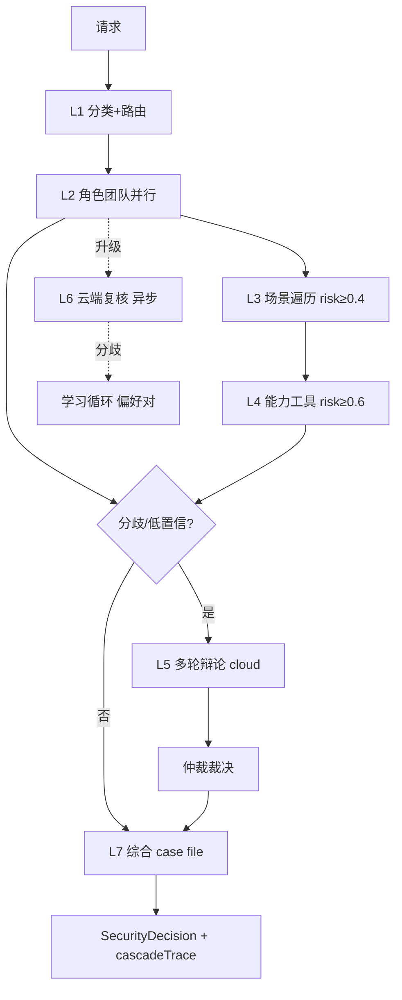

# AetherGuard 雅典学院 — 七层认知架构设计

> 版本：v1.0
> 日期：2026-06-13
> 状态：已实现并验证（除 L6 本地基座待部署、L4 工具集待扩充）
> 关联：`docs/aetherguard-product-prd.md`、`docs/root-resistant-gateway-prd.md`、`backend/src/ai-agents/`

本文档是雅典学院（AetherGuard 多 agent 决策系统）的权威工程设计。它描述每一层的真实职责、执行方式、激活门控、思考深度、数据流与边界约束，以及与检测管线和硬件最后防线的衔接。

---

## 1. 设计目标与诚实定位

雅典学院是 AetherGuard 第一层"主机内检测与响应"的认知引擎。它的职责是：对每一条流量/请求，组织一支分层的 agent 团队，按风险和不确定性按比例投入算力，产出可审计的决策与证据。

它**不是**：万能拦截器（恶意侧由规则护栏兜底）、异构多模型的全部（本地基座待部署）、最终放行者（高危动作最终由硬件 gate 决定）。

设计准则：

1. **真实可观测**：每一层是真正执行的步骤或显式标注的 dormant，不伪造指标。
2. **按比例思考**：思考深度（thinkingDepth）随层和风险递增，算力花在难判上。
3. **级联门控**：每层有自己的激活条件，低层不达标则高层 dormant。
4. **fail-closed + 0% FPR**：AI 层只产出 verdict 与证据；规则护栏的 block 不可被 AI 推翻；AI 不可用时显式降级。
5. **审计闭环**：每次决策携带完整 cascadeTrace，进入 L7 综合，并喂给学习循环。

---

## 2. 七层总览

| 层 | 名称 | 思考深度 | 模型层 | 激活条件 | 真实执行 |
| --- | --- | --- | --- | --- | --- |
| L1 | Collaboration | shallow | local | always | 是 — 攻击族分类 + 角色路由 |
| L2 | Role Playing | standard | local | after L1 | 是 — 三角色并行分析 |
| L3 | Scene Traversal | standard | — | risk ≥ 0.4 | 是 — 攻击叙事重建 |
| L4 | Capability | standard | — | risk ≥ 0.6 | 是 — 沙箱工具执行 |
| L5 | Debate | deep | cloud | 分歧触发 | 是 — 多轮真辩论 |
| L6 | Heterogeneous Model | deliberative | cloud | 升级触发 | 异步 — 云端复核 + 分歧采集 |
| L7 | Synthesis | standard | — | always | 是 — 案件归档 + 自演化 |

每个 `LayerConfig` 携带 `thinkingDepth`、`activation`、`modelTier`，经 `THINKING_DEPTH_PARAMS` 映射到具体的 temperature / token 预算，并随模型请求真正下发到采样参数。

---

## 3. 思考深度与激活门控

`thinkingDepth` 取 `shallow | standard | deep | deliberative`，映射到采样预算：

| 深度 | 温度 | maxTokens | 用途 |
| --- | --- | --- | --- |
| shallow | 0.1 | 400 | L1 快速分流，本地 |
| standard | 0.3 | 1000 | L2 角色团队 / L3/L4 证据步骤 |
| deep | 0.4 | 2000 | L5 多轮辩论 |
| deliberative | 0.5 | 4000 | L6 云端权威复核 |

`LayerActivation` 定义层的触发条件：`always`、`minRiskScore`、`maxPrimaryConfidence`/`minPrimaryConfidence`、`requiresDebateTrigger`、`requiresEscalation`、`attackFamilies`、`requiresLayers`（级联依赖）。编排器 `evaluateLayerCascade` 与 `evaluateLayerActivation` 按真实状态（风险代理、置信度、辩论触发、升级、依赖层）逐层判定，`layersActivated` 如实记录激活集合。

---

## 4. 数据流

每次决策返回 `SecurityDecision`，内含 `layersActivated`、`cascadeTrace`（每层一条 trace：激活/休眠、深度、模型层、延迟、备注）、`evidence`、`debateSession`、`aggregatedDistribution`。

---

## 5. 各层实现细节

### L1 Collaboration（`agent-orchestrator.ts`）
关键词分类攻击族（sqli/xss/path_traversal/command_injection/ssrf/automation/authentication/benign），按 `expertRouting` 路由到角色。shallow 深度、本地、always-on。产出路由决策。

### L2 Role Playing（`roles/*.ts` + `base-agent.ts`）
Socrates（红队/攻击）、Plato（蓝队/防御）、Aristotle（分析师）并行分析。每个 agent 是"规则启发式 + 模型"双轨：硬/软信号先判，模型在标准深度（temp 0.3 / 1000 tokens）补充。verdict + 置信度 + 分布 + 证据。这是判断分歧与触发辩论的来源。

### L3 Scene Traversal（`tracing/trace-context.ts`）
从 trace 上下文重建攻击叙事（attackChain / services / riskLevel），折叠为行为证据。只增证据、不改 verdict。无 trace 时 dormant。

### L4 Capability（`capabilities/tool-executor.ts`）
按攻击族选择沙箱工具（sqli→`explain_sql`、ssrf/automation→`http_probe`），在禁网/禁文件系统沙箱内执行，输出折叠为 `tool_result` 证据。低风险 dormant。工具集可经 `registerTool` 扩展。

### L5 Debate（`debate/debate-protocol.ts`）
当角色分歧（标签冲突 / 分歧 > 阈值 / 置信度跨度大）触发。每一轮**真调模型**（cloud，deep 深度 temp 0.4 / 2000 tokens），把前几轮论点喂进 prompt，让 agent 真正回应彼此。仲裁者（arbitrator）出 finalVerdict（safe/malicious/requires_review），含投票记录与 aggregatedDistribution。模型未接时回退确定性台词（fail-closed + 可测）。

### L6 Heterogeneous Model（异步，经 detection-pipeline）
不是请求同步路径的一环，而是检测管线的异步复核：低置信/高风险/suspicious 的请求入 `sec_detection_async_reviews` 队列，worker 用 `learning_verification` + 云模型重判，比对 primaryAi 与 finalAi，标记分歧（verdict 翻转或置信度落差 ≥ 0.3）并落库。这是学生/教师闭环的"眼睛"，为未来 LoRA 攒偏好对。`getAsyncReviewStats` 暴露 disagreements / disagreementRate。

### L7 Synthesis（`synthesis/synthesis-engine.ts`）
为每次决策生成 case file，提取 lessons，按模式频次建议规则/策略更新（advisory）。`getEvolutionStats` 暴露 case files / lessons / policy updates / topPatterns。

---

## 6. 真实性保证（去空转）

历史上雅典学院的部分层是"声明但空转"。本设计已消除以下空转：

- **辩论**：从硬编码模板台词改为每轮真调模型并互相应对。
- **级联**：从硬编码 `[1,2]+push(5/6)` 改为按激活条件逐层真实评估。
- **思考深度**：从仅 tier 层面改为 temperature/maxTokens 真正下发到模型采样。
- **L3/L4**：从仅"标记激活"改为真执行（重建叙事、跑沙箱工具）并产出证据。
- **L6**：从"异构"宣称改为异步云端复核 + 分歧采集（真实学生/教师信号）。
- **指标**：agent-gateway 的合成心跳（`Math.random`）已规划替换为 `getStats()` 真实数据（任务 #11）。
- **cascadeTrace**：每次决策携带完整层级执行痕迹，前端可视化可点查。

---

## 7. 边界与安全约束

- 规则层是**确定性 block 护栏**：规则判恶意即 block，AI 不可推翻（保 0% FPR 恶意侧 + fail-closed）。
- AI 不可用时**显式 fail-closed 降级**：elevated 风险 block、其余 monitor，并在健康端点标红（任务 #9 / #13）。
- 高危动作（`host_remove`/`wipe_data`/`factory_reset`/`recovery_flash`/`critical_config_change`）的最终放行权在**硬件 gate**（Gateway Appliance），不在任何模型层。雅典学院只产出软决策与证据。
- L4 工具默认禁网、禁文件系统、有超时与内存上限。
- 学习信号（L6 分歧）只用于未来的权重训练，当前不回灌影响在线 verdict。

---

## 8. 可观测性

- `GET /api/ai-system/agents/topology`：七层配置 + 角色 + 阈值 + 各层遥测 + 最近 cascadeTraces。
- `GET /api/ai-system/agents/stats`：编排器/消息总线/模型路由/综合 + 检测管线摘要。
- `GET /api/ai-system/agents/health`：系统健康。
- 前端 `/cognition`：可交互的七层拓扑可视化，点任意层/节点查审计，顶部展示最近一次级联执行时间线。

---

## 9. 待办（与本文档一致的任务）

- ~~#9 AI 主、规则护栏、fail-closed 降级。~~ ✅ 已确认实装：规则为确定性 block 护栏、AI verdict 经 `aiVerdictToDecision` 成为主决策（含 0.6 置信度门防误判）、AI 不可用时 maximum/elevated 高风险 fail-closed block。spine 处已加权威注释。dataset harness 验证 0% FPR 仍成立。
- ~~#10 真异构：快判角色走本地模型。~~ ✅ 代码侧完成：Socrates 用本地 modelConfig（shallow depth），`determineModelTier()` 返回 'local'，`model-router` 新增 per-agent tier 钩子（`honourLocalTier`）尊重它；Plato/Aristotle/Arbitrator 仍走云端。运行时真异构在 Ollama 基座拉起后自动生效。
- ~~#11 替换 agent-gateway 合成指标为真实 getStats。~~ ✅ 已完成：合成心跳（`Math.random`）替换为真实 `ai-system:stats` 广播。
- ~~#13 AI 层健康 + 降级态暴露到 health/admin。~~ ✅ 已完成：`detectionPipelineService.getAiLayerHealth()` 接入 `runtime-health` 的 `aiLayer` 依赖（prod 降级=unhealthy、非 prod=degraded）+ `/agents/topology` telemetry + 前端 `/cognition` 状态条。
- ~~L4 工具集扩充（decode_payload / analyze_headers / check_pattern 已注册待接线）。~~ ✅ 已完成：`selectCapabilityTool` 覆盖全部攻击族——sqli→explain_sql、ssrf/automation→http_probe、xss/path_traversal/command_injection→check_pattern、authentication/business_logic→analyze_headers、other→decode_payload。
- 未来：LoRA 学生/教师权重训练（消费 L6 分歧偏好对）。
