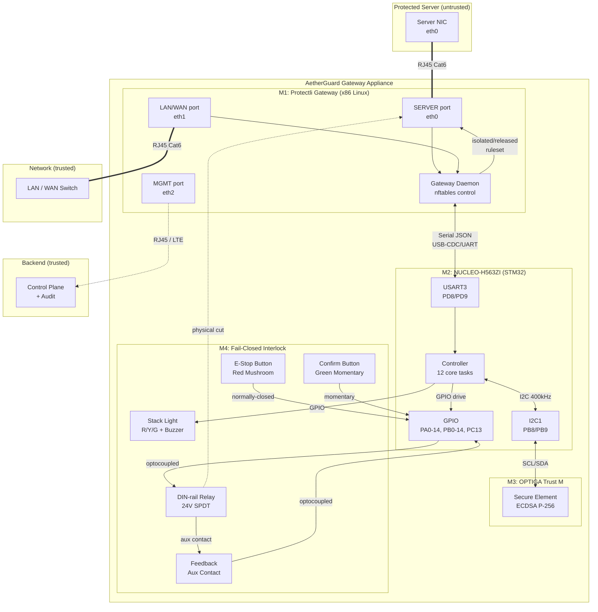
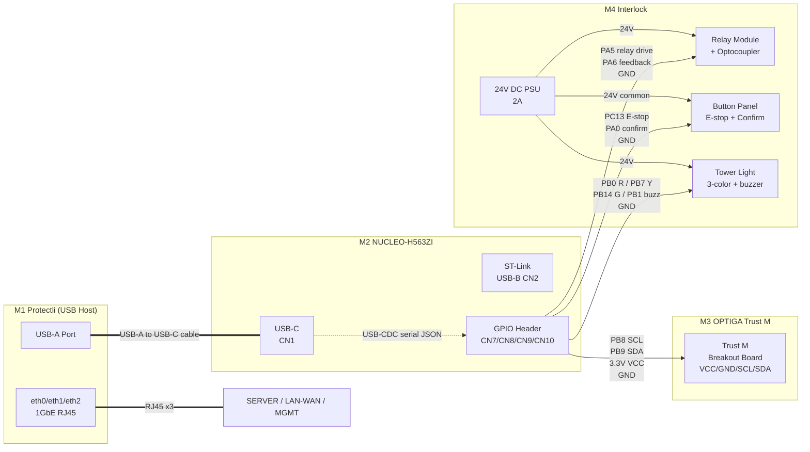
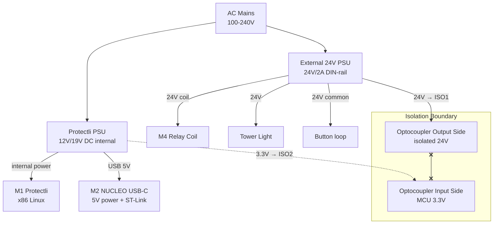
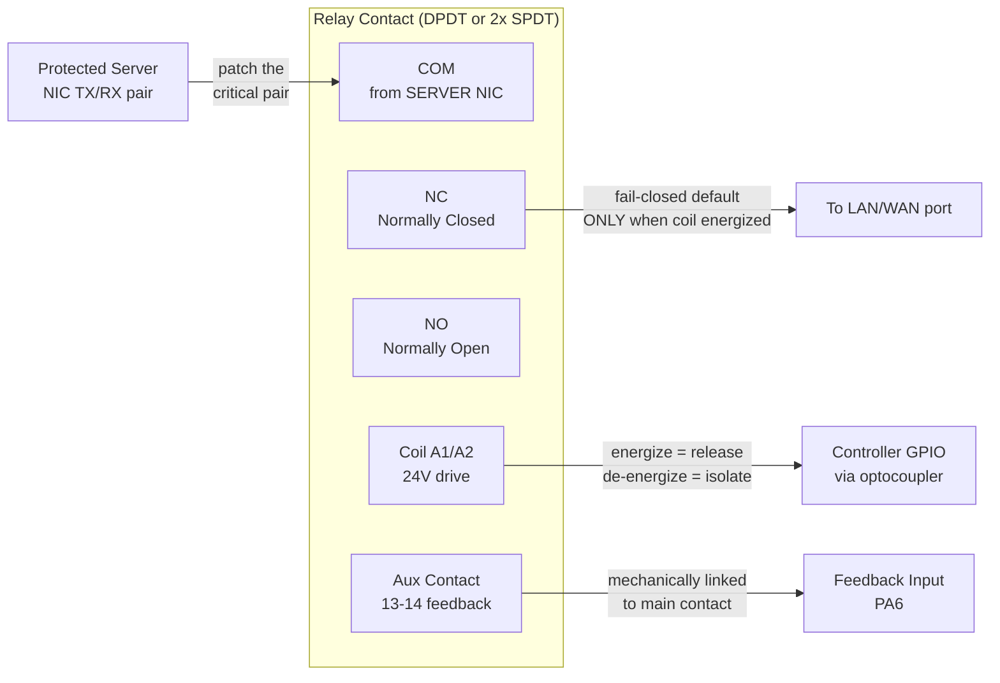

# AetherGuard Gateway Appliance — Three-Plane Wiring Diagram

> Reference: `docs/root-resistant-gateway-prd.md` §4-5
> Hardware: M1 Protectli gateway + M2 NUCLEO-H563ZI + M3 OPTIGA Trust M + M4 relay/interlock

## Overview

Three network planes are physically separated:

1. **Data plane (fail-closed)**: SERVER ↔ LAN/WAN, controlled by M4 relay
2. **Management plane (independent)**: MGMT ↔ Backend control plane
3. **Control plane (internal)**: M1 Gateway Daemon ↔ M2 Controller ↔ M3 SE ↔ M4 Interlock

The protected server's network path is forced through the appliance. In `isolated` state, SERVER ↔ LAN/WAN forwarding is blocked at the nftables layer AND the relay is open. Release requires hardware grant + controller confirm + feedback match.

## System Block Diagram



## Module-to-Module Wiring



## M2 GPIO Pin Assignment (NUCLEO-H563ZI)

### Communication

| Function | MCU Pin | NUCLEO Header | Direction | Wire To | Notes |
|---|---|---|---|---|---|
| USART3 TX (→ M1) | PD8 | CN9 pin 14 | Output | USB-C CN1 (CDC) | Or direct USB-CDC to Protectli |
| USART3 RX (← M1) | PD9 | CN9 pin 16 | Input | USB-C CN1 (CDC) | 115200 baud, 8N1 |
| I2C1 SCL (→ M3) | PB8 | CN7 pin 3 | Output | OPTIGA Trust M SCL | 400 kHz Fast Mode |
| I2C1 SDA (↔ M3) | PB9 | CN7 pin 5 | Bidir | OPTIGA Trust M SDA | Pull-up 4.7kΩ on bus |
| I2C VCC | 3.3V | CN8 pin 7 | Power | OPTIGA Trust M VCC | 3.3V supply |
| I2C GND | GND | CN8 pin 11 | Power | OPTIGA Trust M GND | Common ground |

### M4 Relay + Feedback

| Function | MCU Pin | NUCLEO Header | Direction | Wire To | Notes |
|---|---|---|---|---|---|
| Relay Drive | PA5 | CN7 pin 11 | Output | Optocoupler IN+ | HIGH = drive coil (release) |
| Relay Drive GND | GND | CN7 pin 20 | Power | Optocoupler IN- | |
| Feedback Input | PA6 | CN7 pin 13 | Input | Optocoupler OUT | HIGH = relay closed |
| Feedback VCC | 3.3V | CN8 pin 7 | Power | Optocoupler VCC | Isolator side |

### Buttons (Inputs)

| Function | MCU Pin | NUCLEO Header | Direction | Wire To | Notes |
|---|---|---|---|---|---|
| E-Stop | PC13 | CN7 pin 23 (USER_BTN) | Input (EXTI) | E-stop NC contact | Falling edge = pressed |
| E-Stop GND | GND | CN7 pin 24 | Power | E-stop COM | Normally-closed loop |
| Confirm | PA0 | CN8 pin 1 | Input | Confirm button NO | HIGH = pressed |
| Confirm GND | GND | CN8 pin 11 | Power | Confirm COM | |

### Stack Light (Outputs)

| Function | MCU Pin | NUCLEO Header | Direction | Wire To | Notes |
|---|---|---|---|---|---|
| Red (isolated/fault) | PB0 | CN7 pin 17 | Output | Tower light R+ | Via optocoupler/driver |
| Yellow (armed) | PB7 | CN7 pin 21 | Output | Tower light Y+ | Via optocoupler/driver |
| Green (released) | PB14 | CN7 pin 9 | Output | Tower light G+ | Via optocoupler/driver |
| Buzzer | PB1 | CN7 pin 19 | Output | Tower light BUZZ+ | Via optocoupler/driver |
| Light GND | GND | CN7 pin 8 | Power | Tower light COM | |

## Power Distribution



**Key: 3.3V (MCU side) and 24V (relay/light side) are galvanically isolated via optocouplers.** A 24V relay coil surge cannot back-feed into the MCU GPIO.

## M4 Relay Detail (Fail-Closed Physical Path)

The DIN-rail relay has a SPDT contact: Common (COM), Normally Open (NO), Normally Closed (NC). For fail-closed behavior, wire the SERVER path through the **NC** contact so that loss of coil power = relay drops out = path breaks.



> **⚠️ Critical fail-closed wiring**: The SERVER→LAN/WAN path must go through the relay's NC contact only when the coil is energized (released state). On power loss, coil de-energizes, contact returns to NC default, and the path is broken. This is the physical layer of fail-closed; nftables is the logical layer.
>
> **Aux contact**: Mechanically linked to the main contact, it provides readback (feedback) so the controller can confirm the relay actually moved — not just that it was commanded to move. Mismatch triggers fail-closed (PRD §4.4 #6).

## Cable / Connection Checklist

### Data plane (network)

| # | From | To | Cable | Verification |
|---|---|---|---|---|
| 1 | Protected Server NIC | M1 SERVER port (eth0) | RJ45 Cat6 | `ethtool eth0` shows link up |
| 2 | M1 LAN/WAN port (eth1) | LAN/WAN switch | RJ45 Cat6 | `ethtool eth1` shows link up |
| 3 | M1 MGMT port (eth2) | Backend network / switch | RJ45 Cat6 | `ping <backend>` from gateway |

### Control plane (M1 ↔ M2)

| # | From | To | Cable | Verification |
|---|---|---|---|---|
| 4 | M1 USB-A port | M2 NUCLEO USB-C (CN1) | USB-A → USB-C | `ls /dev/ttyACM0` on M1 |
| 5 | (alt) M1 USB-A | M2 NUCLEO ST-Link (CN2) | USB-A → USB-B | For firmware flashing + VCP |

### M2 ↔ M3 (I2C)

| # | From | To | Wire | Verification |
|---|---|---|---|---|
| 6 | M2 PB8 (SCL) | OPTIGA Trust M SCL | Dupont/jumper | `i2cdetect -y 1` shows 0x30 |
| 7 | M2 PB9 (SDA) | OPTIGA Trust M SDA | Dupont/jumper | (same) |
| 8 | M2 3.3V | OPTIGA Trust M VCC | Dupont/jumper | Multimeter: 3.3V on SE VCC |
| 9 | M2 GND | OPTIGA Trust M GND | Dupont/jumper | Continuity test |
| 10 | (bus) SCL | 3.3V via 4.7kΩ | Resistor | Pull-up on I2C bus |

### M2 ↔ M4 (relay + feedback, optocoupled)

| # | From | To | Wire | Notes |
|---|---|---|---|---|
| 11 | M2 PA5 (drive) | Optocoupler module IN+ | Dupont | Relay drive signal |
| 12 | M2 GND | Optocoupler IN- | Dupont | |
| 13 | 24V PSU + | Optocoupler COM (24V side) | 24AWG | Isolated 24V loop |
| 14 | Optocoupler NO | Relay coil A1 | 24AWG | Energizes on drive HIGH |
| 15 | Relay coil A2 | 24V PSU - | 24AWG | |
| 16 | Relay aux 13-14 | Feedback optocoupler input | 24AWG | Closes when relay energized |
| 17 | Feedback optocoupler output | M2 PA6 | Dupont | HIGH = relay closed |

### M2 ↔ Buttons

| # | From | To | Wire | Notes |
|---|---|---|---|---|
| 18 | M2 PC13 | E-stop NC contact | Dupont | Falling edge = pressed |
| 19 | M2 GND | E-stop COM | Dupont | Normally-closed loop |
| 20 | M2 PA0 | Confirm button NO | Dupont | HIGH = pressed |
| 21 | M2 GND | Confirm COM | Dupont | |

### M2 ↔ Stack light

| # | From | To | Wire | Notes |
|---|---|---|---|---|
| 22 | M2 PB0 → optocoupler → | Tower R+ | 24AWG | Red = isolated |
| 23 | M2 PB7 → optocoupler → | Tower Y+ | 24AWG | Yellow = armed |
| 24 | M2 PB14 → optocoupler → | Tower G+ | 24AWG | Green = released |
| 25 | M2 PB1 → optocoupler → | Tower Buzzer+ | 24AWG | Fault/E-stop |
| 26 | 24V PSU - | Tower COM | 24AWG | Common |

### Relay contact (fail-closed path)

| # | From | To | Wire | Notes |
|---|---|---|---|---|
| 27 | Server NIC critical pair | Relay COM | Patch | The pair to break |
| 28 | Relay NO (energized) | LAN/WAN side | Patch | Closed only when released |

## Physical Layout (DIN-rail)

```
┌──────────────────────────────────────────────────────────────────┐
│                    DIN-rail (35mm, top hat)                       │
├──────────────────────────────────────────────────────────────────┤
│                                                                   │
│  ┌─────────┐  ┌──────────┐  ┌─────────┐  ┌──────┐  ┌─────────┐ │
│  │ 24V PSU │  │ Relay    │  │ Opto    │  │ Opto │  │ Tower   │ │
│  │ 2A DIN  │  │ SPDT     │  │ Output  │  │ Input│  │ Light   │ │
│  │         │  │ 10A      │  │ 4-ch    │  │ 4-ch │  │ R/Y/G   │ │
│  └─────────┘  └──────────┘  └─────────┘  └──────┘  └─────────┘ │
│                                                                   │
│  ┌────────────┐         ┌──────────────┐                         │
│  │ E-Stop     │         │ Confirm Btn  │   (panel mount)         │
│  │ Mushroom   │         │ Green        │                         │
│  └────────────┘         └──────────────┘                         │
│                                                                   │
├──────────────────────────────────────────────────────────────────┤
│  M1 Protectli (1U rack or DIN)     M2 NUCLEO (breadboard/standoff)│
│  ┌─────────────────────┐           ┌──────────────────┐          │
│  │ [S][L][M]  USB      │◄─────────►│ STM32H563ZI      │          │
│  │  eth0 eth1 eth2     │  USB-C     │ [CN7][CN8][CN9]  │          │
│  └─────────────────────┘            │ [CN10]          │          │
│                                     │   ↓ I2C          │          │
│                                     │ [OPTIGA breakout]│          │
│                                     └──────────────────┘          │
└──────────────────────────────────────────────────────────────────┘
```

## Bring-Up Verification Steps

### Phase 1: Power + connectivity (no firmware)

1. **24V PSU**: Multimeter reads 24V ±5% on DIN-rail output
2. **M1 Protectli**: Boots Debian, `ip link` shows eth0/eth1/eth2
3. **M2 NUCLEO**: Power LED on (USB-C from M1), ST-Link recognized (`lsusb`)
4. **I2C scan**: On M2, run `i2cdetect` firmware → OPTIGA Trust M responds at 0x30
5. **Continuity**: Multimeter beep on all GND wires (common ground confirmed)

### Phase 2: Relay + feedback (manual test)

6. **Relay NO default open**: Multimeter on COM↔NO = open (no coil power)
7. **Drive coil manually**: Apply 3.3V to PA5 → relay clicks → COM↔NO closes
8. **Feedback**: PA6 reads HIGH when relay energized, LOW when de-energized
9. **E-stop**: Press E-stop → PA5 drive ignored, relay stays open (hardware interlock)

### Phase 3: Firmware bring-up

10. **Flash firmware**: `openocd -f interface/stlink.cfg -f target/stm32h5x.cfg -c "program build/controller-stm32h5.elf verify reset exit"`
11. **Serial hello**: `cat /dev/ttyACM0` on M1 shows `{"type":"hello"}`
12. **Heartbeat**: Every 5s, `{"type":"heartbeat","secureElementPresent":true,...}`
13. **SE integration**: Controller reports `secureElementPresent:true` (I2C responded)

### Phase 4: End-to-end (with simulator or real backend)

14. **Simulator M1 ↔ real M2**: Run `simulator/sim.ts` pointed at `/dev/ttyACM0` instead of mock controller
15. **Release request**: Backend sends grant → M2 validates → relay closes → feedback confirms → `released_ruleset` applied
16. **Fail-closed E-stop**: Press E-stop → relay opens → `isolated_ruleset` → audit logged
17. **Heartbeat stale**: Disconnect USB → after 45s, M1 daemon fail-closes (PRD #7)

## Notes

- **Galvanic isolation**: All 24V circuits connect to MCU GPIO via optocouplers. Never wire 24V directly to MCU pins.
- **Common ground**: MCU GND, optocoupler input-side GND, and M1 USB GND share a common reference. 24V side has its own ground referenced at the PSU, isolated from MCU by optocouplers.
- **Pull-ups**: I2C bus needs 4.7kΩ pull-ups to 3.3V on SCL and SDA (OPTIGA Trust M breakout may include them).
- **Debounce**: E-stop (PC13) and confirm (PA0) buttons need software debounce (10-20ms) in firmware EXTI handler.
- **Cable length**: USB-C from M1 to M2 should be ≤2m for reliable USB-CDC at 115200 baud. For longer runs, use RS485 instead of USB.

## References

- PRD: `docs/root-resistant-gateway-prd.md` §4.1-4.4, §5
- Phase 0 status: `docs/hardware-phase0-status.md`
- Firmware: `firmware/controller-stm32h5/README.md` (GPIO pinout matches)
- Gateway Daemon: `deployment/gateway/README.md` (nftables + serial protocol)
- Simulator: `simulator/` (control-loop logic reference)


