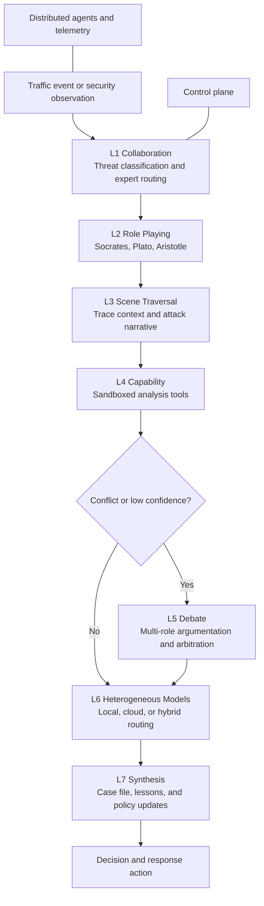
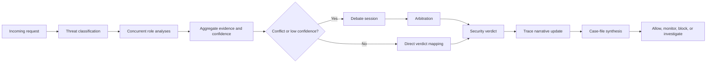
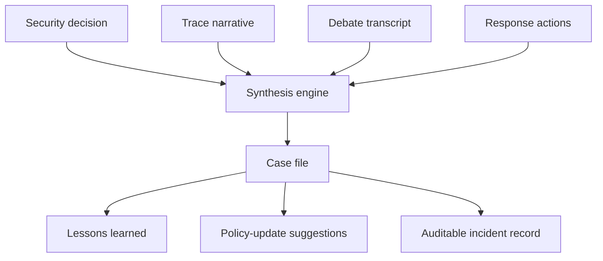

# A Seven-Layer Multi-Agent Debate Architecture for Explainable Security Decision-Making in Distributed Server Defense

**Draft status:** English first draft for SCI-oriented security/systems submission

**Keywords:** multi-agent systems, security decision-making, explainable AI, distributed defense, LLM agents, intrusion detection, debate-based reasoning

## Abstract

Modern server-defense pipelines increasingly incorporate AI components, yet many deployed designs still depend on a single classifier or a single large language model (LLM) invocation to label suspicious traffic. That pattern is operationally convenient but weak at role specialization, conflict resolution, and post hoc explanation. This draft presents a seven-layer multi-agent security decision architecture designed for distributed server defense. The architecture combines expert routing, role-based reasoning, trace-centric scene traversal, sandboxed tool use, multi-role debate, heterogeneous local/cloud model routing, and synthesis into auditable case files. The primary novelty is a debate-oriented decision path in which low-confidence or conflicting analyses are escalated to role-specialized agents representing red-team, blue-team, and analyst perspectives before a final verdict is synthesized. The design is instantiated in the AetherGuard prototype, where the AI subsystem is connected to a broader control-plane and distributed-agent platform. Evaluation is intentionally conservative and evidence-backed: it relies on repository implementation artifacts, unit scenarios, local platform acceptance results, and validated benchmark snapshots rather than unsupported industrial-scale claims. The current evidence shows that the prototype can process representative benign and malicious scenarios, create explainable debate sessions for conflicting cases, and operate within a validated local deployment surface. The results support feasibility and architectural value, while leaving large-scale benchmarking, hybrid local-model validation, and production-grade ablation studies for future work.

## 1. Introduction

Security operations have long relied on layered monitoring, signature matching, anomaly detection, and analyst review to distinguish benign traffic from malicious behavior. Classical intrusion-detection models and practical systems such as Denning's early audit-based formulation and Snort established two enduring requirements: timely detection and interpretable operational outputs [1], [2]. Contemporary systems increasingly add machine learning and deep learning to improve detection coverage, including lightweight DDoS detection and explainable intrusion-detection pipelines [3]-[8]. However, many AI-augmented deployments still collapse diverse security evidence into one model output, which creates three problems in practice: brittle reasoning under ambiguity, weak handling of conflicting evidence, and limited explanation for downstream incident response.

Large language model agent frameworks have recently shown that multi-agent role specialization can improve task decomposition, deliberation, and collaborative problem solving [9]-[16]. Related work on self-consistency, debate, critique, and verbal self-improvement suggests that reasoning quality can improve when multiple perspectives are coordinated instead of forced into a single forward pass [17]-[22]. Parallel work on cost-aware routing and privacy-preserving LLM usage shows that local/cloud orchestration is increasingly important for operational AI systems [23]-[27]. Yet the security domain still lacks a conservative, explainable architecture that combines role-specialized reasoning, explicit conflict escalation, trace reconstruction, and deployment-aware routing into one end-to-end server-defense workflow.

This paper addresses that gap through a seven-layer architecture implemented in the AetherGuard prototype. The proposed design does not claim state-of-the-art benchmark dominance. Instead, it targets an engineering problem: how to structure AI-assisted server defense so that security decisions become more specialized, more explainable, and easier to audit than single-model inference.

The contributions are as follows.

1. A seven-layer security decision architecture that integrates expert routing, role specialization, trace reconstruction, safe tools, debate, heterogeneous inference, and case-file synthesis.
2. A multi-role debate mechanism that escalates low-confidence or conflicting analyses into explicit red-team, blue-team, and analyst reasoning before final synthesis.
3. An implemented prototype that connects the AI subsystem to a broader distributed defense platform with a control plane, WebSocket-linked agents, and runtime routing controls.
4. A feasibility-oriented evaluation based on repository artifacts, local platform acceptance, unit scenarios, and benchmark snapshots, with all claims limited to currently evidenced behavior.

The remainder of this draft is organized as follows. Section 2 reviews related work. Section 3 presents the proposed architecture and debate workflow. Section 4 maps the architecture to the implemented prototype. Section 5 evaluates the system using evidence-backed artifacts and representative scenarios. Section 6 discusses limitations and validity threats. Section 7 concludes the paper.

## 2. Related Work

### 2.1 AI-assisted intrusion detection and traffic defense

Intrusion-detection research has evolved from rule-driven and signature-driven approaches [1], [2] to machine-learning and deep-learning pipelines that model behavioral and protocol-level features [3], [5], [6]. Lightweight detectors such as LUCID demonstrate that deep models can be made operationally practical for high-rate traffic monitoring [3]. More recent surveys emphasize that explainability, domain adaptation, and lifecycle management are now as important as raw detection accuracy [4], [5]. Federated and privacy-aware learning variants have also been proposed to reduce central data concentration while keeping anomaly detection effective [6]. These systems motivate the need for multi-source reasoning, but most still emit a single model verdict rather than an explicit conflict-resolution workflow.

### 2.2 Multi-agent LLM systems

The current LLM-agent literature shows rapid progress in collaborative agent societies, software-oriented agent teams, and workflow automation [9]-[16]. Generative Agents explored believable multi-agent behavior in simulated environments [11], while CAMEL, AutoGen, MetaGPT, and AgentVerse made role-based collaboration a first-class systems pattern [12]-[15]. More recent work studies how to scale collaboration and automatically induce effective agentic workflows [16]. These systems establish that specialization and communication matter, but they are not designed around security-specific evidence such as attack mutations, schema violations, trace narratives, and response actions.

### 2.3 Debate, self-consistency, and critique

Debate and critique mechanisms are especially relevant to security decision-making because ambiguous traffic often generates conflicting interpretations. Self-consistency improves reasoning by sampling multiple chains of thought [17]. Multiagent debate extends that idea by explicitly contrasting positions before convergence [18]. Reflexion and CRITIC further show that critique-driven reasoning can improve task outcomes when models are allowed to inspect and revise intermediate reasoning [19], [21]. At the same time, evidence that LLMs cannot reliably self-correct on their own highlights the need for structured externalization of disagreement rather than blind trust in one model pass [20]. This paper adapts that insight into a security-specific debate path rather than a general-purpose reasoning benchmark.

### 2.4 Hybrid local/cloud inference and privacy-aware routing

Operational security systems often face a trade-off between local privacy constraints and cloud-model capability. Recent work on privacy risks and protection in LLMs, differentially private in-context learning, and trustworthy LLM deployment makes this concern explicit [23]-[25]. Cost-aware and quality-aware routing frameworks such as FrugalGPT and RouteLLM show that model selection can be treated as an optimization problem rather than a static deployment choice [26], [27]. The proposed architecture adopts this direction but grounds routing decisions in security operations, where privacy mode, fallback policy, and runtime availability affect whether traffic analysis should remain local, move to the cloud, or use a hybrid verification path.

### 2.5 Explainability and traceability in security operations

Explainable intrusion-detection work increasingly argues that prediction outputs alone are insufficient for analysts who need incident narratives, forensic evidence, and policy consequences [4], [7], [8]. In this respect, explainability is not only a model-interpretation problem but also a workflow problem: evidence, rationale, and action history must survive after the decision is made. The synthesis layer proposed here extends XAI-oriented security work by turning decisions into case files containing narratives, debate transcripts, and policy suggestions rather than only feature attributions.

**Table 1. Comparison between single-model security analysis and the proposed debate architecture**

| Dimension | Single-model AI analysis | Proposed seven-layer debate architecture |
| --- | --- | --- |
| Analytical perspective | One model or one classifier view | Role-specialized red, blue, and analyst views |
| Conflict handling | Usually hidden inside a score threshold | Explicit debate session and arbitration |
| Context fusion | Often request-local features only | Request, history, trace events, tool outputs, routing state |
| Explainability output | Label, probability, or free-text rationale | Rationale, evidence list, debate transcript, attack narrative, case file |
| Deployment flexibility | Fixed inference backend | Local, cloud, local-preferred, or hybrid verification path |
| Operational follow-up | Separate analyst tooling required | Case actions, lessons learned, and policy-update suggestions |

## 3. Proposed Method

### 3.1 Architectural overview

The proposed method treats security decision-making as a staged workflow rather than a single inference call. Incoming traffic or security events enter a control-plane service that coordinates distributed agents, historical context, trace events, and model-routing state. The workflow then traverses seven layers, each producing an artifact that can be consumed by later layers or audited independently.

**Figure 1. Seven-layer multi-agent security architecture**

### 3.2 Layer-by-layer design

**L1: Collaboration.** The collaboration layer identifies the rough threat family and routes the request to the relevant experts. In the prototype, the orchestrator classifies candidate threat types such as SQL injection, XSS, path traversal, command injection, authentication issues, and a default fallback. This keeps later reasoning specialized without requiring every agent to analyze every request.

**L2: Role Playing.** The architecture uses three named perspectives. Socrates plays the red-team role and searches for bypasses, request mutations, and exploit paths. Plato plays the blue-team role and validates schema, parameter conformance, and policy alignment. Aristotle plays the analyst role and evaluates historical behavior and anomaly scores. The method treats disagreement among these roles as valuable evidence rather than noise.

**L3: Scene Traversal.** The scene-traversal layer builds a trace-centric narrative from distributed events. Instead of recording only the final decision, it reconstructs a timeline, participating services, attack-chain steps, and a summary risk level. This enables the system to explain whether a threat was isolated to one service or propagated across multiple components.

**L4: Capability.** Some security questions require more than pure language-model reasoning. The capability layer therefore exposes sandboxed tools such as SQL explanation, safe HTTP probing, payload decoding, header analysis, and pattern matching. In the current prototype, the default sandbox disables network and file-system access, sets a 30 s timeout, and caps memory at 256 MB, which keeps the tool layer conservative enough for defensive analysis.

**L5: Debate.** The debate layer is the architectural centerpiece. When role outputs disagree or confidence is insufficient, the system creates a debate session in which roles argue from their own evidence. The session records topic, participants, round history, evidence fragments, and arbitrator notes. The current implementation executes up to three rounds before majority-style arbitration over role votes.

**L6: Heterogeneous Models.** The heterogeneous layer chooses between local, cloud, and hybrid inference paths. The design is motivated by operational privacy and availability rather than by benchmark chasing. A deployment can enforce local-only execution for strict privacy, allow cloud-only routing, or prefer local inference with fallback.

**L7: Synthesis.** The synthesis layer creates a case file that combines the final decision, trace narrative, debate record, response actions, lessons learned, and policy-update suggestions. This moves the system from classification toward traceable security operations.

### 3.3 Debate trigger and verdict synthesis

The prototype exposes two complementary trigger paths for debate. At the orchestration level, conflict is detected when at least one role votes malicious while another votes safe, or when the confidence range across role outputs exceeds the configured debate threshold. At the top-level decision wrapper, debate can also be triggered for challenge-like outcomes or evidence-backed low-confidence decisions. This dual trigger design encodes the intended method claim of this paper: debate is not a decorative post-processing stage but a conflict-escalation mechanism.

Once triggered, the debate layer generates a topic from the source of uncertainty. If roles disagree, the session is labeled as a conflict-resolution problem. If roles broadly agree but confidence remains low, the topic becomes a confidence review. Speakers alternate through attack, defense, and analysis positions. Arbitration then aggregates role votes into one of three outcomes: safe, malicious, or requires review. Importantly, the debate record is preserved and later embedded in the synthesized case file.

**Figure 2. End-to-end request-to-decision workflow with debate trigger**

### 3.4 Explainable synthesis outputs

The proposed method treats explainability as a structured output bundle. Each decision can be connected to a reasoning string, an evidence list, an optional debate transcript, an attack narrative, and machine-readable actions such as blocking or monitoring. The synthesis layer also extracts lessons learned and suggests policy updates for recurring malicious patterns or risk-threshold adjustments.

**Figure 3. Synthesis and case-file generation pipeline**

## 4. System Implementation in the AetherGuard Prototype

The architecture is instantiated inside the AetherGuard control plane rather than as a stand-alone academic simulator. The top-level entry point is `backend/src/ai-agents/index.ts`, which assembles the orchestrator, message bus, debate protocol, trace manager, tool executor, model router, synthesis engine, and probe agent. This is important for the system contribution because the AI subsystem is embedded in a larger platform that also includes a backend API, WebSocket gateways, a dashboard, distributed software agents, and device-oriented management flows.

At the coordination layer, `backend/src/ai-agents/core/agent-orchestrator.ts` constructs the expert roles and threat-routing map. Socrates, Plato, and Aristotle are configured with distinct capability descriptions and analyze requests concurrently. The orchestrator aggregates evidence, identifies the most severe role verdict, computes final actions, and exposes a debate trigger based on role disagreement or confidence dispersion.

At the debate layer, `backend/src/ai-agents/debate/debate-protocol.ts` defines the debate session structure, topic generation, round execution, role-specific argument construction, and majority-style arbitration. The implementation records evidence emitted during each round and generates arbitrator notes summarizing key debate evidence. This concrete session object is the core artifact supporting the paper's explainability claim.

The remaining layers are mapped through `backend/src/ai-agents/tracing/trace-context.ts`, `backend/src/ai-agents/capabilities/tool-executor.ts`, `backend/src/ai-agents/models/model-router.ts`, and `backend/src/ai-agents/synthesis/synthesis-engine.ts`. Together, these modules allow the prototype to progress from request analysis to operational follow-up without leaving the repository's control-plane ecosystem.

**Table 2. Layer responsibilities and implementation mapping**

| Layer | Primary responsibility | Implemented module(s) | Main artifact |
| --- | --- | --- | --- |
| L1 Collaboration | Threat typing and expert routing | `core/agent-orchestrator.ts`, `core/message-bus.ts` | Assigned expert set, aggregated role outputs |
| L2 Role Playing | Specialized red, blue, and analyst reasoning | `roles/socrates-agent.ts`, `roles/plato-agent.ts`, `roles/aristotle-agent.ts` | Mutations, schema results, anomaly score |
| L3 Scene Traversal | Trace capture and attack narrative construction | `tracing/trace-context.ts` | Timeline, attack chain, risk-level summary |
| L4 Capability | Safe tool execution for evidence enrichment | `capabilities/tool-executor.ts` | Tool results under sandbox policy |
| L5 Debate | Conflict escalation and arbitration | `debate/debate-protocol.ts` | Debate session, rounds, arbitrator notes |
| L6 Heterogeneous Models | Runtime selection of inference tier | `models/model-router.ts` | Local/cloud/hybrid routing decision |
| L7 Synthesis | Case-file generation and learning outputs | `synthesis/synthesis-engine.ts` | Case file, lessons, policy suggestions |

Two implementation details deserve emphasis. First, the model router is backed by runtime configuration and supports redaction of sensitive prompt content such as IP addresses, email addresses, and bearer tokens before cloud execution. Second, the synthesis layer serializes operational outcomes rather than only classification labels, which is essential if the system is to support audit trails or later response automation.

## 5. Evaluation

### 5.1 Evaluation design and research questions

The evaluation follows three research questions.

- **RQ1:** Can the architecture correctly process representative benign and attack scenarios?
- **RQ2:** Can the debate stage resolve conflicting role outputs into an explainable consensus path?
- **RQ3:** What is the measured feasibility and overhead of the current prototype?

The evaluation is intentionally evidence-backed and conservative. It aggregates three repository artifact sources:

- **[A1]** validated capability status report, which records benchmark and runtime evidence for the current workspace;
- **[A2]** local platform acceptance report, which records authenticated API checks, deterministic AI proof, and an attack-simulator proof path;
- **[A3]** multi-agent unit scenarios, which define benign, SQL injection, XSS, path-traversal, synthesis, and debate-session behaviors.

This evaluation is therefore a feasibility study of the implemented prototype, not a competitive benchmark paper against public IDS datasets.

### 5.2 RQ1: Representative benign and malicious scenarios

The unit scenarios in [A3] provide one benign path and three direct malicious classes. A benign `GET /api/users` request is expected to produce a valid decision object with bounded confidence and an activated collaboration layer. A SQL-injection case targeting `/api/login` is expected to produce a blocking decision with high or critical threat level and non-empty evidence. Separate XSS and path-traversal scenarios are expected to yield blocking or monitoring outcomes, again with evidence-backed reasoning. These scenario expectations are not presented as statistical accuracy metrics; rather, they establish that the layered pipeline covers the intended attack classes in code.

The broader platform evidence in [A2] complements these code-level scenarios with one end-to-end business-path validation. In the local acceptance run, the attack simulator processed a `sql-1` case through the AI-enabled platform route, reported `AI used: true`, used the cloud route, and produced a final verdict of `block` with confidence `0.98` [A2]. This suggests that the decision architecture is not only unit-testable but also reachable through the surrounding control-plane workflow.

**Table 4. Representative benign and attack scenarios**

| Scenario | Source | Input pattern | Observed or asserted outcome | Interpretation |
| --- | --- | --- | --- | --- |
| S1 Benign API read | [A3] | `GET /api/users` | Valid decision object, confidence in `[0,1]`, collaboration layer active | Baseline non-attack behavior is handled without failure |
| S2 SQL injection | [A3] | `POST /api/login` with `' OR '1'='1` payload | `block`, high or critical threat, evidence present | Direct injection path is escalated into blocking logic |
| S3 XSS | [A3] | `POST /api/comments` with `` | `block` or `monitor`, evidence present | Script injection is surfaced as malicious or suspicious |
| S4 Path traversal | [A3] | `GET /api/files?path=../../../etc/passwd` | `block` or `monitor` | File traversal behavior is identified as unsafe |
| S5 Integrated SQL path | [A2] | Attack Simulator `sql-1` | Cloud-routed AI path, `block`, confidence `0.98` | The method is reachable through the larger product workflow |
| S6 Conflict case | [A3] | Socrates=`malicious` at `0.9`, Plato=`safe` at `0.7` | Debate session created with participants | Conflict is externalized instead of hidden inside one score |

### 5.3 RQ2: Debate-driven explainability

The debate contribution is supported by both the implementation and the scenario evidence. In the prototype, a debate topic is generated either from role disagreement or from low-confidence analysis. The debate session records participants, round content, evidence fragments, and final arbitrator notes. This is important because a security operator can inspect not only what the final verdict was, but also why a given role argued for attack, defense, or historical normality.

The unit conflict scenario in [A3] directly demonstrates the architectural purpose of the debate layer. Rather than immediately collapsing the Socrates and Plato outputs into one scalar score, the system instantiates a session object and records the debate participants. The implementation then rotates speakers across attack, defense, and analysis positions and arbitrates over collected votes. The current repository evidence therefore supports the claim that conflict cases are handled through an explainable procedural artifact. It does not yet support a quantitative claim that debate reduces false positives by a specific percentage, and this draft intentionally makes no such claim.

### 5.4 RQ3: Feasibility and measured prototype overhead

The March validated capability snapshot [A1] is now historical. The current software report, `docs/reports/software-validation-status-2026-07-27.md`, records a Rust fixed-key loopback reproduction of 56.6k--61.6k QPS across three rounds, a 75.1k short-sweep peak, and no request errors. It did not reproduce stable 100k QPS. The same report records 3.19k mean QPS for the single-process Node development health path and explicitly leaves local-AI latency and Agent CPU/memory targets unvalidated. This frames the prototype as measurable but not production-capacity evidence.

The local platform acceptance report [A2] adds deployment-path evidence. In that run, Docker services were healthy for `backend`, `frontend`, `postgres`, `redis`, `minio`, and `fastpath`; a deterministic remote-AI proof returned the exact text `AETHERGUARD_REMOTE_AI_OK` with reported latency `973 ms`; and the business-path SQL simulation used the `cloud_only` route and still produced a blocking verdict [A2]. The validated capability report further records that the current runtime snapshot exposed `aiRouting.mode: cloud_only`, `privacyMode: off`, and `fastpath.enabled: true` [A1]. Together, these artifacts support the narrower claim that the architecture can run inside a local, containerized deployment with measured but non-dominant overhead.

**Table 3. Evidence-backed prototype evaluation summary**

| Artifact | Setting | Observed result | Interpretation |
| --- | --- | --- | --- |
| Current software validation | x86_64 Linux fixed-key loopback | Rust 56.6k--61.6k QPS over three rounds; 75.1k short-sweep peak; zero errors | Reproducible local hot-path evidence, not stable 100k or production capacity |
| [A1] Runtime and deployment surface | Docker runtime plus deployment bundles | Healthy runtime and validated bundle generation for six targets | The broader platform around the AI subsystem is operationally coherent |
| [A1] AI routing snapshot | Current config snapshot | `cloud_only`, privacy mode off, fastpath enabled | Heterogeneous routing exists, but current evidence reflects cloud-first execution |
| [A2] Deterministic AI proof | Local acceptance run | Exact proof output with `973 ms` latency | Remote-AI path is functionally reachable |
| [A2] Business-path SQL proof | Attack Simulator `sql-1` | `block`, confidence `0.98`, cloud provider route | End-to-end platform path can invoke the decision stack |
| [A3] Multi-agent unit scenarios | Code-level scenario suite | Benign, SQLi, XSS, traversal, synthesis, and debate cases defined | Representative behavior is covered at implementation level |

## 6. Discussion and Limitations

The current results support three conclusions. First, a security-oriented multi-agent architecture can be made structurally explicit in code, rather than described only as a conceptual LLM pattern. Second, conflict-oriented debate is a meaningful design primitive for security decisions because it exposes disagreement and preserves rationale. Third, case-file synthesis is a practical way to connect model reasoning to downstream security operations such as monitoring, blocking, and policy adaptation.

At the same time, this draft is intentionally conservative about what has been validated. The evaluation relies on repository artifacts, unit scenarios, and local acceptance evidence rather than large public IDS datasets or live production deployments. No ablation currently isolates the effect of the debate layer on false positives, false negatives, analyst workload, or response latency. The current benchmark evidence also does not validate local-model hot-path performance because the local Ollama endpoint was unavailable in the recorded snapshot [A1]. As a result, the heterogeneous-model contribution is presently architectural and implementation-backed, but only partially runtime-backed.

There is also an implementation maturity limitation. The repository clearly implements debate, synthesis, trace construction, and routing as separate modules, and the orchestrator exposes conflict-based triggers. However, the present code path still reflects prototype-stage scaffolding in how some debate-trigger outcomes are routed through the orchestration stack. This does not invalidate the architecture, but it does narrow the correct claim: the current system demonstrates a working debate-capable prototype rather than a fully ablated production decision engine.

Finally, the evaluation omits several high-value external validations: large-scale Linux-host deployment, real-board ESP32 rollout, hybrid local/cloud comparison under stable local-model availability, and user studies on analyst interpretability. These are appropriate directions for future work and necessary before any stronger operational claim should be published.

## 7. Conclusion

This paper draft presented a seven-layer multi-agent debate architecture for explainable security decision-making in distributed server defense. The architecture combines collaboration, role specialization, scene traversal, safe tool execution, debate, heterogeneous model routing, and synthesis into one operational workflow. Its main contribution is not raw benchmark novelty, but a structured way to make security AI decisions more specialized, more inspectable, and more auditable than single-model inference.

The current AetherGuard prototype provides implementation evidence for all seven layers and demonstrates feasibility through unit scenarios, local acceptance artifacts, and validated runtime snapshots. The evidence shows that the architecture can process representative benign and malicious requests, externalize conflict into debate sessions, and generate operationally meaningful artifacts such as case files and response actions. Future work should focus on benchmark-scale validation, ablation of debate benefits, privacy-mode evaluation with local models available, and comparative studies against established IDS and WAF baselines.

## References

[1] D. E. Denning, "An intrusion-detection model," *IEEE Transactions on Software Engineering*, vol. SE-13, no. 2, pp. 222-232, 1987.

[2] M. Roesch, "Snort - Lightweight intrusion detection for networks," in *Proceedings of the 13th USENIX Conference on System Administration (LISA)*, 1999.

[3] M. Doriguzzi-Corin et al., "LUCID: A practical, lightweight deep learning solution for DDoS attack detection," *IEEE Transactions on Network and Service Management*, 2020.

[4] K. Neupane et al., "Explainable intrusion detection systems (X-IDS): A survey of current methods, challenges, and opportunities," *IEEE Access*, 2022.

[5] J. Holdbrook et al., "Network-based intrusion detection for industrial and robotics systems: A comprehensive survey," *Sensors*, 2024.

[6] C. Buyuktanir et al., "Federated learning in intrusion detection: advancements, applications, and future directions," *Discover Artificial Intelligence*, 2025.

[7] P. Hermosilla et al., "Use of explainable artificial intelligence for analyzing and explaining the predictions of an intrusion detection system," *Systems*, 2025.

[8] P. Hermosilla et al., "Explainable AI for forensic analysis: Comparative study of SHAP and LIME in intrusion detection models," *Electronics*, 2025.

[9] M. Wang et al., "A survey on large language model based autonomous agents," *Frontiers of Computer Science*, 2024.

[10] Y. Guo et al., "Large language model based multi-agents: A survey of progress and challenges," in *Proceedings of the Thirty-Third International Joint Conference on Artificial Intelligence (Survey Track)*, 2024.

[11] J. S. Park et al., "Generative agents: Interactive simulacra of human behavior," in *Proceedings of the 36th Annual ACM Symposium on User Interface Software and Technology*, 2023.

[12] G. Li et al., "CAMEL: Communicative agents for 'mind' exploration of large scale language model society," in *Advances in Neural Information Processing Systems*, 2023.

[13] Q. Wu et al., "AutoGen: Enabling next-gen LLM applications via multi-agent conversation," in *Proceedings of the First Conference on Language Modeling*, 2024.

[14] S. Hong et al., "MetaGPT: Meta programming for a multi-agent collaborative framework," in *The Twelfth International Conference on Learning Representations*, 2024.

[15] W. Chen et al., "AgentVerse: Facilitating multi-agent collaboration and exploring emergent behaviors," in *The Twelfth International Conference on Learning Representations*, 2024.

[16] C. Qian et al., "Scaling large language model-based multi-agent collaboration," in *The Thirteenth International Conference on Learning Representations*, 2025.

[17] Q. Zhang et al., "AFlow: Automating agentic workflow generation," in *The Thirteenth International Conference on Learning Representations*, 2025.

[18] X. Wang et al., "Self-consistency improves chain of thought reasoning in language models," in *The Eleventh International Conference on Learning Representations*, 2023.

[19] Y. Du et al., "Improving factuality and reasoning in language models through multiagent debate," in *Proceedings of the Forty-First International Conference on Machine Learning*, 2024.

[20] N. Shinn et al., "Reflexion: Language agents with verbal reinforcement learning," in *Advances in Neural Information Processing Systems*, 2023.

[21] J. Huang et al., "Large language models cannot self-correct reasoning yet," in *The Twelfth International Conference on Learning Representations*, 2024.

[22] A. Gou et al., "CRITIC: Large language models can self-correct with tool-interactive critiquing," in *The Twelfth International Conference on Learning Representations*, 2024.

[23] Z. Chen et al., "A survey on privacy risks and protection in large language models," *Artificial Intelligence Review*, 2025.

[24] R. Tang et al., "Privacy-preserving in-context learning with differentially private few-shot generation," in *The Twelfth International Conference on Learning Representations*, 2024.

[25] K. Feretzakis et al., "Trustworthy AI: Securing sensitive data in large language models," *AI*, 2024.

[26] Z. Chen et al., "FrugalGPT: How to use large language models while reducing cost and improving performance," arXiv, 2023.

[27] S. Ong et al., "RouteLLM: Learning to route LLMs with preference data," arXiv, 2024.

## Repository Artifacts Used for Evaluation

[A1] `docs/reports/validated-capability-status-2026-03-08.md`

[A2] `docs/reports/local-platform-acceptance-2026-03-08.md`

[A3] `backend/src/ai-agents/tests/multi-agent.test.ts`
