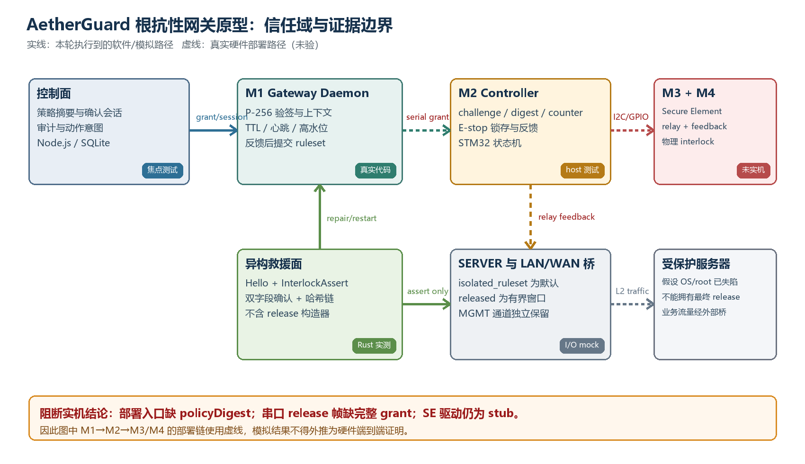

# 宿主失陷条件下的故障闭锁服务器网络隔离

## AetherGuard 根抗性网关软件原型的设计与可复现实验

**Fail-Closed Server Network Isolation Under Host Compromise: Design and Reproducible Evaluation of the AetherGuard Root-Resistant Gateway Prototype**

匿名投稿稿，2026 年 7 月

## 摘要

获得服务器 root 权限的攻击者通常同时控制主机防火墙、端点代理和本机恢复逻辑，使“在被保护主机上阻断该主机”形成信任闭环。本文研究一个更窄但可检验的问题：当宿主操作系统已经失陷时，网络恢复权能否被外移到独立网关，并将“隔离”定义为启动、超时和不确定状态下的共同终态。为此，本文给出 AetherGuard 根抗性网关软件原型。该原型将控制链分为控制面、网关守护进程、控制器状态机、Secure Element 接口、物理 interlock 抽象和只允许安全侧动作的异构救援面；临时释放能力绑定 `policyDigest`、challenge、目标断路器、动作、有效期和单调计数器，且只有控制器回报 `released` 且 `feedbackOk == true` 后，守护进程才提交 released ruleset。本文不把软件模拟等同于硬件证明，而以可证伪状态断言评估原型。

在 Windows 11、Intel Core i7-14650HX、Node.js 24.13.1、Rust 1.90.0 和 GCC 16.1.0 环境中，主模拟流程的 4 个状态断言、4 类故障注入的 15 个断言、STM32 业务逻辑的 18 个 host-side C 测试、控制面 3 个 Jest 套件的 28 个测试、救援面的 51 个串行 Rust 测试和 12 项故障演练均以退出码 0 结束；救援源码守卫扫描 11 个文件，release 违规数为 0。三次独立软件微基准中，P-256 grant 有效验签的运行级均值中位数为 131.817 微秒，篡改 `policyDigest` 的拒绝路径为 132.741 微秒。上述结果直接支持“被测状态机在指定反例输入下转入或保持 isolated”这一命题，但不支持真机继电器时序、硬件密钥不可导出或生产吞吐结论。进一步核对还发现：当前部署包装器未向守护进程注入 `policyDigest`，且串口 release 帧缺少控制器解析所需的完整 grant 字段；Secure Element 固件驱动仍为 stub。因此，本文将系统定位为可执行软件原型，并把真实部署端到端 release 列为阻断实机结论的开放缺口。

**关键词：** 故障闭锁；网络隔离；宿主失陷；硬件授权；单调计数器；安全 interlock；异构救援控制面；可复现实验

## Abstract

Once an attacker obtains root privileges on a server, host firewalls, endpoint agents, and local recovery logic may all fall within the same compromised trust domain. This paper asks a narrower, falsifiable question: can network-release authority be moved to an independent gateway while making isolation the common terminal state for boot, timeout, and uncertainty? We present the AetherGuard root-resistant gateway software prototype. The prototype separates the control plane, gateway daemon, controller state machine, Secure Element interface, physical-interlock abstraction, and a heterogeneous rescue plane restricted to safe-side commands. Temporary release grants bind a policy digest, challenge, breaker target, action, expiry, and monotonic counter. The daemon commits a released ruleset only after the controller reports both `released` and `feedbackOk == true`.

On a Windows 11 workstation with an Intel Core i7-14650HX, Node.js 24.13.1, Rust 1.90.0, and GCC 16.1.0, four main-flow assertions, 15 assertions across four injected fault classes, 18 host-side C tests, 28 focused control-plane tests, 51 serialized rescue-plane tests, and 12 rescue drills terminated with exit code 0. A source guard scanned 11 rescue files and found zero release-command violations. Across three independent software microbenchmark processes, the median run-level mean for P-256 grant verification was 131.817 microseconds; rejection after a tampered policy digest was 132.741 microseconds. These results support only the tested software-state proposition that specific counterexamples preserve or restore isolation. They do not establish physical relay timing, non-exportability of hardware keys, or production throughput. Code inspection further identified two release-blocking integration gaps: the deployment wrapper does not inject the policy digest into the gateway daemon, and its serial release frame omits grant fields required by the controller parser; the Secure Element firmware driver is also a stub. We therefore report an executable software prototype rather than a completed hardware appliance.

**Index Terms:** fail-closed isolation, host compromise, network gateway, hardware authorization, monotonic counter, safety interlock, rescue control plane, reproducible evaluation

## 1 引言

端点安全产品通常假定被保护主机仍保有一个可信执行支点：内核模块能够执行阻断，主机防火墙规则不会被篡改，安全代理能够持续上报，或本地恢复进程能在攻击后重新取得控制。然而 root 权限会直接削弱这些假设。经典的最小权限、完全仲裁和机制经济性原则要求把关键授权点缩小并置于攻击者难以修改的位置[1]；“Trusting Trust”进一步提醒我们，同一软件供应链和执行环境内的自证不能消除共同原因失效[2]。

现有替代路径各有边界。零信任和微分段强调按请求决策与缩小横向移动面[3,4]，但策略执行器通常仍是交换机、虚拟交换、主机代理或集中控制器。TEE 和最小可信计算基方法能缩小宿主内的可信代码[5,6]，但并不天然拥有服务器外部二层链路的最终断开权。BMC 提供带外管理，却也引入高权限、长期在线的独立攻击面；已有工作展示了 lights-out 管理栈中的固件和网络风险[7]。数据二极管以物理单向性换取强隔离，但不适合需要短时双向恢复窗口的通用服务器运维。

本文借用功能安全中的保守终态思想：系统在信息不足时不猜测“仍可运行”，而是回到可观察的隔离状态[8,9]。研究对象不是一台已经量产的安全设备，而是一套跨 TypeScript、C 和 Rust 的可执行参考原型。本文关心三个研究问题：

1. **RQ1：** 能否把临时网络释放表示为上下文绑定、可过期且不可回放的能力，而非一个裸布尔开关？
2. **RQ2：** 在签名篡改、计数器回滚、心跳陈旧、急停、反馈不一致和审计不可写等反例下，被测状态字段是否保持或返回 `isolated`？
3. **RQ3：** 独立救援面能否在源码类型、运行时反馈和审计链三个层面被限制为“只能隔离、不能释放”？
4. **RQ4：** 软件中的策略摘要、P-256 签名和验签开销处于什么量级，且该量级能否在不外推到硬件的前提下复现？

本文贡献如下。

- 提出一个以“隔离为常态、释放为有界例外”的五态网关模型，并给出释放谓词与故障闭锁转换规则。
- 给出上下文绑定 grant：将策略摘要、challenge、目标断路器、动作、过期时间和单调计数器纳入同一签名消息，避免只签“允许/拒绝”导致的跨场景重用。
- 设计只含 `hello` 和 `interlock_assert` 的异构救援命令集；隔离成功必须同时满足归一化状态为 `isolated` 且物理反馈为真，否则返回 error 而非伪造成功。
- 用 5 条控制流程、18 个固件 host 测试、28 个控制面焦点测试、51 个救援单元测试、12 项演练和三次软件微基准给出可复现实验证据，并公开列出真实部署包装、串口协议和 Secure Element 驱动的阻断缺口。

## 2 背景与相关工作

### 2.1 主机内防御与可信执行

TEE、动态可信执行和最小 TCB 研究试图把敏感决策与通用操作系统隔离。Flicker 通过按需建立小型可信执行环境降低持续驻留 TCB[5]；Intel SGX 系统化了 enclave 的机密性与完整性边界[6]。这类机制适合密钥操作和小型判定函数，但“判定允许断网”与“实际切断服务器外部链路”是两个不同命题。若执行器仍依赖被攻陷宿主的 NIC、内核或虚拟交换配置，宿主内可信判定并不能单独推出物理拓扑已经改变。

本文的差异不在于提出新的 TEE，而是把最终网络执行点放到服务器外部的串联桥，并要求状态反馈参与提交。该外移也不会自动产生更强安全性：外部网关自身的固件、供电、管理口和供应链成为新的 TCB，故必须在威胁模型中显式列出。

### 2.2 BMC 与带外管理

BMC 能在宿主关机或失陷时维持独立管理通道，是异构恢复的重要先例。Bonkoski 等对 lights-out 管理进行了实证安全分析，说明带外并不等于天然可信[7]。BMC 通常拥有电源、控制台、固件更新和虚拟介质等宽权限；一旦自身失陷，影响面可能超过普通主机代理。

AetherGuard 原型选择更窄的动作面：正常网关面负责有条件的临时 release，救援面只保留状态查询、隔离和白名单内主进程重启。本文没有证明这一缩权设计已经抵御 BMC 级固件攻击，只证明当前 Rust 救援命令类型和源码守卫中不存在 release 构造器。

### 2.3 零信任、微分段与单向网关

NIST SP 800-207 把零信任定义为围绕资源而非网络位置进行显式判断[3]。近期微分段研究进一步提高了云网络策略的可扩展性[4]。这些工作主要回答“哪些流可通过”；本文关注“当决定层或宿主不可再信任时，谁拥有恢复连通的最终能力”。两者可以组合：零信任生成细粒度策略，外部 interlock 为高风险恢复提供最后一道物理执行边界。

单向网关和数据二极管通过硬件方向性获得强隔离，但牺牲通用双向会话。本文允许双向桥在短窗口内释放，因此其保证弱于真正的数据二极管；补偿手段是默认隔离、签名上下文绑定、单调计数器、反馈提交和 TTL 自动回收。

### 2.4 功能安全与审计完整性

Leveson 的系统安全方法强调约束控制行为，而非只统计部件失效率[8]；IEC 61508 提供了电气/电子/可编程安全相关系统的生命周期框架[9]。本文不声称通过 IEC 61508 认证，而只借用两项工程思想：去能量化的安全终态，以及故障复位不得自动恢复危险动作。固件 E-stop 状态机因此在松开按钮后回到 `isolated`，只有显式 clear 和新 grant 才能再次释放，这与 ISO 13850 对急停复位不应自动重启的原则一致[10]。

救援审计使用前序哈希和快照锚检测字段篡改、重排和截断。它不是区块链，也不等价于外部时间戳服务；安全审计日志研究已指出，只有链式认证还不足以对抗删除整个后缀，因而需要外部或独立锚[11]。原型使用本地 snapshot anchor，能检测与锚不一致的截断，但不能抵御同时篡改日志和锚的高权限攻击者。

## 3 威胁模型与安全目标

### 3.1 资产与对手

受保护资产是服务器与 LAN/WAN 之间的业务连通，以及恢复该连通的授权能力。对手可获得受保护服务器 root 权限，修改主机防火墙、停止 Agent、伪造宿主侧状态并尝试重放旧 grant；对手也可造成控制面到网关之间的消息延迟、丢失、重排和篡改。本文还考虑普通软件故障：守护进程重启、控制器心跳陈旧、反馈不一致、审计目录不可写和主控制面不可达。

以下能力不在本文已证范围：拆机短接继电器、替换网关固件、攻击调试口、窃取或克隆真实 Secure Element 密钥、侧信道和故障注入、破坏独立供电、攻陷专用 MGMT 网络，以及同时控制救援日志与其锚。由于当前 Secure Element 驱动是 stub，本文也不把“私钥不可导出”作为实验结论。

### 3.2 安全目标

定义网关状态集合

\[
S = \{I, A, R, F, U\},
\]

分别表示 isolated、armed、released、fault 与 unknown。系统初态为 \(I\)。对任意 grant \(g\) 和时刻 \(t\)，软件原型的释放前置条件写为

\[
P(g,t)=V_{sig}\land V_{gate}\land V_{target}\land V_{action}\land V_{policy}\land (t<g.exp)\land(g.counter>h)\land SE\_present.
\]

其中 \(h\) 为本地高水位。满足 \(P\) 只允许 \(I\rightarrow A\)，不能直接到 \(R\)。只有控制器回报

\[
state=\texttt{released}\land feedbackOk=\texttt{true}
\]

才允许 \(A\rightarrow R\)。任何验证失败、反馈超时、状态冲突、E-stop 或 TTL 到期都触发

\[
\{A,R,F,U\}\rightarrow I,
\]

并同时请求 `isolated_ruleset` 与 `interlock_assert`。需要强调的是：这是代码状态机的目标与被测行为；真实继电器是否断开仍需硬件反馈和 HIL 证明。

### 3.3 非目标

本文不评价攻击检测准确率，不主张替代 IDS/WAF，不讨论大模型判定质量，也不把一次软件测试通过解释为 SIL 等级或量产认证。本文只评估授权、状态转换、故障语义和救援动作边界。

## 4 系统设计

### 4.1 信任域分解

系统分为六个角色：

1. **控制面：** 生成动作意图、策略摘要和硬件确认会话，并保存审计记录。
2. **M1 Gateway Daemon：** 校验 ECDSA P-256 grant、上下文、有效期和单调计数器；管理 nftables ruleset 与控制器反馈窗口。
3. **M2 Controller：** 校验 challenge、策略摘要、计数器、有效期、E-stop 与反馈，驱动 relay 抽象。
4. **M3 Secure Element 接口：** 设计目标是保存设备密钥和硬件计数器；当前固件实现仅有 presence 探测，签名与计数器 API 尚为 stub。
5. **M4 Interlock：** 串联服务器业务桥的继电器与反馈触点；当前实验中为 mock。
6. **异构救援面：** 独立 Rust 二进制，只允许查询、`interlock_assert` 与白名单内主进程重启，不拥有 release 命令。



图 1 中实线表示本轮实际执行到的模拟或 host-side 路径，虚线表示需要真实 STM32、Secure Element、relay 和网桥的部署路径。图示不把 mock I/O 画成实体硬件。

### 4.2 上下文绑定 grant

grant 的签名消息按固定顺序拼接 15 个字段：`gateId`、`sessionId`、`actionId`、`tenantId`、`scope`、`targetId`、`commandType`、`payloadHash`、`policyDigest`、`challenge`、`breakerTarget`、`interlockAction`、`issuedAt`、`expiresAt` 和 `monotonicCounter`。该设计同时约束“谁、对什么、依据哪份策略、在何时、执行哪种动作”。

`policyDigest` 由规范化策略对象的稳定序列化结果计算 SHA-256。策略动作中的字符串、数值和布尔值先经显式转换，避免语义相同但表示不同的 JSON 产生隐式分歧。带任一扩展字段的 grant 如果新格式验签失败，不退回 legacy 11 字段签名，从而避免攻击者借兼容路径剥离上下文。

### 4.3 单调计数与时间窗口

控制面数据库、M1 守护进程和 M2 控制器分别维护高水位，均要求新计数严格大于旧值。多层高水位不是共识协议，而是纵深防御：任一层观察到回滚即可拒绝。当前 M1/M2 高水位是进程或内存状态，尚未证明掉电持久；M3 的硬件计数器 API 也未实现。因此本文只主张“当前进程生命周期内的严格递增断言”。

release TTL 被约束在 5 秒到 15 分钟之间。M1 收到有效 grant 后进入 `armed` 并等待反馈；若反馈未在 `min(releaseTtl, heartbeatStale)` 内到达，则重新隔离。进入 `released` 后另启 TTL，窗口到期再次请求 `interlock_assert`。

### 4.4 反馈后提交

守护进程不在签名通过时立即加载 released ruleset，而在 `handleControllerFrame` 中同时观察到 `released` 和 `feedbackOk == true` 后调用 `commitReleased`。控制器先驱动 relay，再读取反馈；反馈为假时立即撤销 relay、发 alert 并返回 denied。这一区分对应两类失败语义：

- **操作未生效：** relay 未闭合或反馈不成立，最终状态必须不是 released。
- **操作曾生效后失去保证：** TTL 到期、心跳陈旧、E-stop 或状态冲突，守护进程重新加载 isolated ruleset 并发 `interlock_assert`。

软件 mock 只能断言内部状态和发出的帧，不能证明物理触点最终位置。

### 4.5 安全侧救援面

救援命令枚举是闭集：`Hello` 与 `InterlockAssert`。运行时 `isolate` 只有在 `bridge_state == "isolated"` 且 `feedback_ok == Some(true)` 时返回 `allowed`；不可达、unknown、缺失反馈或负反馈均返回 `error`。审计目录不可写时，动作在发往外部设备前被拒绝。哈希链和快照锚用于检测事件字段篡改、重排与截断。

这一设计刻意牺牲“救援面直接恢复业务”的可用性，以避免共同原因失效时第二条路径也能释放桥。需要恢复时，救援面只能修复或重启主控制面，再由正常授权链申请新的临时 release。

## 5 原型实现与已知集成断点

### 5.1 实现映射

M1 位于 `backend/src/companion/gateway-daemon.ts`，签名格式位于 `backend/src/security/hardware-grant.ts`，策略规范化位于 `backend/src/security/final-defense-policy.ts`。M2 host-side 状态机位于 `firmware/controller-stm32h5/Core/Src/controller_tasks.c`，串口解析器位于 `serial_json.c`。模拟器使用真实 M1 代码和 mock M2/M3/M4。异构救援面位于 `rescue/`，不依赖主控制面的 Redis、数据库或 AI 运行时。

### 5.2 阻断真实部署结论的缺口

代码核对发现三个不能被测试绿色掩盖的断点。

第一，部署包装器构造 `GatewayDaemon` 时未传 `policyDigest`；而守护进程在 `!this.policyDigest || grant.policyDigest !== this.policyDigest` 时固定进入 `policy_digest_mismatch`。这意味着当前部署入口的 release 会安全地失败闭锁，但不会形成可用的授权释放链。

第二，M1 内部 `DaemonFrame` 的 release 命令仅携带命令、目标、reason 与时间戳；部署包装器进一步序列化为 `command`、`breakerTarget` 和 `ts`。M2 的 `serial_json_parse` 却从 release 帧读取 `challenge`、`policyDigest`、`monotonicCounter` 和 `expiresAt`。模拟器通过直接把完整 grant 传给 mock controller 绕过了这一封装差异，因此模拟结果不能证明部署串口协议贯通。

第三，`se_driver.c` 明确标为 stub：`se_get_public_key`、`se_sign`、`se_read_counter` 和 `se_increment_counter` 均返回 false；控制器注释也说明签名验证在 Gateway Daemon 侧。故当前实现没有形成“M2 使用真实 Secure Element 独立验签”的硬件信任根。

这三个缺口都是实机/发布前阻断项。本文选择缩小主张，不在论文任务中修改安全控制流；原因是安全协议修复需要独立设计评审、兼容性决策和 HIL 验证，不能作为文档生成的附带改动。

## 6 实验方法

### 6.1 环境与代码快照

实验时间为 2026-07-13（Asia/Shanghai）。环境为 Windows 11 专业版 10.0.26200 x64、Intel Core i7-14650HX（16 核/24 线程）、31.7 GiB 内存、Node.js 24.13.1、npm 11.8.0、Rust 1.90.0、Cargo 1.90.0 和 GCC 16.1.0。Git 基线为 `bc034f9418d9abcbe36ec3daea4c8275d42bd5a5`，分支为 `codex/production-cleanup-20260513`；工作树非 clean，因此该 commit 只能标识基线，不能单独重建全部结果。附录 A 给出关键文件 SHA-256。

### 6.2 实验矩阵

| 实验 | 输入/反例 | 可证伪充分条件 | 不能证明的事项 |
| --- | --- | --- | --- |
| E1 主模拟 | 有效签名 grant + 30 秒 TTL | release 被反馈提交，TTL 后 `isReleased == false` 且 `bridgeState == isolated` | 真实串口、relay、nftables |
| E2 故障注入 | 无效签名、计数回滚、陈旧心跳、E-stop | 每条场景的最终 bridge 字段为 isolated，并命中预期 reason | 其他 5 类 README 所列但本轮未单独执行的故障 |
| E3 固件 host 测试 | challenge 重用、策略不匹配、过期、UINT32_MAX、反馈错、E-stop | C 断言直接比较 `GRANT_RESULT_DENIED/RELEASED` 与 interlock state | STM32 HAL、实时性、掉电持久化 |
| E4 控制面焦点测试 | 上下文篡改、非递增计数、session 重放/过期 | Jest 断言 reason/status/dispatchCount 等字段 | 全量后端无回归 |
| E5 救援单测与演练 | 缺配置、缺密钥、审计不可写、反馈缺失/为假、日志截断 | decision/reason/bridge_state/feedback_ok/chain_valid 字段匹配预期 | 真机恢复和管理网可达性 |
| E6 微基准 | 有效 grant 与篡改 digest | 有效验签恒真、篡改验签恒假，且时间字段非零 | I2C/SE/relay/网络端到端时延 |

### 6.3 微基准设计

微基准每次启动生成一对 P-256 密钥，构造带扩展上下文的 grant，并在计时前断言三个前置条件：有效 grant 被接受、篡改 `policyDigest` 被拒绝、策略摘要重复计算相同。摘要与消息构造各运行 30 个 batch；签名每 batch 100 次，验签每 batch 200 次。本文运行三个独立 Node 进程，报告三个进程“batch 均值”的中位数与范围。它测量 Node/OpenSSL 加上当前 key 解析和消息构造的软件成本，不代表 OPTIGA Trust M 或 UART 成本。

## 7 结果

### 7.1 状态机与故障注入

`npm run sim` 以退出码 0 结束，4 个断言分别确认：M1 接受上下文绑定签名 grant、M2 mock 接受 grant、M1 在反馈后观察到 released、30 秒 TTL 到期后回到 isolated。该命令墙钟时间约 39.1 秒，其中主要部分是设计的 30 秒释放窗口，不能解释为算法时延。

4 个单故障脚本均以退出码 0 结束，共 15 个字段/状态断言通过：无效签名 3 个、计数回滚 5 个、心跳陈旧 2 个、E-stop 5 个。关键结果见表 2。

| 场景 | 关键输入 | 直接断言 | 结果 |
| --- | --- | --- | --- |
| 无效签名 | base64 bogus signature | `accepted === false`；bridge isolated；reason 为 `grant_signature_invalid` | 3/3 |
| 计数回滚 | 相同 counter、新 challenge、有效签名 | M2 denied；M1 false；reason 为 `monotonic_counter_rollback`；最终 isolated | 5/5 |
| 心跳陈旧 | 容忍 1 秒，控制器 60 秒发一次；等待 3.2 秒 | reason 为 `controller_heartbeat_stale`；最终 isolated | 2/2 |
| E-stop | release 后触发急停；锁存期间再给有效 grant | 急停后 isolated；锁存 grant denied；显式 clear 后新 grant 才 release | 5/5 |

证据证明 X：上述输入下 mock/软件状态字段满足预期。待证命题 Y：真实硬件在相同故障下断开物理桥。X 只是 Y 的前置，不是同一件事，因而本实验不能推出 Y。

### 7.2 固件与控制面字段断言

GCC 直接编译 `mock_hal.c`、`test_stubs.c`、`test_controller.c`、`controller_tasks.c`、`serial_json.c` 和 `interlock_driver.c`，编译退出码 0，执行退出码 0，统计为 `18 passed, 0 failed`。测试覆盖启动默认隔离、challenge 重用、RFC 8259 空格与转义、值内伪键、策略摘要不匹配、严格递增计数、成功后高水位推进、过期、E-stop 锁存、`UINT32_MAX` 后回绕拒绝、16 槽 challenge 窗口、有效 release 与反馈不一致拒绝。

控制面命令

```text
npx jest src/__tests__/services/final-defense.service.test.ts \
  src/__tests__/services/hardware-authorization.service.test.ts \
  src/__tests__/services/device-control.service.test.ts --runInBand
```

以退出码 0 结束，`3 suites / 28 tests` 通过，snapshot 为 0。直接字段断言包括：`policyDigest_mismatch`、`non_increasing_monotonic_counter`、critical 审计 severity、`session_expired`、session 重放不重复 dispatch、网关陈旧时 `active == false`，以及只有外部网关 active 时高风险动作才进入硬件确认。

全量 `npm run test:all` 的结论不同：命令退出码 1，在 shard 3 停止，因此 shard 4 未执行。单独复跑 shard 3 得到 `61 suites passed / 1 failed`，`802 tests passed / 3 failed / 805 total`；失败集中在 `refresh-token-reuse.test.ts`，首个注册预期 201 实得 503，后续 refresh/replay 断言连带失败。它与本文网关焦点路径不同，但足以阻止“全仓无回归”的声明。

### 7.3 救援面

`cargo test -- --test-threads=1` 以退出码 0 结束，库测试 `51 passed / 0 failed / 0 ignored`，main 与 doc tests 均为 0 测试且退出码 0。直接断言包括：`SafeCommand` 只序列化为 `hello` 或 `interlock_assert`；隔离成功要求 `bridge_state == isolated` 与 `feedback_ok == Some(true)`；unknown、负反馈、缺失反馈和不可达均返回 error；审计链字段篡改、重排和锚不匹配均使 `chain_valid == false`。

故障演练脚本以退出码 0 结束，`12/12 drill assertions passed`。其中 `SEC-005` 观察到对端仍为 released 时返回 error 而非假确认；`SEC-005b` 在状态 isolated 但 `feedbackOk == false` 时仍返回 error；`SEC-007/007v` 对日志截断和锚不匹配返回 accepted false/chainValid false。源码守卫命令输出 `11 files scanned, 0 violations`。

需要保留一个负结果：默认并行 `cargo test` 的一次运行得到 `49 passed / 2 failed / 0 ignored`，失败为审计事件编号和链完整性断言；同一时刻存在另一个 Cargo 测试进程争用共享缓存。串行复跑全部 51 个测试通过，这与共享测试状态干扰的解释一致，但尚未由独立修复实验充分证明。因此，默认并行测试稳定性仍是开放缺口，本文只将串行命令作为可复现门禁。

### 7.4 软件微基准

| 操作 | 每进程操作数 | 三次运行均值中位数 | 运行均值范围 |
| --- | ---: | ---: | ---: |
| SHA-256 策略摘要 | 60,000 | 5.248 微秒 | 4.388–5.297 微秒 |
| grant 消息拼接 | 150,000 | 0.319 微秒 | 0.306–0.354 微秒 |
| P-256 签名（mock SE） | 3,000 | 34.517 微秒 | 34.382–34.606 微秒 |
| P-256 有效验签 | 6,000 | 131.817 微秒 | 119.234–132.169 微秒 |
| 篡改 digest 后验签拒绝 | 6,000 | 132.741 微秒 | 127.692–139.122 微秒 |

三次运行的预条件字段均为 `validGrantAccepted == true`、`tamperedPolicyDigestRejected == true` 和 `deterministicPolicyDigest == true`。有效与篡改路径量级接近，说明当前拒绝路径没有通过跳过签名验证获得表面性能优势；但该观察不是常数时间证明，也不构成侧信道分析。

## 8 讨论

### 8.1 对 RQ1–RQ4 的回答

对 RQ1，代码与测试表明软件原型已把 release 从裸开关提升为包含 15 字段的签名能力；`policyDigest`、challenge、目标、动作、时间和计数均进入消息。该结论限于消息构造、验签和 session 测试，不包括部署串口帧。

对 RQ2，5 条已执行流程提供了“具体反例输入导致具体状态字段”的可证伪证据。最重要的不是脚本退出 0，而是无效签名、回滚、陈旧心跳和 E-stop 分别对应 `accepted == false`、`GRANT_RESULT_DENIED`、预期 reason 以及最终 isolated 字段。

对 RQ3，Rust 闭集枚举、11 文件源码守卫、运行时双字段确认和审计不可写前置拒绝形成四层约束。它们降低了救援面意外拥有 release 能力的概率，但不能证明二进制供应链、编译器或部署主机未被篡改[2]。

对 RQ4，当前桌面软件验签约 0.13 毫秒，策略摘要约 0.005 毫秒。与 5–900 秒级 release 窗口相比，纯软件密码学开销不是主导项；真正未知的是 Secure Element I2C、串口、relay 与 nftables 的端到端分布，必须通过 HIL 采集。

### 8.2 为什么失败闭锁不等于系统可用

当前部署包装器缺少 `policyDigest` 会让 release 一律拒绝。这是安全侧的失败闭锁，却也是功能不可用。把它写成“安全已经实现”会混淆两个命题：不错误释放与能够在合法授权下释放。本文只证明前者的若干软件分支，并明确后者尚未在部署入口贯通。

同理，救援面没有 release 能力降低了共同原因风险，却增加了主控制面长期不可恢复时的可用性代价。真实产品需要通过独立 MGMT、离线运维流程、双人授权或可审计的物理维护口解决，而不能悄悄给救援面增加 release fallback。

### 8.3 与相关工作的互补关系

| 机制 | 最终执行点 | 宿主 root 后的独立性 | 双向临时恢复 | 本文原型的关系 |
| --- | --- | --- | --- | --- |
| 主机防火墙/EDR | 宿主内核或代理 | 低 | 支持 | 检测与日常处置层，不能充当最后执行点 |
| TEE/Flicker | 宿主 CPU/固件边界 | 中 | 可编程 | 可保护 grant 判定，但不直接切断外部链路 |
| BMC | 带外管理控制器 | 高于宿主 | 支持 | 先例相近，但权限面通常更宽 |
| 零信任/微分段 | 网络控制器/交换执行器 | 取决于部署 | 支持 | 可生成策略；本文关注失陷后的最终 release 能力 |
| 数据二极管 | 物理单向链路 | 高 | 不支持通用双向 | 保证更强但功能不同 |
| 本文原型 | 外部桥 + interlock 抽象 | 设计目标为高 | 有界 TTL | 当前只完成软件状态机与 mock/host 验证 |

## 9 有效性威胁与未覆盖范围

### 9.1 内部有效性

模拟器直接把完整 grant 传给 mock controller，绕过部署包装器的串口序列化；因此 E1/E2 不能发现真实包装字段缺失。M2/M3/M4 是 mock，Node crypto 私钥可由进程访问，与真实不可导出密钥不同。固件 host 测试使用 mock HAL，不包含中断、DMA、串口分帧、relay 抖动和任务调度。救援默认并行测试存在一次非绿色结果，串行通过不能自动消除夹具竞态风险。

### 9.2 外部有效性

实验只有一台 Windows x64 主机，没有 ARM Cortex-M33、目标 Linux 网关、真实 nftables、OPTIGA Trust M、双网口桥或独立供电。微基准只反映 Node/OpenSSL 和本机 CPU；不能外推到嵌入式密码学或生产 QPS。未进行断电、brownout、时钟回拨、串口乱码、触点粘连、网络风暴和长期 soak。

### 9.3 构念有效性

`bridgeState == isolated` 是软件状态，不是物理断链。只有来自独立反馈触点的可信观测，才能把软件变量与现场状态连接起来。当前 mock feedback 由同一进程生成，不能证明传感独立性。`0 violations` 的源码守卫只证明扫描规则未命中 release 构造，不证明编译产物或依赖没有动态构造等价帧。

### 9.4 统计结论有效性

故障脚本是确定性断言，不是随机抽样；重复同一路径不能扩展故障覆盖。微基准只有 3 个进程、每个 30 batch，适合给数量级，不适合推断跨机器分布。本文不报告显著性检验。

### 9.5 本轮未覆盖范围

- 未执行真实 STM32 firmware build；仓库 `.ioc`/CubeMX HAL 尚未生成，只有 host-side C 逻辑被编译。
- 未读取或验证真实 PCB 电气设计、relay 选型、触点反馈独立性、EMC、安规和失电状态。
- 未执行真实 Secure Element I2C 命令、密钥生成、签名、计数器持久化、抗侧信道或故障注入。
- 未验证部署包装器修复后的完整串口 release/ack 协议；当前实现存在明确字段断点。
- 未执行 README 所列的 SE unavailable、grant expired、feedback mismatch、daemon/controller divergence 等每个独立模拟脚本；其中部分只在单元测试中覆盖。
- 未执行真实 nftables 二层转发、吞吐、丢包、切换时延或 MGMT 通道保活。
- 未完成后端全量回归；`npm run test:all` 在 shard 3 的 3 个 refresh-token 断言失败后停止，shard 4 未运行。
- 未执行生产 Postgres、Redis、真实浏览器、Docker compose、ARM release 构建或物理故障演练。
- 未做形式化模型检查、渗透测试、第三方代码审计、IEC 61508/ISO 13849/ISO 13850 合规评定。

经检索与本文语义相关的路径使用命令：

```text
rg -n "policyDigest|monotonic|interlock|release_window_expired|failClosed" \
  backend/src/companion backend/src/services backend/src/security simulator firmware rescue
rg -n "release|interlock_assert|chain_valid|feedback_ok" rescue/src scripts/guards
```

检索还命中未在本轮运行的 red-team、companion、gateway-daemon 和 hardware-grant edge-case 测试；因此不能声称相关路径已穷尽。

## 10 结论

本文给出一种面向宿主失陷场景的故障闭锁网络隔离原型：释放是带策略、目标、动作、时间和单调计数约束的暂态能力，隔离是启动、超时、冲突和不确定状态的共同终态；独立救援面只允许安全侧动作。跨 TypeScript、C 与 Rust 的测试为若干关键反例提供了字段级证据，软件 P-256 验签开销在本机约为 0.13 毫秒量级。

更重要的结论是否定性的：软件模拟和 host 测试尚不能证明硬件最终防线。真实部署入口的 `policyDigest` 注入、串口 grant 封装和 Secure Element 驱动仍未贯通，且后端全量回归不绿。因此，当前最准确的工程状态是“可执行软件原型，具备可复现故障语义证据，但不可据此声称硬件端到端交付”。下一阶段研究应先闭合协议与驱动断点，再在 HIL 环境中对物理触点、掉电持久、串口故障、网桥切换和独立管理恢复进行测量；只有这些字段级证据成立后，才适合把论文主张从软件原型推进到硬件强制系统。

## 附录 A 关键源码指纹

Git 基线之外，以下 SHA-256 用于标识本轮直接引用的非 clean 工作树文件：

| 文件 | SHA-256 |
| --- | --- |
| `backend/src/companion/gateway-daemon.ts` | `170715E5329FE798B5042C6EA281D1CE51EDD851BC3FA8E9D951D388717923E6` |
| `backend/src/security/hardware-grant.ts` | `A1CFE2AAFD546EC6479916011F1A786C7DC60E241C2FB6994D26A9EF4A98151D` |
| `backend/src/security/final-defense-policy.ts` | `49F2F3936DCBB0042F74DA4F87C11FA23C11837CC45DF8C4F71CEFAA66CCB421` |
| `deployment/gateway/bin/aetherguard-gateway-daemon.ts` | `68D9D9B834014BBE8AC8C92243CA70F98DEBAE729BBE2661D2918DFCEFED1AE0` |
| `firmware/controller-stm32h5/Core/Src/controller_tasks.c` | `93036482724F278E0AE37CCE6596B800CA851EC1C96433125DC5B4248B615DD4` |
| `firmware/controller-stm32h5/Core/Src/serial_json.c` | `6CEB2CD344F4A51B4C815076EB3D36810A4325A1BE6EE2C4FD13B7D4F2A6F27D` |
| `firmware/controller-stm32h5/Core/Src/se_driver.c` | `77862C3E9AAF2F74A81DE55999E60097D642007531A0A555CD884A43C8A61A53` |
| `simulator/sim.ts` | `9F092810A8CAEEC6406B598FDAAC67974882F5F083D381AB8C112C35B088C650` |
| `simulator/test-scenarios.ts` | `79C21D4F3C0F9A83E5CEA67F5568DD0D8876B650A018A3C0F434CD97341ABBA4` |
| `rescue/src/appliance.rs` | `FB02B4A55E0F9138BA3C8D955C7AABE5A07A827882E45DA0CDE5EDE650A9DE13` |
| `rescue/src/runtime.rs` | `C871EC795621049FE5DCB25BE5DFA459D62AC67888D41BE81CA2325E5838AE71` |

## 附录 B 复现实验命令

```powershell
# 主流程与四类故障注入
Set-Location simulator
npm run sim
npm run test:invalid-sig
npm run test:counter-rollback
npm run test:heartbeat-stale
npm run test:estop

# STM32 业务逻辑 host 测试（Windows 无 make 时的等价命令）
Set-Location ..\firmware\controller-stm32h5
$exe = Join-Path $env:TEMP 'aetherguard-test-controller-paper.exe'
gcc -Wall -Wextra -std=c11 -g -Itest -ICore/Inc -ICore/Src -o $exe `
  test/mock_hal.c test/test_stubs.c test/test_controller.c `
  Core/Src/controller_tasks.c Core/Src/serial_json.c Core/Src/interlock_driver.c
& $exe

# 控制面焦点测试
Set-Location ..\..\backend
npx jest src/__tests__/services/final-defense.service.test.ts `
  src/__tests__/services/hardware-authorization.service.test.ts `
  src/__tests__/services/device-control.service.test.ts --runInBand

# 救援面
Set-Location ..\rescue
cargo test -- --test-threads=1
Set-Location ..
node scripts/rescue/run-drills.mjs
node scripts/guards/check-rescue-no-release.mjs

# 软件微基准
Set-Location backend
$env:TS_NODE_PROJECT='tsconfig.json'
$env:TS_NODE_COMPILER_OPTIONS='{"module":"CommonJS"}'
npx ts-node ..\docs\papers\fail-closed-gateway-prototype\reproduce\benchmark-control-path.ts
```

## 参考文献

[1] J. H. Saltzer and M. D. Schroeder, “The Protection of Information in Computer Systems,” *Proceedings of the IEEE*, vol. 63, no. 9, pp. 1278–1308, 1975. doi: 10.1109/PROC.1975.9939.

[2] K. Thompson, “Reflections on Trusting Trust,” *Communications of the ACM*, vol. 27, no. 8, pp. 761–763, 1984. doi: 10.1145/358198.358210.

[3] S. Rose, O. Borchert, S. Mitchell, and S. Connelly, *Zero Trust Architecture*, NIST SP 800-207, 2020. doi: 10.6028/NIST.SP.800-207.

[4] S. K. Mani, K. Hsieh, S. Segarra, R. Chandra, Y. Zhou, and S. Kandula, “Securing Public Cloud Networks with Efficient Role-based Micro-Segmentation,” in *22nd USENIX Symposium on Networked Systems Design and Implementation (NSDI 25)*, 2025, pp. 1033–1048.

[5] J. M. McCune, B. Parno, A. Perrig, M. K. Reiter, and H. Isozaki, “Flicker: An Execution Infrastructure for TCB Minimization,” in *EuroSys 2008*, pp. 315–328. doi: 10.1145/1352592.1352625.

[6] V. Costan and S. Devadas, “Intel SGX Explained,” IACR Cryptology ePrint Archive, Report 2016/086, 2016.

[7] A. J. Bonkoski, R. Bielawski, and J. A. Halderman, “Illuminating the Security Issues Surrounding Lights-Out Server Management,” in *USENIX Workshop on Offensive Technologies (WOOT 13)*, 2013.

[8] N. G. Leveson, *Engineering a Safer World: Systems Thinking Applied to Safety*. MIT Press, 2011. doi: 10.7551/mitpress/8179.001.0001.

[9] International Electrotechnical Commission, *IEC 61508: Functional Safety of Electrical/Electronic/Programmable Electronic Safety-Related Systems*, 2nd ed., 2010.

[10] International Organization for Standardization, *ISO 13850:2015, Safety of Machinery—Emergency Stop Function—Principles for Design*, 2015.

[11] B. Schneier and J. Kelsey, “Secure Audit Logs to Support Computer Forensics,” *ACM Transactions on Information and System Security*, vol. 2, no. 2, pp. 159–176, 1999. doi: 10.1145/317087.317089.

[12] R. M. Needham and M. D. Schroeder, “Using Encryption for Authentication in Large Networks of Computers,” *Communications of the ACM*, vol. 21, no. 12, pp. 993–999, 1978. doi: 10.1145/359657.359659.

[13] P. Syverson, “A Taxonomy of Replay Attacks,” in *Proceedings of the Computer Security Foundations Workshop*, 1994, pp. 187–191. doi: 10.1109/CSFW.1994.315935.

[14] National Institute of Standards and Technology, *Digital Signature Standard (DSS)*, FIPS 186-5, 2023. doi: 10.6028/NIST.FIPS.186-5.

[15] A. Regenscheid, *Platform Firmware Resiliency Guidelines*, NIST SP 800-193, 2018. doi: 10.6028/NIST.SP.800-193.

[16] K. Stouffer et al., *Guide to Operational Technology (OT) Security*, NIST SP 800-82 Rev. 3, 2023. doi: 10.6028/NIST.SP.800-82r3.

[17] Trusted Computing Group, “Root of Trust: The Foundation for Device Security,” 2022. [Online]. Available: https://trustedcomputinggroup.org/resource/root-of-trust-what-it-is-and-why-it-matters/

[18] Cybersecurity and Infrastructure Security Agency, *Microsegmentation in Zero Trust, Part One: Introduction and Planning*, 2025.
