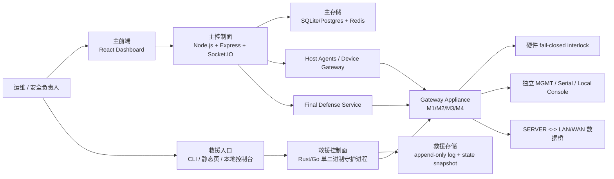

# AetherGuard 项目目标、范围与异构救援控制面执行需求

> 日期：2026-07-08
> 版本：v0.1
> 状态：执行草案 / 技术部门交接版
> 适用对象：架构组、后端组、前端组、硬件/固件组、SRE/运维组、安全测试组
> 关联文档：`docs/aetherguard-product-prd.md`、`docs/root-resistant-gateway-prd.md`、`AGENTS.md`

---

## 1. 文档目的

本文档把 AetherGuard 当前项目目标、边界、技术范围、工程约束和下一阶段的异构救援控制面要求收敛成一份可执行交接材料。技术部门可以据此拆分 ADR、任务单、研发计划、验证计划和上线演练。

本文件不是市场宣传稿。所有涉及安全、可用性、最终防线、救援链路的表述都按工程语义定义：

- 不使用"绝对不会崩溃"作为验收承诺。
- 工程目标是：任一单点组件、运行时、数据库、代理、认证依赖或主控制面故障，不得同时打垮主控制面与救援控制面。
- 性能低下可以接受；救援路径的第一优先级是生存、隔离、留痕和恢复主系统可见性。
- 救援控制面不得成为绕过 Final Defense / Gateway Appliance 硬件授权的 fail-open 后门。

---

## 2. 项目总目标

AetherGuard 是一套面向关键服务器的智能安全防御平台，目标是在常规软件防护之外提供一条可审计、默认隔离、硬件强制的最后防线。

### 2.1 平台级目标

1. 通过前端 Dashboard、Node.js 控制平面、WebSocket 网关、分布式 Host Agent、Rust fastpath、数据库和审计链路，完成常规检测、编排、策略下发、告警和审计。
2. 通过 Gateway Appliance 将关键网络释放权移出被保护服务器的软件环境。
3. 对高风险动作实施 Final Defense 控制流：本地策略、硬件 grant 签名、policyDigest、单调计数器、有效期、interlock feedback、审计归档全链校验。
4. 在主系统局部故障、主机被 root、数据库或 Redis 异常、前端或反向代理不可用时，仍保留一条低功能但独立的救援控制路径。

### 2.2 异构救援控制面目标

新增一套与现有 React + Node.js + Redis + 主数据库链路异构的 Rescue Control Plane。它不是第二套完整 Dashboard，也不是同技术栈的热备实例，而是一条低功能、低依赖、低性能但不同故障域的控制路径。

核心目标：

- 主控制面不可用时，救援控制面仍能读取关键状态、执行安全侧动作、导出本地审计并协助恢复主系统。
- 主控制面被攻陷时，救援控制面不能被用来绕过硬件授权恢复 SERVER <-> LAN/WAN 业务连接。
- 救援控制面自身不依赖主系统的 Node.js 进程、React 前端、Redis、主数据库连接池、JWT session、主反向代理或 AI 检测管线。
- 两套系统共享的唯一安全权威必须落在 Gateway Appliance / Final Defense 硬件状态机和审计事实，而不是某个软件服务的自判。

---

## 3. 背景与问题

当前项目已经具备主控制面的端到端链路：前端发起请求，后端 Express / Socket.IO 处理，服务层与 repository 访问数据库，最终进入审计、检测、设备控制或 Final Defense 链路。

这条链路的风险是：它总体上仍是一条主路径。一旦以下任一环节异常，用户可能失去操作入口或状态可见性：

- 浏览器 / 前端资源加载异常；
- 反向代理、CORS、Cookie、CSRF、限流、中间件或安全插桩误拦截；
- Node.js 控制面进程异常；
- Redis 不可用导致限流、会话或 WebSocket 降级异常；
- 主数据库连接、schema、写入事务或 shadow store 异常；
- WebSocket gateway、agent gateway、device gateway 状态不同步；
- AI 检测管线阻塞或异常放大；
- 登录链路请求未到达后端，或到达后端但被中间件提前阻断；
- Final Defense 控制面能请求硬件，但主控制面不可用时缺少独立操作入口。

普通高可用方案通常是在同一技术栈上做多副本，这能解决部分机器故障，但不能解决共因故障：同一代码缺陷、同一依赖、同一错误配置、同一认证路径、同一数据库 schema 或同一代理规则会同时影响所有副本。

因此，本项目下一阶段需要引入异构救援控制面，类似工业仪器中的"数字控制系统 + 低功能模拟/硬线救援系统"思想：第二系统能力少、速度慢、体验差都可接受，但必须减少与第一系统的共同失效原因。

---

## 4. 总体范围

### 4.1 本项目范围内

| 范围 | 内容 |
| --- | --- |
| 主控制面 | React Dashboard、Express API、Socket.IO、services、repositories、审计、检测、部署管理、Final Defense API |
| 数据链路 | 前端 API client、HTTP envelope、Cookie/session、认证授权、限流、DB 抽象、SQLite/Postgres 目标路径 |
| 设备链路 | Host Agent、device gateway、Gateway Appliance 注册、状态上报、命令签名、WebSocket |
| Final Defense | policyDigest、hardware grant、monotonic counter、interlock assert/release、feedback、审计 |
| Gateway Appliance | M1 Gateway Daemon、M2 STM32 控制器、M3 Secure Element/TPM、M4 fail-closed interlock |
| 异构救援控制面 | 独立运行时、独立认证、独立存储、独立入口、最小状态读取、隔离、安全重启、审计导出、恢复同步 |
| 运维与验证 | 故障矩阵、ADR、自动化测试、断链演练、runbook、验收证据 |

### 4.2 明确不在范围内

- 不做第二套完整业务后台或完整 Dashboard。
- 不允许救援控制面绕过硬件 grant、policyDigest、counter、expiry、interlock feedback。
- 不把救援路径做成同一 Node.js 后端的另一个路由前缀。
- 不把"Redis 内存 fallback"、"数据库重试"、"前端重载"称为异构救援系统。
- 不承诺未经真实验证的性能指标或硬件量产状态。
- 不覆盖未接入 Gateway Appliance 的物理链路，例如 BMC、Wi-Fi、空闲网卡、本地控制台、直连存储破坏。

---

## 5. 目标架构

### 5.1 主控制面定位

主控制面负责正常业务流：

- 登录、租户、RBAC、Dashboard；
- agent / device 注册与 WebSocket；
- 检测、告警、规则、AI 管线；
- Final Defense 动作编排；
- 主审计归档与对象锁归档；
- 业务报表、部署包、配置管理。

### 5.2 救援控制面定位

救援控制面只负责故障和失陷时的最小安全操作：

- 查看本机、主服务、Gateway Appliance、interlock、SE、counter、policyDigest 的关键状态；
- 发起 `assert isolated` / `stop` / `lockdown` 等安全侧动作；
- 重启主控制面相关服务，或将其切换到维护模式；
- 导出救援控制面本地 append-only 审计；
- 在主系统恢复后进行受控状态同步；
- 在极端情况下提供低功能人工操作入口。

### 5.3 两套系统的关系

主控制面和救援控制面可以同时存在，但不得同时以未仲裁方式向 Gateway Appliance 下发相互冲突的命令。仲裁原则：

1. `isolated` / `assert interlock` / `stop` 永远优先于 `release`。
2. `release` 必须经过 Gateway Appliance 硬件授权状态机；救援控制面不得降低门槛。
3. 两套控制面命令都必须进入审计链路；救援本地审计在主系统恢复后补同步。
4. 若状态不确定，系统停在 `isolated`，而不是继续业务连接。

---

## 6. 异构分离要求

| 维度 | 主控制面 | 救援控制面要求 |
| --- | --- | --- |
| 运行时 | Node.js / React / Vite | Rust 或 Go 单二进制；推荐 Rust，减少运行时依赖 |
| 入口 | Web Dashboard + API + Socket.IO | 本地 CLI、静态 HTML、独立 MGMT 端口、串口或本机 console |
| 认证 | JWT / httpOnly cookie / API key / Redis 限流 | 离线签名 challenge、硬件 token、TOTP 或本机 sealed recovery key；不得依赖 Redis/JWT |
| 存储 | SQLite / Postgres / Redis | append-only log + 小型 state snapshot；不得依赖主 DB 可用 |
| 网络 | 反向代理 / `/api` / WebSocket | 独立监听地址，默认绑定 localhost/MGMT；可选串口；不经主反向代理 |
| 部署 | 主应用 compose / npm / node service | 独立 systemd unit / Windows service；独立 watchdog；单独包 |
| 配置 | `.env` / 主配置中心 | 最小配置、只读默认值、显式 provision；缺配置时默认锁定 |
| 日志 | 主审计归档 | 本地不可截断 append-only 日志，恢复后再同步主审计 |
| 故障语义 | 主业务服务可降级 | 救援路径只允许降级到更保守状态：只读、隔离、拒绝 release |

---

## 7. 功能需求

### 7.1 主控制面要求

| 编号 | 要求 | 验收口径 |
| --- | --- | --- |
| AG-PRIMARY-001 | 前端所有后端调用必须经过 `frontend/src/services/api.ts` | `check-no-direct-api-fetch.mjs` 通过 |
| AG-PRIMARY-002 | route handler 不得直连 DB，必须走 service/repository | `check-route-db-access.mjs` 通过 |
| AG-PRIMARY-003 | 登录链路必须可观测：请求到达、认证判定、session/cookie、审计写入、失败原因可定位 | 提供登录成功、密码错误、限流、Redis 不可用、DB 写失败的集成测试 |
| AG-PRIMARY-004 | HTTP 响应必须使用统一 API envelope | 新增/修改路由测试断言 `success/data/error/code/message` |
| AG-PRIMARY-005 | Redis 不可用时不得导致认证安全语义放宽 | 测试断言限流/会话降级的具体字段，不只断言 HTTP 200/500 |
| AG-PRIMARY-006 | Postgres shadow 或主写路径异常不得静默吞掉安全关键写入 | 测试断言写失败被上报或进入明确降级状态 |
| AG-PRIMARY-007 | WebSocket agent/device 命令必须签名并能重放拒绝 | 测试覆盖 HMAC 失败、过期、重放、session 失效 |

### 7.2 救援控制面最小能力

| 编号 | 要求 | 说明 |
| --- | --- | --- |
| AG-RESCUE-001 | 提供 `ag-rescue status` | 输出主服务、主 DB、Redis、Gateway Appliance、interlock、SE、counter、policyDigest 摘要 |
| AG-RESCUE-002 | 提供 `ag-rescue isolate` | 只执行安全侧动作：请求 Gateway Appliance assert isolated / interlock_assert |
| AG-RESCUE-003 | 提供 `ag-rescue restart-primary` | 重启主控制面服务，必须留本地审计；不得清空主数据 |
| AG-RESCUE-004 | 提供 `ag-rescue audit export` | 导出救援本地 append-only 日志和当前 state snapshot |
| AG-RESCUE-005 | 提供 `ag-rescue resync` | 主系统恢复后把救援期间审计与状态补同步到主审计 |
| AG-RESCUE-006 | 提供只读静态状态页 | 不依赖 React bundle，不依赖主后端 API，不包含危险操作按钮 |
| AG-RESCUE-007 | 支持串口或本地 console 模式 | 在 MGMT 网络不可达时仍可读取状态和执行 isolate |
| AG-RESCUE-008 | 任何 release 类动作默认关闭 | 是否允许 rescue release 必须单独 ADR；即使允许，也必须比主路径更严格 |

### 7.3 救援控制面禁止能力

| 编号 | 禁止项 | 原因 |
| --- | --- | --- |
| AG-FORBID-001 | 禁止提供通用业务 API 代理 | 避免成为第二业务后台和绕过主权限模型的入口 |
| AG-FORBID-002 | 禁止直接写主业务数据库 | 避免 DB schema/事务/权限共因故障扩散 |
| AG-FORBID-003 | 禁止绕过 Gateway Appliance 执行 release | release 是硬件授权，不是软件权限 |
| AG-FORBID-004 | 禁止在不确定状态下恢复 SERVER <-> LAN/WAN | 不确定即 isolated |
| AG-FORBID-005 | 禁止把 rescue auth 接到主 JWT / Redis session | 这是共因故障，不是异构 |
| AG-FORBID-006 | 禁止把救援服务挂在主 Express app 下 | Node app 崩溃时救援路径会同时失效 |

---

## 8. 安全语义要求

### 8.1 默认状态

- Gateway Appliance 默认 `isolated`。
- 主控制面不可用时，业务连接不得因为救援控制面存在而自动恢复。
- 救援控制面启动失败、配置缺失、认证失败、日志不可写、硬件状态未知时，最终语义必须是只读或 `isolated`。

### 8.2 高风险动作

高风险动作包括但不限于：

- `host_remove`
- `wipe_data`
- `factory_reset`
- `recovery_flash`
- `critical_config_change`
- SERVER <-> LAN/WAN `release`

这些动作必须继续遵守 Final Defense：policyDigest、hardware grant、monotonic counter、expiry、breakerTarget、interlockAction、feedback 一致性和审计留痕。救援控制面不得把其中任一项降级为"可选"。

### 8.3 release 策略

建议 MVP 阶段救援控制面不提供 release，只提供 isolate、status、audit、restart-primary、resync。

若业务必须支持 rescue release，则必须满足以下附加要求：

1. 单独 ADR 明确为什么需要 rescue release。
2. 必须要求硬件 grant + 物理确认或离线双人签名。
3. release TTL 不得超过主路径上限，且建议更短。
4. 救援 release 必须写入救援本地审计和主审计补同步队列。
5. 任何状态字段缺失、counter 不确定、feedback 不一致、SE 不可用，必须拒绝 release 并保持 isolated。

---

## 9. 数据与审计要求

### 9.1 救援本地数据

救援控制面只维护最小数据集：

| 文件 / 表 | 内容 | 写入规则 |
| --- | --- | --- |
| `rescue-events.log` | append-only 事件日志 | 只追加，不覆盖；包含 hash chain |
| `rescue-state.json` | 最近一次关键状态快照 | 原子写入，损坏则回退只读 |
| `rescue-keyring/` | 公钥、证书、硬件 token 元信息 | provision 后只读 |
| `primary-services.json` | 主服务清单与重启策略 | 只读配置 |
| `sync-queue.log` | 待补同步主审计的事件 | append-only |

### 9.2 审计字段

每条救援审计至少包含：

- `eventId`
- `timestamp`
- `actor`
- `authMethod`
- `command`
- `target`
- `beforeState`
- `afterState`
- `decision`
- `reason`
- `hardwareState`
- `policyDigest`
- `monotonicCounter`
- `previousHash`
- `eventHash`

### 9.3 主系统恢复后的补同步

主系统恢复后，`ag-rescue resync` 必须：

1. 验证救援日志 hash chain。
2. 逐条写入主审计归档。
3. 标记每条事件的来源为 `rescue-control-plane`。
4. 保留原始救援 event hash，避免重写历史。
5. 对无法同步的事件生成明确错误和重试队列。

---

## 10. API 与 CLI 契约

### 10.1 本地 HTTP API

救援 HTTP API 默认只监听 `127.0.0.1` 或独立 MGMT 地址。禁止默认暴露在业务网段。

| Method | Path | 语义 |
| --- | --- | --- |
| `GET` | `/rescue/health` | 进程健康，不代表安全状态 |
| `GET` | `/rescue/status` | 主服务、硬件、interlock、审计状态 |
| `POST` | `/rescue/interlock/assert` | 请求 `isolated` / `interlock_assert` |
| `POST` | `/rescue/services/restart-primary` | 重启主控制面服务 |
| `POST` | `/rescue/audit/export` | 导出救援审计包 |
| `POST` | `/rescue/resync` | 主系统恢复后补同步 |

### 10.2 CLI

| 命令 | 语义 |
| --- | --- |
| `ag-rescue status` | 打印关键状态 |
| `ag-rescue isolate --reason <text>` | 安全侧隔离 |
| `ag-rescue restart-primary --service <name>` | 重启主服务 |
| `ag-rescue audit export --out <path>` | 导出审计包 |
| `ag-rescue resync` | 补同步主审计 |
| `ag-rescue doctor` | 本地自检，输出可复现诊断 |

CLI 输出必须支持 `--json`，便于自动化演练和验收。

---

## 11. 部署要求

### 11.1 服务部署

- 救援控制面作为独立 systemd unit / Windows service 部署。
- 启动顺序独立于主 Node.js 服务。
- 必须配置 watchdog；进程卡死时重启。
- 配置缺失时不得进入可 release 状态。
- 日志目录权限默认最小化，禁止 world-writable。

### 11.2 网络部署

- 默认只监听 localhost。
- 若启用 MGMT 口监听，必须显式配置允许的网卡和 CIDR。
- 禁止默认监听 `0.0.0.0`。
- 救援静态页不得引用外部 CDN。
- 串口模式必须有独立速率、帧格式、超时和错误处理规范。

### 11.3 打包交付

交付物至少包括：

- `ag-rescue` 单二进制；
- systemd unit / Windows service 模板；
- 最小配置模板；
- 公钥 / token provision 工具；
- 离线安装包；
- 卸载脚本；
- runbook；
- 故障演练脚本。

---

## 12. 验收场景

### 12.1 主链路故障演练

| 编号 | 故障注入 | 预期结果 |
| --- | --- | --- |
| DRILL-001 | 停止 Node.js 后端 | `ag-rescue status` 可读，`ag-rescue isolate` 可执行 |
| DRILL-002 | 停止 Redis | 救援控制面认证和 isolate 不受影响 |
| DRILL-003 | 破坏主数据库连接 | 救援本地审计仍可追加 |
| DRILL-004 | 断开主反向代理 | 本地 CLI / MGMT 救援入口仍可用 |
| DRILL-005 | 前端 bundle 不可用 | 静态救援状态页或 CLI 仍可读 |
| DRILL-006 | AI 检测管线阻塞 | 救援状态、隔离、审计不依赖 AI 管线 |
| DRILL-007 | WebSocket gateway 异常 | 救援控制面对 Gateway Appliance 的本地状态读取不依赖主 WebSocket |

### 12.2 安全演练

| 编号 | 场景 | 预期结果 |
| --- | --- | --- |
| SEC-001 | 使用错误救援认证 | 命令拒绝，审计记录失败原因 |
| SEC-002 | rescue auth 可用但 SE 不可用 | release 拒绝，保持 isolated |
| SEC-003 | monotonic counter 回滚 | 命令拒绝，触发 fail-closed |
| SEC-004 | policyDigest 不匹配 | 命令拒绝，保持 isolated |
| SEC-005 | feedback 与期望不一致 | 命令拒绝或回落 isolated |
| SEC-006 | 主控制面被 root 模拟 | 救援控制面不能仅凭主系统状态执行 release |
| SEC-007 | 救援日志被截断 | `resync` 检测 hash chain 断裂并拒绝伪造补同步 |

### 12.3 验收证据要求

每个演练必须提供：

- 注入命令；
- 环境前置条件；
- 命令退出码；
- 关键输出字段；
- 对应审计事件；
- 最终硬件 / interlock 状态；
- 未覆盖范围。

只证明服务返回 200 不足以证明安全语义。涉及安全不变量的验收必须断言具体字段，例如 `bridgeState == "isolated"`、`releaseAllowed == false`、`audit.chainValid == true`。

---

## 13. 实施阶段

| 阶段 | 目标 | 主要交付物 |
| --- | --- | --- |
| Phase 0 | 故障域分析与 ADR | 共因故障矩阵、救援控制面 ADR、release 策略 ADR |
| Phase 1 | 救援进程骨架 | Rust/Go 单二进制、`status`、本地健康、自检 |
| Phase 2 | 独立认证与本地审计 | 离线 challenge、append-only log、hash chain、审计导出 |
| Phase 3 | Gateway Appliance 安全侧集成 | `isolate`、interlock assert、状态读取、硬件异常处理 |
| Phase 4 | 主系统恢复能力 | `restart-primary`、服务清单、resync 补同步 |
| Phase 5 | 可选 rescue release 评审 | 单独 ADR、硬件授权、物理确认、严格测试；如无业务必要则不做 |
| Phase 6 | 演练与交接 | 故障演练脚本、runbook、验收报告、技术部门培训 |

建议 Phase 0-4 作为 MVP；Phase 5 只有在业务明确需要时启动。

---

## 14. 技术部门任务拆分

### 14.1 架构组

- 编写 ADR：异构救援控制面、release 策略、认证方式、存储方式、网络暴露方式。
- 输出共因故障矩阵：运行时、存储、认证、网络、部署、配置、日志、硬件。
- 定义主控制面与救援控制面对 Gateway Appliance 的仲裁规则。

### 14.2 后端组

- 梳理主控制面状态读取接口，提供不依赖前端的机器可读状态源。
- 修正登录链路、Redis 降级、DB 写入、WebSocket revalidation 的测试空白。
- 提供主服务重启和维护模式的受控接口或 system service 清单。

### 14.3 救援控制面组

- 实现 `ag-rescue` 单二进制。
- 实现 CLI、静态状态页、本地 HTTP API、append-only 审计。
- 实现独立认证和配置 provision。
- 实现 `status`、`isolate`、`restart-primary`、`audit export`、`resync`。

### 14.4 硬件 / 固件组

- 固化 Gateway Appliance 状态查询和 interlock assert 协议。
- 确认 STM32 控制器的 counter、policyDigest、expiry、feedback、e-stop 行为与后端一致。
- 提供串口或本地控制接口的错误码和超时语义。

### 14.5 前端组

- 主 Dashboard 增加救援状态入口提示，但不得把救援能力做成依赖 React 的唯一入口。
- 在主系统 degraded 时清晰展示原因，不得把主系统降级显示成硬件最终防线正常。
- 救援静态页只做只读状态，不做高风险操作按钮。

### 14.6 SRE / 运维组

- 编写安装、升级、卸载、密钥轮换、故障演练 runbook。
- 建立 systemd watchdog、日志轮转、权限、备份、恢复策略。
- 组织断链演练并保留证据。

### 14.7 安全测试组

- 对照第 12 节做故障注入和安全演练。
- 验证救援认证、日志防篡改、release 禁止路径、resync 防伪造。
- 检查救援控制面默认监听、文件权限、token 存储和审计完整性。

---

## 15. 关键决策待定

| 决策 | 推荐默认 | 需要确认的问题 |
| --- | --- | --- |
| 救援实现语言 | Rust 单二进制 | 团队是否具备 Rust 运维和交叉编译能力 |
| 救援入口 | CLI + localhost HTTP + 可选 MGMT | 是否必须支持串口 |
| 认证方式 | 离线签名 challenge + 硬件 token | 是否已有企业硬件 token 标准 |
| rescue release | MVP 不开放 | 是否存在必须在主控面不可用时恢复业务桥的场景 |
| 本地日志介质 | append-only 文件 + hash chain | 是否需要 TPM sealed storage 或 WORM 介质 |
| 主系统重启方式 | systemd / Windows service allowlist | 生产部署形态是否统一 |

这些决策进入开发前必须形成 ADR；涉及 release 的决策必须按安全阻断级处理。

---

## 16. 交付清单

技术部门交付时至少包含：

1. `docs/adr/` 下的架构决策记录。
2. 救援控制面源码、构建脚本、安装包和配置模板。
3. CLI 与本地 HTTP API 契约。
4. Gateway Appliance 救援协议说明。
5. append-only 审计格式和 resync 协议。
6. 自动化测试：单元、集成、故障注入、安全拒绝路径。
7. 断链演练脚本和执行报告。
8. 运维 runbook。
9. 回滚方案。
10. 未覆盖范围和阻断级缺口清单。

---

## 17. 验收门槛

项目不能只以"代码写完"作为交付判断。每项能力必须有可复现证据：

- 主控制面：全量或分片测试、typecheck、guard 脚本、登录链路集成测试。
- 救援控制面：故障注入演练、CLI 退出码、JSON 输出字段、审计事件、日志链校验。
- Gateway Appliance：interlock 最终状态、counter、policyDigest、feedback、SE 状态断言。
- 运维：systemd/Windows service 启停、watchdog、权限、离线包安装和卸载验证。

最低验收矩阵：

| 能力 | 必须证明的字段 |
| --- | --- |
| 主后端停止后救援可用 | `primary.status == "down"` 且 `rescue.status == "ready"` |
| 救援隔离动作 | `bridgeState == "isolated"` |
| 错误认证拒绝 | `decision == "denied"` 且 `reason == "auth_failed"` |
| policyDigest 失配拒绝 | `releaseAllowed == false` 且 `reason == "policy_digest_mismatch"` |
| counter 回滚拒绝 | `releaseAllowed == false` 且 `reason == "non_increasing_monotonic_counter"` |
| 日志链完整 | `audit.chainValid == true` |
| resync 防伪造 | 篡改日志后 `resync.accepted == false` |

---

## 18. 备注

本方案的重点不是追求一套"更高性能的备份后台"，而是把救援系统做成另一种生物：少功能、少依赖、慢一点、硬一点、默认保守。主控制面负责智能和效率，救援控制面负责在主系统失效时保住可见性、隔离能力和审计事实。两者都不能替代 Gateway Appliance 的硬件最终授权。
