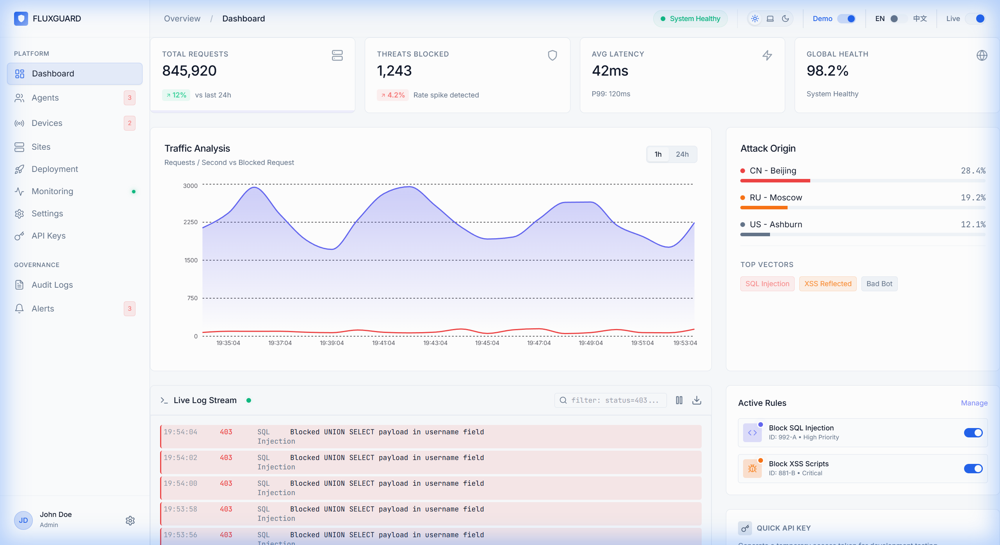
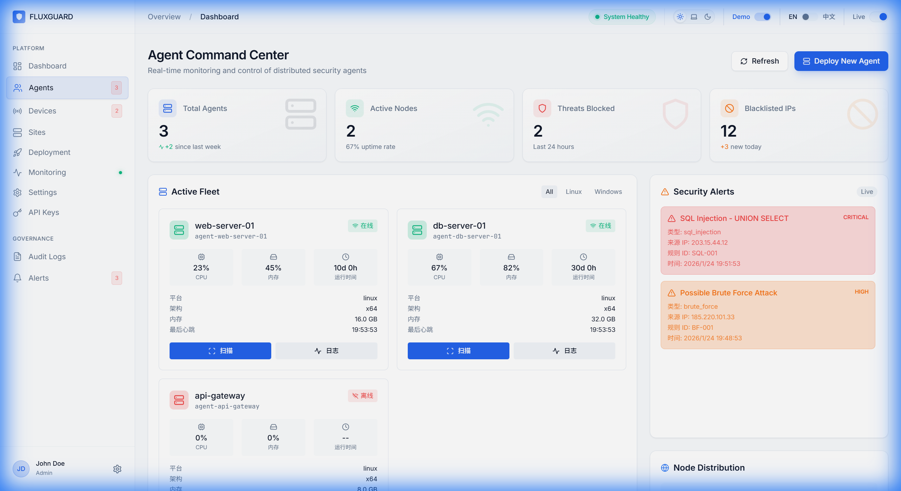
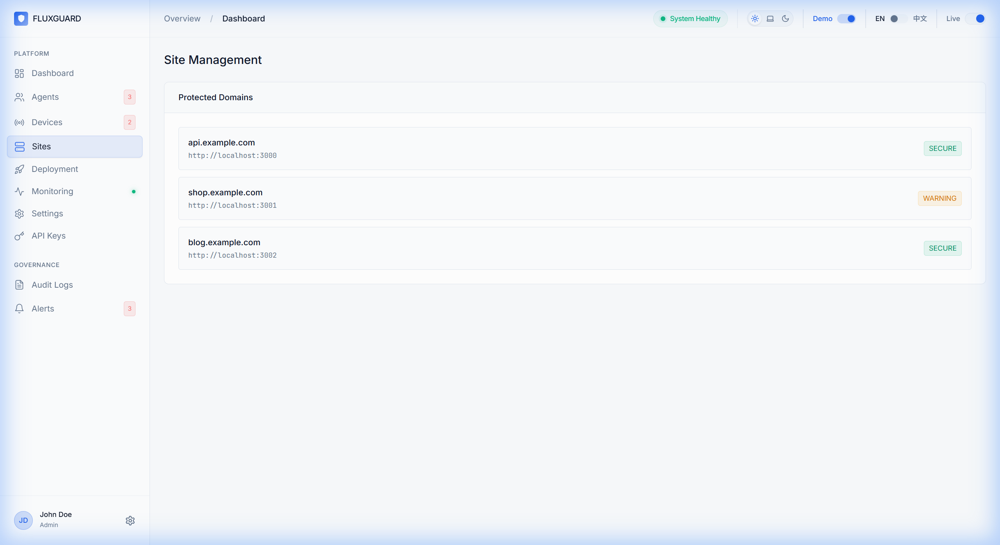
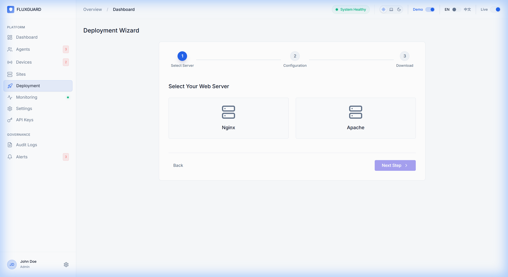
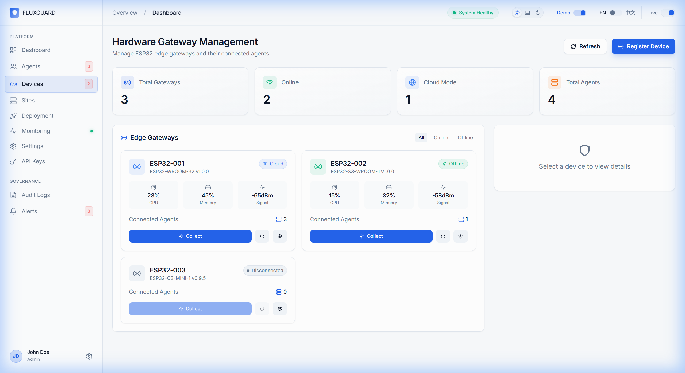
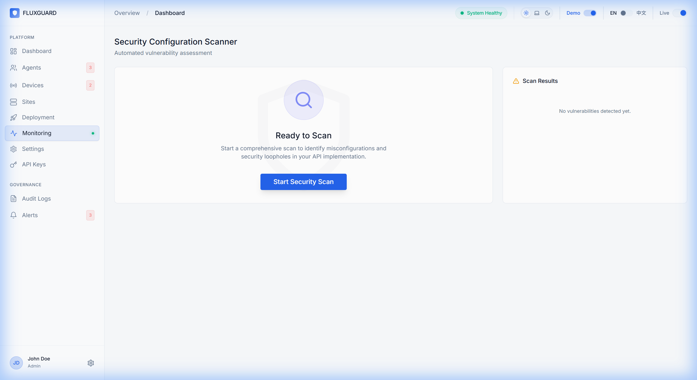
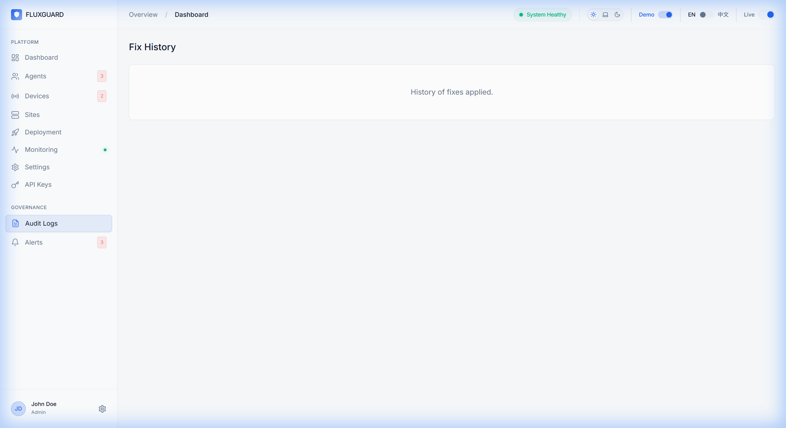
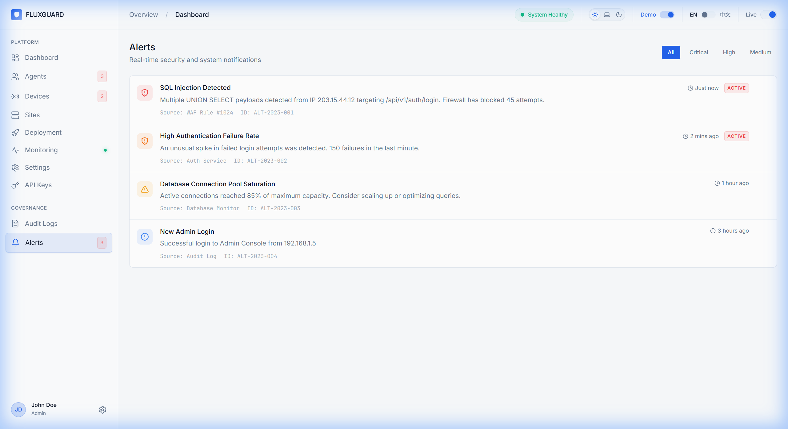
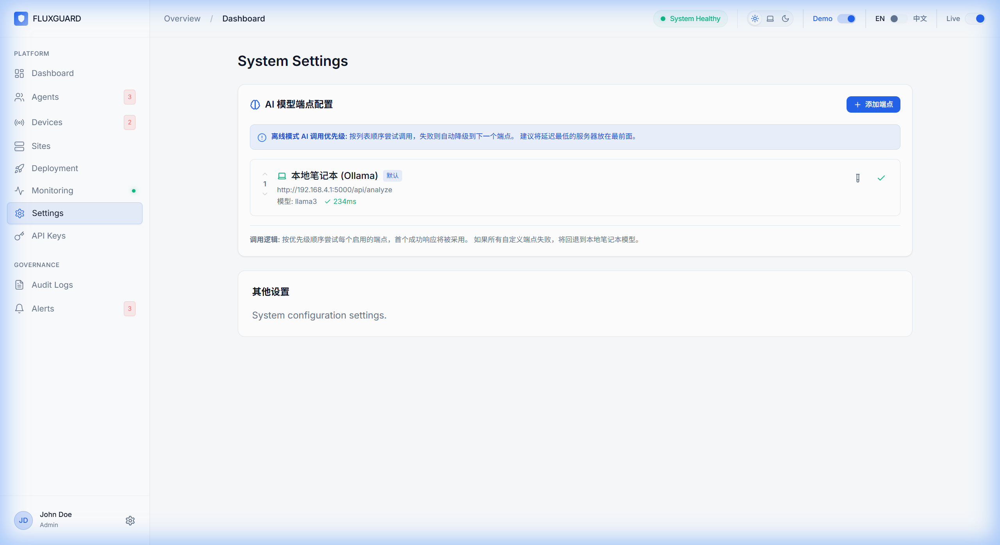
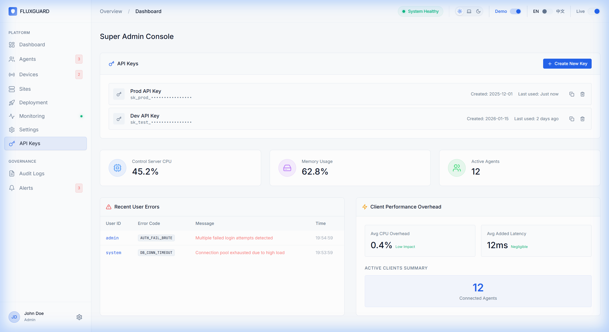

# AetherGuard 产品白皮书
## 下一代智能服务器免疫防御系统

**发布日期**: 2026年1月
**面向对象**: 企业决策者、IT 安全主管、系统架构师

---

> Validation Note (2026-07-27): This whitepaper includes target and historical marketing language. Current software evidence is tracked in `docs/reports/software-validation-status-2026-07-27.md`. The latest fixed-key Rust loopback reproduction measured 56.6k–61.6k QPS across three rounds and a 75.1k short-sweep peak; stable `100,000+ QPS` was not reproduced. The 4,500-sample synthetic corpus measured 63.97% detection and 0% FPR on its 1,200 synthetic normal samples. `<10ms local AI`, `<2% CPU`, `<50MB`, live external integrations, cross-platform rollout, production capacity, and physical hardware remain unvalidated by that report.

## 1. 产品愿景

在万物互联的今天，API 和服务器基础设施已成为企业数字资产的核心载体。然而，传统的防火墙（WAF）和网关常常通过静态规则进行被动防御，不仅难以应对 AI 驱动的新型攻击，更无法防御深层的业务逻辑漏洞。

**AetherGuard** (前身为 API Security Middleware) 正是为解决这一痛点而生。我们重新定义了服务器安全——**从 "被动拦截" 进化为 "主动免疫"**。通过独创的 **"Agent-Inside"** 技术，我们的防御引擎直接驻留在业务服务器内部，结合本地化 AI 分析与 Gateway Appliance 硬件授权设备，构建了一套从代码层到物理层的全方位防御体系。

新的产品主张是 **“AetherGuard 完全最后防线：即使控制平面沦陷，危险动作仍需本地硬件放行。”** 在工程定义上，它对应 Final Defense Mode：控制平面只发起请求和记录审计，最终授权由本地主机 companion、离线签名本地策略、硬件安全芯片签名 grant、单调计数器、payload hash、策略摘要和 interlock 反馈共同决定。

该主张成立的前提必须明确：管理链路已接入 Gateway Appliance 安全授权控制器 interlock，Final Defense Mode 已启用，本地策略已签名，安全芯片（OPTIGA Trust M / ATECC608C）已 provision，外部 DC、反馈回路、companion 心跳和策略摘要均健康。第一版物理断路只控制低压网络/管理链路，不切换市电或直接切断业务主机电源。

---

> Evidence note: 2026-03-08 Docker and hardware-flow evidence remains a dated historical snapshot. Use `docs/reports/software-validation-status-2026-07-27.md` for current software metrics and unresolved validation gaps.

## 2. 核心价值主张

| 传统 WAF | AetherGuard | 价值提升 |
| :--- | :--- | :--- |
| **流量清洗** (黑盒) | **应用内 Hook** (白盒) | 直达业务逻辑；“误报率降低 90%”尚无外部对照实验，不作为当前结果 |
| **IP 封禁** | **身份指纹封禁** | 更精准识别伪造 IP 的攻击者 |
| **人工运维** | **Gateway Appliance 硬件授权 + Final Defense Mode** | 高危动作需要本地硬件 grant 与签名策略共同放行 |
| **规则死板** | **AI 动态分析** | 自适应未知的 0-Day 攻击模式 |

---

> Evidence note: 2026-03-08 Docker and hardware-flow evidence remains a dated historical snapshot. Use `docs/reports/software-validation-status-2026-07-27.md` for current software metrics and unresolved validation gaps.

## 3. 十大核心功能模块详解

AetherGuard 提供了一个一体化的安全管控平台，涵盖从态势感知到硬件管理的完整闭环。

### 3.1 全局态势感知 (Dashboard)
企业的安全指挥中心。通过可视化大屏，您可以实时掌握全球范围内的威胁态势。系统毫秒级聚合所有节点的各类指标，包括 QPS 压力、拦截次数、活跃 Agent 数量等，帮助您做出最快决策。

### 3.2 分布式 Agent 集群 (Agents)
集中管理成百上千个分布式 Agent 节点。不同于传统网关的单点瓶颈，AetherGuard Agent 轻量级部署于每一台业务服务器上，形成去中心化的防御网格。即使管理中心断连，本地防御依然有效。

### 3.3 站点与策略管理 (Sites)
精细化管理所有受保护的域名与服务。您可以针对核心支付业务开启 "严格模式"（AI 敏感度极高），而对普通资讯页面开启 "监控模式"，在保障安全的同时最大化业务连续性。

### 3.4 自动化部署向导 (Deployment)
极简的服务器接入体验。无论您的基础设施是基于 Linux、Docker 还是 Kubernetes，系统都能自动生成适配的安装脚本。运维人员只需一行命令即可完成从 Agent 下载、安装到注册的全流程。

### 3.5 硬件网关与 Gateway Appliance (Devices)
AetherGuard 独有的硬件创新已演进为 **Root-Resistant Gateway Appliance** 统一形态：工业级多网口网关提供透明 L2 桥接 + 独立 MGMT 口；内置独立 STM32H5/U5 安全授权控制器负责 grant 签名与策略执行；Secure Element（OPTIGA Trust M）提供不可导出的 ECDSA P-256 密钥；硬件级 fail-closed interlock 确保默认失败关闭。legacy ESP32 Deployment Dongle 已归档。Control Board v1 已归档为 legacy 安全控制器。，只有 secure element、策略摘要、外部电源、反馈、companion 和 interlock 全部健康时，控制台才显示 “Final Defense Active / 完全最后防线已启用”。

### 3.6 主动漏洞扫描 (Scanner)
防患于未然。内置基于 Nuclei 引擎的轻量级扫描器，能够定期对您的资产进行体检，发现未修复的 CVE 漏洞、弱口令配置以及敏感文件泄露，并提供一键修复建议。

### 3.7 审计与历史记录 (History)
满足最严苛的合规要求。系统详细记录每一次拦截、每一个 AI 决策以及每一次人工操作。所有日志采用 "Write-Once" 存储技术，确保不可篡改，完美支持等保与 GDPR 审计。

### 3.8 实时告警中心 (Alerts)
不遗漏任何关键威胁。支持将致命警报（Critical Alerts）通过 Webhook 推送至钉钉、飞书或 Slack。智能降噪算法确保您收到的每一条告警都值得关注，告别 "告警疲劳"。

### 3.9 AI 智能配置 (Settings)
灵活定义 AI 大脑。支持接入 DeepSeek、GPT-4 或本地运行的 Llama3 模型。对于金融等高敏感行业，可以开启 **"隐私优先模式"**，确保所有敏感数据分析仅在本地完成，绝不出网。

### 3.10 超级管理员控制台 (Admin)
专为大中型企业设计的多租户管理能力。您可以为不同的业务线（如电商部、支付部）创建独立的 API Key，并限制各租户的资源配额，实现精细化的权限管控。

---

> Evidence note: 2026-03-08 Docker and hardware-flow evidence remains a dated historical snapshot. Use `docs/reports/software-validation-status-2026-07-27.md` for current software metrics and unresolved validation gaps.

## 4. 硬件创新：Root-Resistant Gateway Appliance

AetherGuard 不仅仅是软件。我们引入了自研的 Root-Resistant Gateway Appliance，将复杂的服务器安全授权与网络隔离工作封装在一台工业级硬件设备中。

- **三平面架构**: 数据平面（SERVER↔LAN/WAN 透明桥接）、管理平面（独立 MGMT 口↔Backend）、控制平面（安全控制器↔Gateway Daemon↔Backend）。
- **物理安全确认**: 涉及删库等高危操作时，必须由安全控制器上的独立确认流程完成 grant 签名，从根本上杜绝远程黑客的破坏性指令。
- **离线能力**: 安全控制器内置签名策略验证，支持在断网环境下独立完成授权决策。

### 4.1 Final Defense Mode：完全最后防线

Gateway Appliance 安全授权控制器将物理确认升级为失败关闭的本地授权边界。控制平面返回的任意脚本对高危动作无效；`host_remove`、`wipe_data`、`factory_reset`、`recovery_flash`、`critical_config_change` 和 `interlock_release` 等动作必须同时满足本地签名策略和硬件 grant。grant 签名消息包含 `policyDigest`、`challenge`、`breakerTarget`、`interlockAction`，并由 Secure Element 内不可导出的 ECDSA P-256 私钥签名。

Interlock 状态统一为 `isolated`、`armed`、`released`、`fault`、`disabled`、`unknown`，旧 `asserted` 兼容映射为 `isolated`。默认失败关闭：外部电源缺失、反馈不一致、签名失败、计数器回退、策略摘要不匹配、会话过期或 controller 心跳丢失时，管理链路保持或回到 `isolated`。

---

> Evidence note: The targets below are current only where the table says they were measured. Use `docs/reports/software-validation-status-2026-07-27.md` for methodology and boundaries.

## 5. 技术规格

| 指标 | 当前证据或目标 | 说明 |
| :--- | :--- | :--- |
| **支持架构** | x86_64 Linux 已验证；ARM64 为未验证目标 | 当前 Rust release、Node 和浏览器结果来自一台 x86_64 Linux 主机 |
| **Agent 资源占用** | `<2% CPU, <50MB RAM` 为未验证目标 | 本轮没有独立 Agent 资源基准，不得写成已达标 |
| **Rust rate-check 吞吐** | 三轮 56.6k–61.6k QPS；短扫描峰值 75.1k | 本机 loopback、固定 key、release binary；不是整个平台或生产 SLA |
| **Node 开发控制面吞吐** | `/health` 三轮均值 3.19k QPS | 单进程开发模式且开启请求日志；不是 production build 上限 |
| **AI 分析延迟** | `<10ms Local Mode` 为未验证目标 | 当前机器没有真实本地模型推理证据 |
| **部署方式** | Docker、Binary、K8s 代码/包存在 | 本轮未执行 Docker、外部 Linux 或真实 Kubernetes 生命周期验收 |

---

> Evidence note: Performance and integration claims must remain tied to the dated validation reports; target values are not warranties or production SLAs.

### 📞 立即联系我们

**AetherGuard Security Team**
致力于为构建更安全的数字世界提供基础设施级保护。

如需预约演示或申请 POC 测试，请访问我们的开发者门户或联系销售代表。
