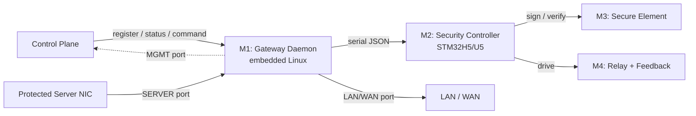

# AetherGuard Root-Resistant Gateway Appliance PRD

> 版本：v0.3
> 日期：2026-06-12
> 阶段：硬件可信原型 / 企业 PoC
> 文档性质：网关一体机子 PRD
> 父文档：`docs/aetherguard-product-prd.md`（AetherGuard 平台顶层 PRD，v1.0）
> 变更说明：v0.3 起拆分为"平台顶层 PRD（父）+ 网关子 PRD"。平台级内容（背景与问题、目标用户、核心价值主张、检测与 AI 管线、性能验证状态、宣传口径纪律）移至父文档，本文件聚焦网关硬件选型、interlock 机制、root-resistant active 判定、网关功能需求与 roadmap。v0.2 的硬件方案（M1-M4）与 fail-closed 语义完整保留。

---

## 1. 产品概述

### 1.1 产品名称

**AetherGuard Root-Resistant Gateway Appliance**

中文定位：

> AetherGuard 根权限抵抗型最终防线网关一体机

简称：AetherGuard Gateway Appliance 或 AG Appliance。

### 1.2 一句话定位

> AetherGuard Gateway Appliance 是部署在关键服务器外部的自研工业级硬件最后防线一体机，用于在服务器失陷后继续控制关键网络释放。

### 1.3 核心主张

> AetherGuard 把关键网络释放权从被保护服务器的软件系统中移出，交给外部独立的自研硬件安全一体机执行。

技术表达（与父文档第 8 节 Final Defense Mode 衔接）：

> 即使受保护服务器被攻击者获取 root 权限，攻击者也不能仅凭该服务器自身权限恢复 SERVER ↔ LAN/WAN 的关键网络连接。最终 release 必须经过 Gateway Appliance 的工业多网口网关、独立 STM32H5/U5 安全授权控制器、Secure Element / TPM、策略 digest、单调计数器、有效期、物理确认或授权流程，以及硬件级 fail-closed interlock feedback 校验。

该主张成立的全部前提见父文档第 8 节与本文件第 7 节（root-resistant active 判定）。不覆盖范围（带外 BMC、Wi-Fi、空闲网卡、本地控制台、直连存储破坏、主机磁盘被 root 加密）见父文档第 4.2 节。

### 1.4 硬件代际演进

本 Appliance 全面替代此前的 ESP32 硬件方案：

| 维度 | 前代方案（已退役） | 当前方案（Appliance） |
| --- | --- | --- |
| 硬件形态 | ESP32-WROOM-32 串口部署 dongle / ESP32-S3 控制板 | 工业级多网口网关一体机 |
| 网络能力 | 无（仅 USB-TTL 串口） | 双 1GbE 数据口 + 独立 MGMT 口 + 可选蜂窝 |
| 安全控制器 | ESP32-S3（通用 MCU） | STM32H5/U5 专用安全 MCU |
| 安全芯片 | ATECC608C（单一选型） | OPTIGA Trust M / SE050 / ATECC608B / STSAFE-A110（多选型兼容） |
| 隔离机制 | 软件管理链路隔离 | 硬件级 fail-closed interlock + 物理 relay + feedback 闭环 |
| 信任根 | ESP32 内部 flash | 独立 Secure Element（私钥不可导出）+ 可选 TPM 2.0 |
| 数据平面控制 | 无 | SERVER ↔ LAN/WAN 透明 L2 桥接 / 防火墙 |
| 产品化程度 | 跳线原型 / 开发板 | 工业网关 + 安全控制板 + DIN-rail 集成（当前为原型，未量产） |

---

## 2. 宣传口径

宣传口径纪律（禁用与推荐表述）见父文档第 15 节。本节仅保留网关特有的、面向不同对象的话术。

面向评委 / 路演：

> AetherGuard 解决的是服务器被入侵后的最后防线问题。传统 EDR、防火墙和自动化运维工具都运行在可被攻破的软件环境里，一旦攻击者拿到 root，许多防护会失效。AetherGuard 的 Root-resistant Final Defense 把最终网络释放权移到服务器外部，通过工业多网口网关、独立 STM32 安全控制器、Secure Element 和硬件 interlock，实现默认隔离、硬件授权、状态反馈和全链路审计。

面向企业客户：

> AetherGuard 不替代现有防火墙、EDR 或堡垒机，而是在关键服务器外增加一层可审计的硬件最后防线。服务器被入侵后，攻击者不能仅凭主机 root 权限恢复生产网络连接。网络释放必须经过外部网关、本地策略、硬件身份、单调计数器、有效期、物理确认或授权流程，以及 interlock feedback 校验。

面向技术评审：

> 当前原型采用工业多网口 x86/ARM 网关承担 SERVER、LAN/WAN、MGMT 三平面隔离；STM32H5/U5 安全控制器承担最终授权状态机；OPTIGA Trust M / ATECC608 / SE050 等 Secure Element 保护设备私钥；硬件 interlock 和 feedback 输入用于实现 fail-closed。Linux 网关只能请求释放，不能单方面决定释放。后续量产版本可将控制器、Secure Element、隔离 IO 和网关联动机制收敛为一体化硬件。

---

## 3. 产品定位

### 3.1 产品是什么

- 一台部署在被保护服务器与 LAN/WAN 之间的外部硬件一体机。
- 默认隔离 SERVER ↔ LAN/WAN 转发，仅在硬件授权 + interlock 反馈一致时短暂释放。
- 一条独立于被保护服务器 OS 的管理通道（MGMT）。
- 一条可审计、fail-closed 的硬件控制边界。

### 3.2 产品不是什么

- 不替代防火墙、EDR 或堡垒机。
- 不切换市电、不直接切断业务主机电源；v1 物理断路只控制低压网络 / 管理链路。
- 不保护未物理接入本 appliance 的链路。
- 当前为工业硬件原型，未量产。

---

## 4. 推荐硬件方案

Appliance 由四大核心硬件模块组成，各模块职责明确、接口清晰：

```text
┌─────────────────────────────────────────────────────────────────┐
│              AetherGuard Root-Resistant Gateway Appliance       │
│                                                                 │
│  ┌─────────────────────┐    ┌──────────────────────────────┐    │
│  │ M1: Multi-port      │    │ M2: Security Authorization   │    │
│  │     Gateway          │◄──►│     Controller               │    │
│  │ (工业多网口网关)     │    │ (独立安全授权控制器)          │    │
│  └──────────┬──────────┘    └──────────┬───────────────────┘    │
│             │                          │                        │
│             │    ┌──────────────┐      │    ┌───────────────┐   │
│             │    │ M3: Secure   │      │    │ M4: Fail-     │   │
│             │    │ Element/TPM  │      │    │ closed        │   │
│             │    │ (安全芯片)   │      │    │ Interlock     │   │
│             │    └──────────────┘      │    │ (硬件级闭锁)  │   │
│             │                          │    └───────────────┘   │
│                                                                 │
│  SERVER ◄──► bridge ◄──► LAN/WAN     relay + feedback           │
│  MGMT   ◄──► mgmt   ◄──► Backend     button + stack light       │
└─────────────────────────────────────────────────────────────────┘
```

### 4.1 M1: Multi-port Gateway（工业多网口网关）

**模块定位**：Appliance 的数据平面和管理平面承载平台，运行嵌入式 Linux，承担网络桥接/防火墙控制和后端通信。

首选：Protectli Vault VP2430 / VP2420 / VP4650。备选：OnLogic、Moxa、Advantech 工业多网口主机/网关。

| 参数 | 要求 |
| --- | --- |
| CPU | x86（Intel Celeron / Atom）或 ARM（NXP i.MX8 / Rockchip RK3568） |
| 内存 | ≥ 4 GB DDR4 / DDR5 |
| 存储 | ≥ 32 GB eMMC / NVMe SSD（OS + gateway daemon + 审计日志本地缓存） |
| 网口 | ≥ 3 个物理 GbE RJ45：SERVER、LAN/WAN、MGMT |
| 扩展网口 | 可选 SFP / SFP+ 用于 10G 上联 |
| 蜂窝 | 可选 4G/5G M.2 模块作为 MGMT 冗余通道 |
| TPM | 可选板载 TPM 2.0（与 M3 互补） |
| OS 支持 | Debian 12+ / OpenWrt 23+ / OPNsense / VyOS |
| Watchdog | 硬件 watchdog，firmware 挂死时驱动 bridge 回落到 isolated |
| 供电 | 12V/19V DC，支持冗余电源输入 |
| 工作温度 | 0°C ~ 50°C（工业级），可选 -20°C ~ 60°C（宽温级） |
| 外形 | 无风扇被动散热，DIN-rail 或 1U 机架安装 |

Gateway Daemon（嵌入式 Linux 守护进程）职责：向后端注册身份/端口/控制器/SE 状态；管理 SERVER ↔ LAN/WAN 的 nftables/iptables 桥接与防火墙规则；通过 serial JSON 与 M2 通信；仅在 interlock released 且 feedback 一致时打开 bridge；周期性上报状态；本地审计日志环形缓冲 + 远程同步。

### 4.2 M2: Security Authorization Controller（独立安全授权控制器）

**模块定位**：Appliance 的最终授权决策引擎，独立于网关 Linux 运行，承担所有密码学校验、策略匹配、物理确认与 interlock 控制。即使网关 Linux 被攻破，控制器仍能独立执行 fail-closed。

首选：NUCLEO-H563ZI（STM32H563ZI, Cortex-M33, 250 MHz）。备选：NUCLEO-U575ZI-Q（STM32U575ZI）、NXP LPC55S69-EVK。

| 参数 | STM32H563 | STM32U575 | NXP LPC55S69 |
| --- | --- | --- | --- |
| 内核 | Cortex-M33 | Cortex-M33 | Cortex-M33 |
| 主频 | 250 MHz | 160 MHz | 150 MHz |
| Flash | 2 MB | 1 MB | 640 KB |
| RAM | 640 KB | 786 KB | 360 KB |
| 安全特性 | TrustZone, HASH, AES, PKA | TrustZone, AES, PKA, PUF | TrustZone, AES, SHA, PUF |
| 接口 | SPI, I2C, UART, USB, GPIO | SPI, I2C, UART, USB, GPIO | SPI, I2C, UART, USB, GPIO |
| HSM | 内置安全启动 | 内置安全启动 | 内置安全启动 |

控制器 12 项核心任务：接收 release request；校验 challenge（不可复用）；校验 policyDigest（须匹配本地已签名策略）；校验 monotonic counter（不可回滚）；校验 expiry；驱动 SE 执行签名/身份验证；读取物理确认按钮；控制 interlock output（relay 驱动）；读取 feedback input；周期性 heartbeat；上报 state；支持 emergency stop。

通信协议：Controller ↔ Gateway Daemon 为 newline-delimited JSON over UART/USB-CDC/RS485，消息类型含 `hello`、`command physical_confirmation_required`、`command interlock_assert`、`command interlock_release`、`state`、`heartbeat`、`alert`、`physical_confirmation_ack`、`interlock_result`。Controller ↔ Secure Element 走 I2C/SPI。

### 4.3 M3: Secure Element / TPM（安全芯片 / 可信平台模块）

**模块定位**：Appliance 的硬件信任根，保护设备私钥与 grant 签名密钥，确保设备身份不可伪造、授权签名不可抵赖。

#### 4.3.1 Secure Element（必选）

首选：Infineon OPTIGA Trust M。备选：NXP EdgeLock SE050、Microchip ATECC608B、STSAFE-A110。

| 特性 | OPTIGA Trust M | SE050 | ATECC608B | STSAFE-A110 |
| --- | --- | --- | --- | --- |
| 算法 | ECC-256/384, RSA-2048, AES-128/256 | ECC-256/384/521, RSA, AES, 3DES | ECC-256, AES-128/256 | ECC-256 |
| 密钥存储 | 非导出私钥, 4 KB data | 非导出私钥, 可扩展 | 非导出私钥, 16 slots | 非导出私钥 |
| 接口 | I2C | I2C | I2C / SPI | I2C |
| 认证 | CC EAL6+ (high) | CC EAL6+ | CC EAL5+ | CC EAL5+ |

职责：保存非导出设备私钥；生成/验证 grant 签名（ECDSA P-256 over SHA-256）；绑定设备身份；支持 provisioning workflow；支持后续 mTLS / device certificate 扩展；支持 monotonic counter 硬件实现。

grant 签名消息（15 字段 newline-joined）：`gateId`、`sessionId`、`actionId`、`tenantId`、`scope`、`targetId`、`commandType`、`payloadHash`、`policyDigest`、`challenge`、`breakerTarget`、`interlockAction`、`issuedAt`、`expiresAt`、`monotonicCounter`。

#### 4.3.2 TPM 2.0（可选，位于 Gateway 主板）

型号如 Infineon SLB 9670 / ST33TPHF2X。与 SE 互补：平台级度量启动（Measured Boot）；固件完整性度量（gateway daemon 启动前验证固件 digest）；平台身份认证（TPM quote + AIK 远程 attestation）；可选将 gateway daemon 通信密钥存于 TPM NV RAM。

### 4.4 M4: Fail-closed Interlock（硬件级闭锁机制）

**模块定位**：Appliance 的物理执行层，通过硬件 relay 和 feedback 闭环实现"默认断开、授权闭合、异常回落"。

| 组件 | 规格 | 职责 |
| --- | --- | --- |
| DIN-rail relay | 24V DC, SPDT/DPDT, 额定 10A | 物理控制 SERVER ↔ LAN/WAN 通断 |
| 隔离数字输出 | 光耦隔离, 24V 驱动 | 安全控制器驱动 relay |
| 隔离数字输入 | 光耦隔离, 24V 兼容 | 读取 feedback 辅助触点 |
| Feedback 辅助触点 | 与主触点机械联动 | 反馈 relay 真实物理状态 |
| Emergency stop 按钮 | 常闭触点, 红色蘑菇头 | 一键切断所有 release，立即 isolated |
| Confirmation 按钮 | 瞬时触点, 绿色 | 物理确认授权操作 |
| Stack light 塔灯 | 三色（红/黄/绿）+ 蜂鸣器 | 实时指示 Appliance 状态 |

Fail-closed 9 类自动隔离触发器：SE 签名验证失败；monotonic counter 回滚；policyDigest 与本地已签名策略不匹配；grant 过期（expiresAt）；SE 不可用或通信中断；feedback 辅助触点与期望不一致；controller heartbeat 丢失（> 45 秒）；MGMT 独立管理通道不健康；gateway daemon 与 controller 状态冲突。

Bridge 状态机：

```text
isolated ──(release granted + feedback OK)──► released
    ▲                                            │
    └────(window expiry / fault / estop)─────────┘

isolated ──(release pending)──► armed ──(confirmed)──► released
    ▲                              │(timeout)              │(window expiry)
    └──────────────────────────────┴───────────────────────┘
```

| 状态 | 含义 |
| --- | --- |
| `isolated` | 默认断开，SERVER ↔ LAN/WAN 无转发 |
| `armed` | 已验证释放请求，等待物理确认或自动授权 |
| `released` | interlock 已释放，SERVER ↔ LAN/WAN 在 release window 内可转发 |
| `fault` | 检测到硬件异常或 feedback 不一致 |

interlock 状态归一为 `isolated | armed | released | fault | disabled | unknown`；遗留 `asserted` 映射为 `isolated`。

---

## 5. 系统架构



三平面分离：SERVER 与 LAN/WAN 构成 fail-closed 的数据桥；MGMT 独立于数据桥，appliance 自身管理通道在 `isolated` 时仍可用。Linux 网关只能向控制器请求释放，不能单方面决定释放。

---

## 6. Root-resistant Active 判定条件

UI 只能在满足全部条件时显示 "Root-resistant Active"：

1. external gateway present；
2. SERVER 口 link up；
3. LAN/WAN 口 link up；
4. MGMT 独立通道 healthy；
5. Secure Element provisioned；
6. controller heartbeat healthy；
7. gateway daemon healthy；
8. policyDigest matched；
9. firmware digest / attestation matched（MVP 可标记 simulated / not enforced）；
10. bridge state 为 isolated 或 armed；
11. feedback 与期望状态一致；
12. 最近一次 counter 未回滚。

不满足时应显示具体原因，例如：

```text
Root-resistant Degraded:
- Secure Element not provisioned
- Feedback mismatch
- MGMT path unhealthy
- Policy digest mismatch
```

---

## 7. 功能需求

- **网关注册**：appliance 启动后向控制平面注册身份、端口、控制器状态、SE 状态；身份基于 SE 私钥与设备证书。
- **默认隔离**：未授权时 SERVER ↔ LAN/WAN 无转发；appliance 管理通道保持可用。
- **Release 请求**：控制平面下发 release 请求，含 action、target、payload hash、policyDigest、challenge、breakerTarget、interlockAction、有效期、单调计数器。
- **硬件授权**：控制器校验全部字段后驱动 SE 验签；通过则进入 `armed`，物理确认后 `released`。
- **Interlock 控制**：仅在 `released` 且 feedback 一致时打开 bridge；窗口到期或任一 fail-closed 触发器命中即回落 `isolated`。
- **状态上报**：周期性上报 bridge 状态、interlock、SE、heartbeat、counter 到控制平面。
- **审计日志**：每次 release 请求、授权决策、interlock 变更、fail-closed 触发全部留痕，进入父文档第 11.1 节的对象锁审计归档。

---

## 8. 用户故事

- **安全负责人查看最后防线状态**：Dashboard 显示 root-resistant active，所有判定条件绿色。
- **运维发起高危操作**：发起 release，控制器要求物理确认，确认后短暂放行并全程审计。
- **服务器被 root 后仍无法恢复网络**：攻击者篡改主机防火墙、伪造健康状态，但 SERVER ↔ LAN/WAN 仍 `isolated`，需外部授权才释放。
- **硬件异常时自动隔离**：feedback 失配或 heartbeat 丢失，appliance 自动回落 `isolated` 并告警。

---

## 9. MVP 范围

**必须实现**：网关注册与心跳；默认隔离；release 请求 + 签名 grant + 单调计数器 + policyDigest 校验；interlock assert/release + feedback 校验；状态上报；fail-closed 触发器；审计留痕。

**可模拟**：物理确认按钮（可先用授权流程代替）；firmware digest / attestation（MVP 可标记 simulated / not enforced）；真板量产。

---

## 10. 非功能需求

- **安全**：fail-closed 为硬约束；私钥非导出；grant 不可复用、不可回滚、不可过期重放；feedback 闭环。
- **可用性**：任一组件失联即 `isolated`；MGMT 通道独立；hardware watchdog。
- **性能**：bridge 状态切换为秒级；审计上报不阻塞数据桥。性能强主张（吞吐/延迟/CPU/内存）属平台级，见父文档第 11 节，本网关不单独承诺未经取证的数值。

---

## 11. API

Final Defense 网关相关路由（与父文档第 8 节一致）：

- `GET /api/final-defense/status`
- `POST /api/final-defense/policies`
- `POST /api/final-defense/actions`
- `POST /api/final-defense/gateways/status/report`
- `POST /api/final-defense/gateways/actions`

设备 WebSocket 通道 `/ws/device`（别名 `/ws/status`）承担注册、心跳、状态广播。

---

## 12. Roadmap

| 阶段 | 目标 |
| --- | --- |
| Phase 0 | 硬件采购与台架搭建（M1-M4 到齐，三平面接线） |
| Phase 1 | Final Defense Control Loop（注册、默认隔离、release、状态上报、审计） |
| Phase 2 | Gateway Network Isolation（nftables 桥接 + interlock 闭环 + feedback） |
| Phase 3 | Secure Element Integration（provisioning、签名 grant、单调计数器硬件化） |
| Phase 4 | Root-resistant Demo（完整失陷后止损闭环路演） |
| Phase 5 | 产品化评估（一体化硬件、量产可行性、真板 rollout） |

平台级 roadmap 与检测、审计、部署包进度见父文档第 14 节。

---

## 13. 统一对外口径

> AetherGuard 的核心不是"多做一个安全 Agent"，而是在服务器外部建立一条 root-resistant 的最终控制边界。自研的 AetherGuard Root-Resistant Gateway Appliance 集成工业多网口网关、STM32H5/U5 安全授权控制器、Secure Element / TPM 与硬件级 fail-closed interlock，实现默认隔离、硬件授权、状态反馈与审计闭环。Appliance 全面替代此前的 ESP32 硬件方案，从串口部署 dongle 升级为具备双千兆数据口、独立管理通道与物理级网络隔离能力的一体机（当前为工业硬件原型）。

---

## 14. 关联文档

- `docs/aetherguard-product-prd.md` —— 平台顶层 PRD（父文档），含背景、用户、价值、检测管线、性能验证、口径纪律。
- `docs/product_whitepaper.md` 第 4 节 —— Root-Resistant Gateway Appliance 产品白皮书描述。
- `CLAUDE.md` —— Final Defense Mode 与 root-resistant 的权威工程定义、Final Defense API。
- `docs/reports/validated-capability-status-2026-03-08.md` —— 验证状态（性能强主张未验证）。