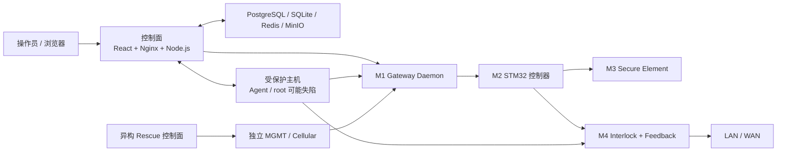
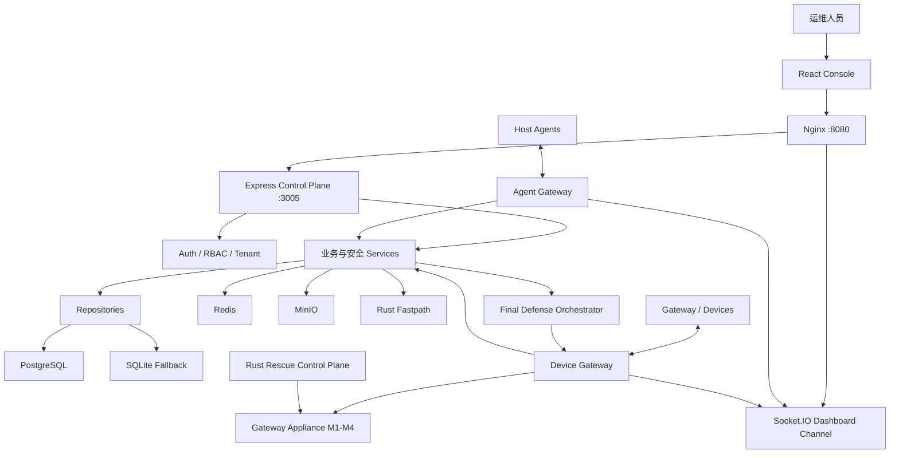
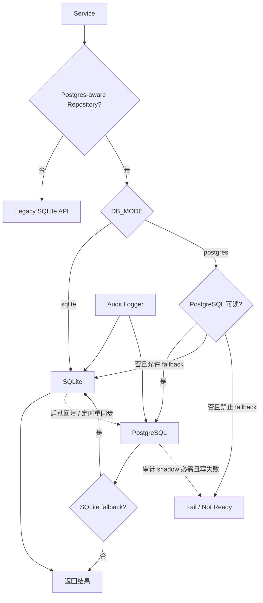
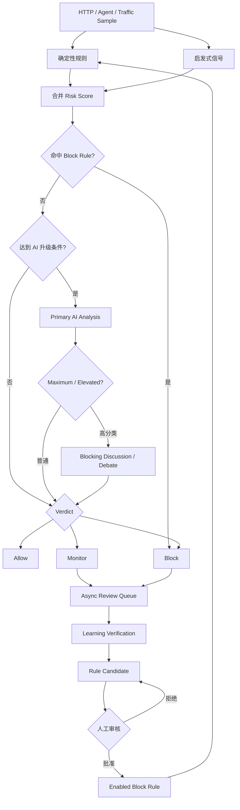
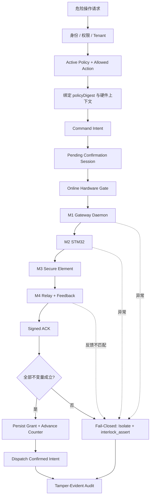

# AetherGuard 技术白皮书

## 面向服务器安全的软硬件协同 Fail-Closed 防御体系

| 文档属性 | 内容 |
| --- | --- |
| 版本 | 0.9 技术预览版 |
| 日期 | 2026-07-17 |
| 适用基线 | `codex/production-cleanup-20260513`，本地 HEAD `b3adb5c` |
| 产品 | AetherGuard 智能服务器安全防御平台 |
| 文档定位 | 架构、威胁模型、安全不变量、运行流程和验证边界 |
| 证据状态 | 软件门禁已形成可复现证据；真实硬件 HIL 尚未完成 |

> 本白皮书描述当前代码基线和可复现的软件验证结果，不构成等保、ISO、IEC、FIPS、Common Criteria 或其他第三方认证声明。文中“最后防线”“Root-Resistant”等表述仅在列明的布线、硬件、策略、授权和健康条件全部成立时有效。

---

## 1. 执行摘要

AetherGuard 是一套面向服务器、边缘节点和关键业务主机的安全控制平台。系统由 Node.js 控制面、React 运维控制台、分布式 Host Agent、Rust Fastpath、异构救援控制面，以及独立于受保护服务器的 Root-Resistant Gateway Appliance 组成。

传统主机安全产品通常将检测、决策、执行和证据全部放在受保护操作系统内部。一旦攻击者取得 root 权限，攻击者可能同时控制安全进程、策略文件、日志和网络配置。AetherGuard 的核心工程选择是把高风险动作的最终释放权移出受保护主机：控制面可以提出请求、执行策略编排并记录审计，但只有硬件授权链满足签名、上下文、时效、单调计数器和物理反馈等全部条件，危险动作才可继续。

系统采用两条互补路径：

1. **常规安全控制路径**：HTTP API、实时 Agent 通道、规则与 AI 检测、扫描、告警、审计和自动化处置。
2. **Final Defense 路径**：策略摘要绑定、硬件确认会话、Secure Element 签名、STM32 控制器校验、硬件 interlock 反馈以及 fail-closed 断桥。

这意味着 AetherGuard 的安全目标不是声称软件永不被攻破，而是在控制面、主机或网络出现不确定状态时，把不可逆或高风险操作收敛到“缺少证明即不执行”。

---

## 2. 问题背景

### 2.1 传统主机内防御的结构性限制

当检测程序、执行程序、策略和审计日志都运行在同一操作系统内时，root 攻击者可能：

- 停止 Agent 或伪造心跳；
- 替换策略、脚本和二进制文件；
- 回滚计数器或重放旧授权；
- 伪造“操作成功”“隔离生效”等状态；
- 删除本地审计记录；
- 绕过主机防火墙或重新启用网络接口；
- 通过受保护服务器自身恢复对外连通。

仅增加更多同机软件模块无法消除这一共同失陷域。AetherGuard 因此把“检测与编排”和“最终物理授权”分离，并为事故恢复提供独立的 Rescue 控制面。

### 2.2 设计问题

本系统试图回答四个工程问题：

1. 如何在不牺牲日常运维效率的前提下，对高风险操作增加独立授权？
2. 如何防止旧签名、旧计数器或跨会话授权被重放？
3. 当心跳、反馈、数据库、审计或硬件状态不确定时，系统应如何失败？
4. 当受保护主机已被 root 控制时，如何仍保留可信的网络隔离和恢复路径？

---

## 3. 设计目标与非目标

### 3.1 设计目标

- 为服务器安全事件提供检测、审计、调查和响应闭环；
- 保持前端、API、Service、Repository 和数据层的明确边界；
- 对租户、角色、权限和设备身份实施隔离；
- 对危险操作使用可验证、可过期、不可重放的硬件 grant；
- 在签名、摘要、计数器、时效或反馈异常时主动 fail-closed；
- 在隔离业务桥时保留 Gateway 自身独立 MGMT/蜂窝恢复路径；
- 通过软件模拟器、固件 host 测试、CI 和故障演练固化不变量；
- 支持在线 Docker 部署和离线客户机安装。

### 3.2 非目标与覆盖边界

Root-Resistant v1 不自动覆盖以下路径：

- 未经过 Gateway Appliance 的备用 NIC、Wi-Fi、BMC、带外管理或其他物理链路；
- 攻击者对本地磁盘数据的直接加密或破坏；
- 物理拆线、旁路布线、继电器焊接绕过等现场攻击；
- 上游交换机、云平台控制面或第三方身份系统的失陷；
- 未完成 Secure Boot/Measured Boot 的固件供应链攻击；
- 未经过真实硬件 HIL 的时序、电气和耐久性结论。

---

## 4. 威胁模型与信任边界

### 4.1 攻击者能力假设

系统按以下强攻击者模型设计高风险路径：

- 攻击者可能拥有受保护服务器 root 权限；
- 攻击者可能读取、修改或删除主机内文件和日志；
- 攻击者可能调用控制面 API，但仍受身份、权限和租户边界限制；
- 攻击者可能捕获并重放历史消息；
- 攻击者可能伪造软件状态或断开上报通道；
- 攻击者不能提取 Secure Element 私钥，不能改变未被物理旁路的 interlock 反馈事实。

### 4.2 信任域



控制面负责身份、策略、编排和审计，但 Final Defense 最终授权由 M2/M3/M4 的硬件事实约束。受保护主机不属于最终可信根。

---

## 5. 系统总体架构

### 5.1 组件视图



### 5.2 分层约束

| 层级 | 责任 | 强制约束 |
| --- | --- | --- |
| L0 页面与 Context | 展示、交互、状态组合 | 不得直接访问后端 |
| L1 `frontend/src/services/api.ts` | 唯一前端 API 客户端 | `credentials:'include'`，统一 envelope |
| L2 Nginx/Vite | 网络代理和静态资源 | Docker 仅暴露前端入口 |
| L3 `createControlPlaneApp()` | 中间件和应用构造 | 测试和嵌入上下文不得绕过 |
| L4 Routes | 输入、鉴权、响应映射 | 不得直接 SQL |
| L5 Services/Security | 业务和安全语义 | 危险动作在此编排 |
| L6 Repositories | 数据访问 | 新 SQL 应集中在仓储层 |
| L7 数据引擎 | SQLite/PostgreSQL | 模式和 fallback 语义显式化 |

上述规则由 `scripts/guards/` 下的静态门禁执行，而不只依赖代码评审约定。

---

## 6. 请求生命周期

### 6.1 HTTP 请求链

```mermaid
flowchart LR
    B["Browser"] --> N["Nginx"]
    N --> CORS["CORS"]
    CORS --> HEADERS["Helmet"]
    HEADERS --> COOKIE["Cookie Parser"]
    COOKIE --> PRE["Pre-parse Pollution Guard"]
    PRE --> METRICS["Metrics"]
    METRICS --> BODY["Body Parser + Raw Body"]
    BODY --> POST["Post-parse Pollution Guard"]
    POST --> LIMIT["API Rate Limit"]
    LIMIT --> OPTIONAL["Optional JWT Context"]
    OPTIONAL --> SHADOW["Traffic Shadow"]
    SHADOW --> AUTH["Route Auth / Permission / Tenant"]
    AUTH --> ROUTE["Route Handler"]
    ROUTE --> SERVICE["Service"]
    SERVICE --> REPO["Repository"]
    REPO --> RESPONSE["sendSuccess / sendError"]
    RESPONSE --> B
```



### 6.2 API 响应契约

成功响应：

```json
{
  "success": true,
  "data": {},
  "error": null,
  "meta": {}
}
```

失败响应：

```json
{
  "success": false,
  "data": null,
  "error": "error code",
  "code": "MACHINE_READABLE_CODE",
  "message": "localized.message.key"
}
```

健康端点 `/health`、`/health/live` 和 `/health/ready` 直接注册，不受业务 API 开关影响。受保护的 `/api/health/*` 提供更完整的依赖信息。

---

## 7. 数据架构与一致性语义

### 7.1 当前数据库模式

生产配置要求 `DB_MODE=postgres`。当前代码已存在 PostgreSQL-aware Repository，同时仍保留 SQLite 引擎和兼容路径：

- 非测试运行时优先 `better-sqlite3`，启用 WAL；
- Jest 优先 `sql.js`，每个 worker 使用隔离内存数据库；
- PostgreSQL Shadow Store 创建并维护当前支持的表；
- 已迁移 Repository 在 PostgreSQL 模式下主写或主读 PostgreSQL；
- `SQLITE_FALLBACK_ENABLED=true` 时，部分路径继续写入 SQLite；
- 尚未抽取的旧 Service 仍可能直接使用统一 SQLite API；
- 启动和定时 Resync 将支持的 SQLite 数据回填到 PostgreSQL。

因此，“`DB_MODE=postgres`”表示生产意图和已迁移路径的主数据库选择，不等价于“所有模块已经完全脱离 SQLite”。

### 7.2 数据流



### 7.3 本地数据库基线证据

2026-07-17 本地 `npm run db:check` 的字段断言结果：

| 字段 | 实测值 |
| --- | --- |
| JetBrains 连接端点 | `127.0.0.1:15432` |
| Database | `aetherguard` |
| User | `aetherguard` |
| PostgreSQL | 16 或以上 |
| Public tables | 37 |
| 必需表 | `audit_log`、`hardware_gates`、`sites`、`users` |
| 初始用户数 | 1 |

此证据证明本地开发数据库的连接、身份和表结构，不证明所有业务写路径已完成 PostgreSQL 迁移。

---

## 8. 实时 Agent 与检测管线

### 8.1 Agent 通道

AgentGateway 负责：

- API Key/Agent 身份验证；
- Agent 与 Tenant 绑定；
- 连接数和事件级限流；
- `agent:register`、`agent:heartbeat`、`agent:traffic_stats`；
- `agent:threat`、`agent:review_sample`、`agent:scan_result`；
- 命令 ACK/Failed 回执；
- 向 Dashboard 广播租户隔离后的实时状态。

心跳中的 `agentId` 必须与认证身份一致。威胁事件进入审计、检测记录和 Dashboard，但上报通道失败不会自动解除本地 interlock。

### 8.2 检测决策主干



确定性 Block Rule 是硬护栏。候选规则不会自动上线；非法正则和空 matcher 在提升前被拒绝。AI 不可用时，高分类、高风险请求按当前策略 fail-closed。

---

## 9. Final Defense Mode

### 9.1 适用动作

Final Defense 面向具有不可逆或高影响后果的操作，例如：

- `host_remove`；
- `wipe_data`；
- `factory_reset`；
- `recovery_flash`；
- `critical_config_change`；
- 临时释放 Root-Resistant 网络桥。

### 9.2 授权上下文

每个硬件确认会话绑定：

- `tenantId`、`scope`、`targetId`、`commandType`；
- Payload Hash；
- `policyDigest`；
- `challenge`；
- `breakerTarget`；
- `interlockAction`；
- `issuedAt`、`expiresAt`；
- `monotonicCounter`；
- Secure Element 私钥产生的 ECDSA P-256 SHA-256 签名。

### 9.3 授权流程



### 9.4 控制面充分条件

控制面仅在以下布尔命题全部成立时接受 ACK：

```text
confirmed === true
&& signature exists
&& ECDSA verification == true
&& policyDigest == storedPolicyDigest
&& breakerTarget == storedBreakerTarget
&& challenge == storedChallenge
&& interlockAction == storedInterlockAction
&& expiresAt == session.expiresAt
&& now <= expiresAt
&& monotonicCounter > previousHighWater
```

### 9.5 Fail-Closed 语义

Fail-closed 不是“返回一个 403”而已。Gateway Daemon 的失败路径执行：

1. 将业务桥状态置为 `isolated`；
2. 应用隔离 ruleset；
3. 发送 `interlock_assert`；
4. 检查物理反馈；
5. 写入审计与状态事件。

签名失败、Policy Digest 不匹配、Counter 回滚、授权过期、Secure Element 不可用、心跳过期、控制器告警和反馈不匹配均进入此路径。

---

## 10. Root-Resistant Gateway Appliance

### 10.1 M1-M4 分层

| 模块 | 角色 | 主要不变量 |
| --- | --- | --- |
| M1 Gateway Daemon | 网桥状态机和控制面接入 | 签名、摘要、上下文、Counter、TTL、反馈 |
| M2 STM32H5/U5 | 独立安全控制器 | Challenge 去重、Counter 严格递增、E-stop 锁存 |
| M3 Secure Element | 硬件身份和签名 | 私钥不可导出，签名/Counter 异常即拒绝 |
| M4 Interlock | 物理网络释放与反馈 | 默认隔离，释放暂态，反馈必须匹配 |

### 10.2 三套单调计数器

系统使用互不共享的高水位：

1. 控制面数据库 `hardware_gates.last_monotonic_counter`；
2. M1 Gateway Daemon 进程内高水位；
3. Companion/Controller 本地高水位。

每一层都要求新 Counter 严格大于历史值。多层高水位减少单一存储回滚重新打开重放窗口的风险。

### 10.3 暂态释放

网络释放不是永久状态。释放窗口受 TTL 约束，控制面策略范围为 5 秒至 15 分钟；Gateway 默认窗口为 30 秒。窗口到期后自动执行 `release_window_expired`，重新进入隔离状态。

### 10.4 独立管理通道

`isolated` 阻断的是受保护服务器与 LAN/WAN 之间的业务桥，不切断 Gateway 自身的 MGMT 或蜂窝管理通道。这使系统在业务桥隔离后仍保留远程恢复能力。

---

## 11. 异构 Rescue 控制面

Rescue 是独立的 Rust 单二进制控制面，目标是在主控制面不可用或不可信时执行安全侧恢复动作。其设计约束包括：

- 不依赖主 Node.js 进程；
- 不依赖 Redis、主数据库或 AI Runtime；
- 审计不可写时拒绝动作；
- 只允许隔离、状态读取和安全恢复操作；
- 源码门禁禁止出现 release 帧能力；
- 不把“命令已发送”冒充为“现场状态已确认”。

Rescue 的价值不在于复制主控制面全部功能，而在于缩小故障恢复时的依赖集合和攻击面。

---

## 12. 身份、权限与租户隔离

### 12.1 浏览器身份

- JWT 存储在 httpOnly Cookie；
- 前端不读取 Token；
- SameSite 和 Cookie 属性由后端集中设置；
- 登录策略、break-glass 和企业运行模式受环境门禁约束；
- 登录失败、锁定和审计分开处理。

### 12.2 权限模型

高风险路由使用显式 permission，例如：

- `final_defense.read`；
- `final_defense.manage`；
- `final_defense.execute`；
- `gate.enroll`；
- `deployment.run.create`；
- `deployment.run.approve`。

### 12.3 Agent 与 Device 身份

Agent 身份经 API Key/Agent 服务验证并绑定 Tenant。Device Gateway 仍包含实验性或共享凭据路径，因此生产 Nginx 故意不公开代理 `/ws/device`；在完成每设备可撤销身份或 mTLS 前，不扩大该入口的网络暴露。

---

## 13. 审计、证据与可观测性

### 13.1 审计目标

审计记录覆盖：

- Tenant、Actor、Target；
- 事件类型、类别、严重度；
- 动作、状态和结构化 Details；
- 硬件 Session、Grant 和 Payload Hash；
- 登录、部署、命令、威胁和 Final Defense 事件。

审计 HMAC 覆盖持久化取证字段。生产模式可要求 PostgreSQL shadow 同步写入；当审计是操作成立的前提时，审计不可用会阻断操作。

### 13.2 健康与诊断

- `/health`：进程连通；
- `/health/live`：存活；
- `/health/ready`：依赖就绪；
- `/api/health/dependencies`：认证后的依赖详情；
- `scripts/ai/diagnose.mjs`：机器可读诊断；
- Dashboard Socket.IO：Agent、流量、扫描、威胁和设备状态。

返回 200 只证明连通；行为正确性依赖字段断言、拒绝分支和现场反馈证据。

---

## 14. 部署拓扑

### 14.1 生产 Docker

生产 Compose 默认只发布：

```text
127.0.0.1:8080 -> Nginx frontend/API proxy
```

Backend、Redis、PostgreSQL、MinIO 和 Fastpath 仅在 Compose 网络内可达。环境文件由 `scripts/setup.mjs` 生成随机密钥，占位值和弱密钥在生产启动时被拒绝。

### 14.2 开发数据库

JetBrains 开发 override 额外发布：

```text
127.0.0.1:15432 -> PostgreSQL 5432
```

该映射仅绑定 loopback，不进入生产 Compose。数据库密码保存在被忽略的本地 `.env` 或 JetBrains Password Safe，不进入共享 `.idea/dataSources.xml`。

### 14.3 离线部署

离线 Bundle 支持：

- 预构建 Docker 镜像；
- SHA-256 清单；
- 可选 Docker 静态引擎；
- 现场生成密钥；
- `docker compose up -d --no-build`；
- 无网络客户机安装。

---

## 15. 软件验证基线

### 15.1 GitHub CI

GitHub Actions run `29555715547`，HEAD `f9690a6`：

| Job | 结果 |
| --- | --- |
| workflow-lint | success |
| project-contracts | success |
| gateway-safety-check | success |
| frontend-build | success |
| rescue-check | success |
| backend-test | success |
| rust-fastpath-check | success |
| installer-build | success |
| security-scan | success |
| docker-build | success |
| release-verify | success |

Release Verify 中记录的软件证据包括：

- Firmware host tests：18 passed，0 failed；
- Rescue drills：12/12 assertions passed；
- Playwright release E2E：9 passed；
- Docker backend 和依赖达到健康状态；
- Final Defense simulator 覆盖签名错误、Counter 回滚、心跳过期和 E-stop 等 fail-closed 场景。

### 15.2 本地开发数据库

本地提交 `b3adb5c` 的 PostgreSQL/JetBrains 配置通过：

- `npm run db:check` exit 0；
- `npm run check:project-structure` exit 0；
- 31 个契约文件、10 个 Run Configuration、0 个绝对用户路径；
- 三个 JetBrains XML 文件解析成功；
- PostgreSQL 和 backend 容器均为 healthy。

该提交在白皮书生成时仍因 GitHub 443 网络不可达而处于本地 `ahead 1`，尚无远端 CI 结果。

---

## 16. 未验证范围与发布阻断项

以下事项不能由当前软件证据推出，属于硬件发布前必须补齐的证据：

1. 真实 Gateway Appliance 整机 HIL；
2. 真实 STM32、Secure Element 和继电器联调；
3. 物理网线经过 SERVER/LAN-WAN 端口的断桥与释放测试；
4. 断电、复位、Brownout、串口断连和反馈卡死测试；
5. Secure Element 量产 Provisioning Ceremony；
6. Secure Boot、Measured Boot 和固件回滚保护；
7. 继电器寿命、电磁兼容、环境和工业认证；
8. 真实生产 PostgreSQL 故障下注入后的全业务一致性验证；
9. 所有 Legacy Service 完成 Repository/PostgreSQL 迁移；
10. 每设备可撤销 Device 身份或 mTLS；
11. OIDC/MFA 企业身份集成；
12. 大规模 QPS、Agent 数量和审计吞吐压测。

在以上硬件项完成前，不应把软件模拟结果表述为真实硬件“最后防线已交付”。

---

## 17. 路线图

### 阶段 A：数据库主路径收敛

- 统计所有直接 SQLite Service；
- 按模块迁移到 Repository；
- 为 PostgreSQL/SQLite 双写增加一致性对账；
- 定义迁移完成后关闭 fallback 的门槛；
- 为审计和硬件 Counter 建立恢复演练。

### 阶段 B：设备身份与固件信任

- 每设备身份和撤销机制；
- mTLS 或等价双向认证；
- Secure Element Provisioning；
- Secure/Measured Boot；
- 固件版本和 Digest 远程证明。

### 阶段 C：真实硬件验证

- 建立 Gateway Appliance HIL 台架；
- 自动注入断电、断线、重放、反馈错误和 Counter 回滚；
- 采集继电器现场状态而不是仅采集命令 ACK；
- 将 HIL 证据纳入发布审批。

### 阶段 D：规模化与合规

- 性能和容量压测；
- 多站点高可用和灾备；
- OIDC/MFA；
- 审计留存和合规映射；
- 第三方渗透测试及硬件安全评估。

---

## 18. 核心安全不变量摘要

| 不变量 | 失败行为 |
| --- | --- |
| Policy Digest 必须端到端一致 | 拒绝授权并隔离 |
| Counter 必须严格递增 | 判定重放/回滚并隔离 |
| Grant 必须未过期且与 Session 过期时间一致 | 拒绝 |
| `confirmed` 必须是布尔值 `true` | 拒绝字符串/数字真值 |
| Breaker Target 与 Interlock Action 必须匹配 | 拒绝并审计 |
| Secure Element 必须可用 | Fail-closed |
| Relay Feedback 必须等于预期状态 | Fail-closed |
| Release 必须有 TTL | 到期重新隔离 |
| 未知 Interlock/Bridge 状态不得算 Active | 标记 degraded |
| Rescue 不得具备 release 能力 | 源码门禁拒绝构建 |
| 审计为必需时不得静默丢失 | 阻断相关操作 |

---

## 19. 结论

AetherGuard 的差异点不只是“检测更多攻击”，而是把危险动作从普通软件调用提升为需要独立证明的授权过程。控制面负责组织请求、身份、策略、审计和可观测性；Gateway Appliance 负责在受保护主机之外执行最终网络释放；Rescue 控制面负责在主控制面失效时保留最小化、安全侧恢复能力。

当前软件基线已经形成可运行的控制面、数据库、Agent 通道、检测管线、授权服务、模拟器、固件 host 测试和 CI 门禁；直接证据是 GitHub run `29555715547` 的 11 个 Job 全部为 `success`，以及本地 `npm run db:check` exit 0。与此同时，项目仍明确承认真实硬件 HIL、Secure Element 量产集成、整机电气验证和完整 PostgreSQL 迁移尚未结束。这种证据分级是系统从技术预览走向可投产产品的必要条件。

---

## 20. 参考实现锚点

- `README.md`
- `AGENTS.md`
- `docs/architecture-layers.md`
- `docs/root-resistant-gateway-prd.md`
- `docs/adr/2026-03-12-postgres-primary-write-path.md`
- `backend/src/index.ts`
- `backend/src/bootstrap/control-plane-app.ts`
- `backend/src/bootstrap/persistence.ts`
- `backend/src/services/detection-pipeline.service.ts`
- `backend/src/services/final-defense.service.ts`
- `backend/src/services/hardware-authorization.service.ts`
- `backend/src/services/device-control.service.ts`
- `backend/src/companion/gateway-daemon.ts`
- `backend/src/companion/serial-device-companion.ts`
- `firmware/controller-stm32h5/Core/Src/controller_tasks.c`
- `rescue/`
- `simulator/`
- `.github/workflows/ci.yml`
