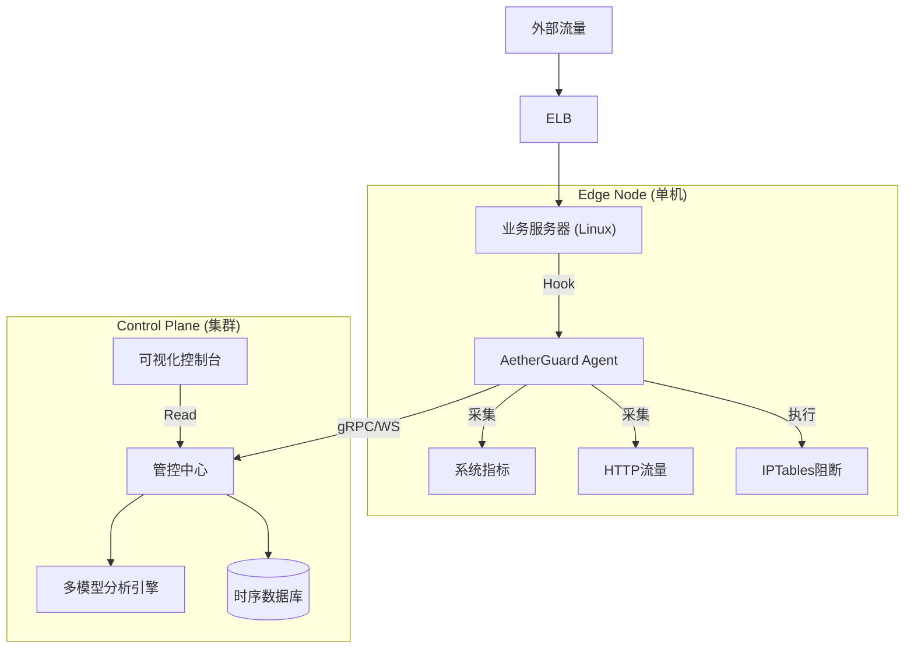
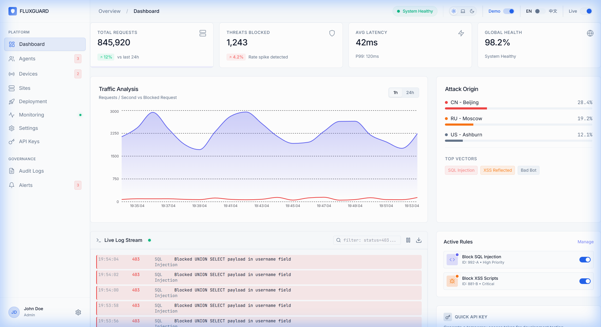
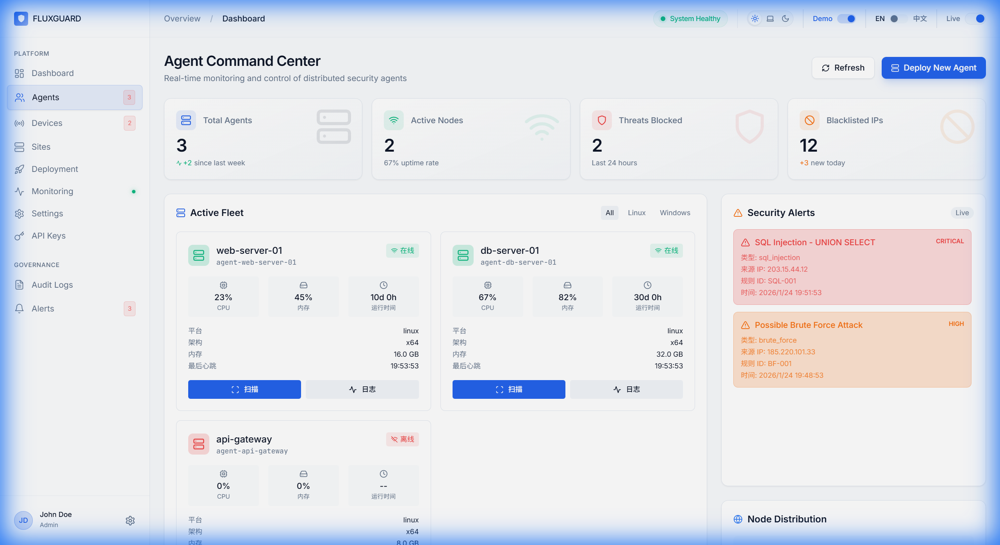
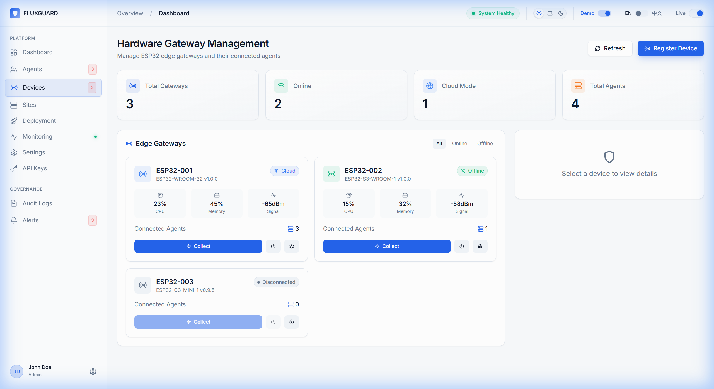
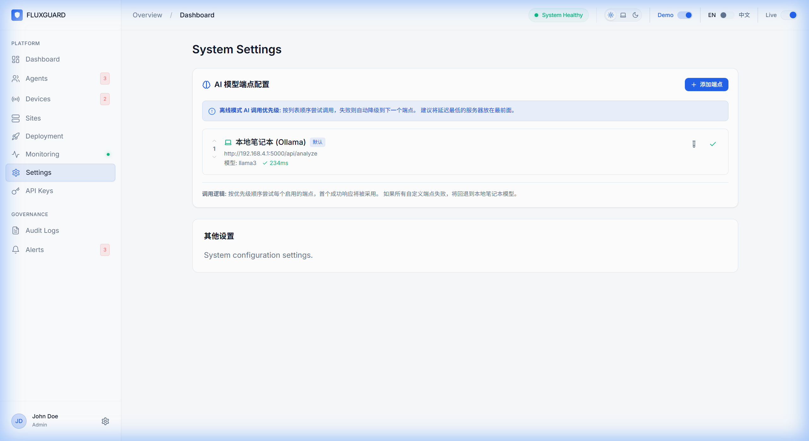

# AetherGuard - 技术架构与功能实施手册

**密级**: 内部技术文档
**版本**: v2.1.0
**日期**: 2026-01-24
**作者**: 技术研发部

---

> Validation Note (2026-07-27): Current software test results and boundaries are in `docs/reports/software-validation-status-2026-07-27.md`. Keep Object Lock, notification and simulated device-flow evidence tied to the dated 2026-03-08 environment. The latest fixed-key Rust loopback reproduction did not stably reach 100k QPS; live external services, external Linux lifecycle, cross-platform support, resource targets and physical hardware remain unvalidated.

## 1. 系统综述

AetherGuard 是下一代**服务器安全防御平台**，旨在解决传统 WAF 无法防御的业务逻辑攻击与内部威胁。系统采用 "Agent-Hub" 架构，通过驻留在业务服务器上的轻量级 Agent 实时采集流量与系统调用，上报至中心化 Hub 进行 AI 分析与决策。

### 核心架构图

---

## 2. 功能模块详解

### 2.1 全局态势感知 (Dashboard)
**功能**: 提供上帝视角的安全监控，展示系统的整体健康度与实时攻防状态。
**实现原理**: 
- 前端通过 WebSocket 订阅 `/topic/dashboard`。
- 后端 Redis 聚合每秒的 QPS、拦截数、活跃 Agent 数。
- **Screenshot Ref**: `dashboard.png`

### 2.2 智能 Agent 集群 (Agents)
**功能**: 分布式节点的注册、心跳保活与指令下发。
**实现原理**:
- 采用双向心跳机制 (Heartbeat Interval: 30s)。
- Agent 支持自升级与配置热加载。
- 状态机管理: Online / Offline / Warning / Critical (资源过载)。
- **Screenshot Ref**: `agents.png`

### 2.3 硬件化部署与运维 (Devices)
**功能**: 纳管 ESP32 部署工具 (Deployment Dongle)。
**实现原理**:
- ESP32 通过 WebSocket 连接网关。
- 采用 **Codebook 压缩协议** 降低带宽消耗，仅传输 4 字节状态码。
- 支持远程 OTA：用户上传固件 -> 后端推送 -> ESP32 自动写入 Flash。
- **Screenshot Ref**: `devices.png`

### 2.4 主动与被动扫描 (Scanner & Sites)
**功能**: 结合 Nuclei 的主动漏洞探测与基于流量的被动分析。
**实现原理**:
- **被动**: Agent 镜像流量 -> 正则/AI 匹配 (SQLi, XSS)。
- **主动**: 任务调度器定期下发 Nuclei 扫描任务 -> Agent 执行 -> 回传 JSON 报告。
- **Screenshot Ref**: `sites.png`, `scanner.png`

### 2.5 自动化部署向导 (Deployment)
**功能**: 降低 Agent 接入门槛。
**实现**:
- 动态生成带 Token 的 Install Script (Curl | Bash)。
- 自动检测 OS 类型 (Ubuntu/CentOS) 并适配安装命令。
- **Screenshot Ref**: `deploy.png`

### 2.6 AI 决策大脑 (Settings - AI Endpoint)
**功能**: 配置威胁分析引擎。
**技术细节**:
- 支持模型热切换: Local Ollama (Phi-3/Llama3) vs Cloud API (DeepSeek/GPT-4)。
- **Privacy Mode**: 开启后，仅在本机进行 Embedding，只有脱敏的 Vector 向量会被发送到云端（如果需要）。
- **Screenshot Ref**: `settings.png`

### 2.7 日志与审计 (History & Alerts)
**功能**: 满足企业合规性需求 (Compliance)。
**实现**:
- 不可篡改的日志存储 (Write-Once)。
- 告警风暴抑制算法 (Debounce)，防止同一 IP 触发海量告警。
- **Screenshot Ref**: `history.png`, `alerts.png`

---

## 3. 硬件接口协议 (ESP32)

### 通信协议
- **物理层**: USB-TTL (Serial 115200 8N1)
- **协议层**: 显式串口标记协议
  - 运行阶段: `AG:BEGIN:<action>`, `AG:STEP:<action>:RUN`
  - 环境识别: `AG:ENV:LINUX`, `AG:ENV:WINDOWS`
  - 结果回包: `AG:OK:<action>`, `AG:ERR:<action>:<code>`

### 安全机制
- **Hard Confirmation**: 涉及 `rm -rf` 等指令时，ESP32 固件逻辑强制拦截，等待本地 `BTN_OK (GPIO18)` 按下确认后才放行。

---
**Technical Department @ AetherGuard**
