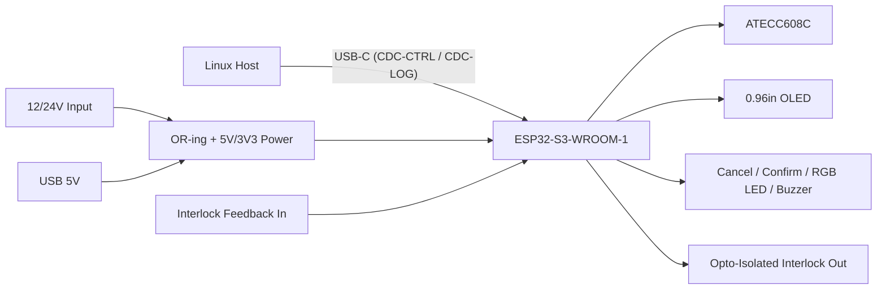

# AetherGuard Control Board v1

Single-host physical authorization and deployment companion board for AetherGuard.

## Scope

- One Linux server per board.
- USB-C to host for data and logic backup power.
- External 12/24V input for interlock path and auxiliary loads.
- ESP32-S3-WROOM-1 controller with ATECC608C-backed physical confirmation.
- 0.96" OLED, passive buzzer, RGB LED, Cancel key, Confirm key.
- Low-voltage isolated interlock output and feedback input only. No AC mains switching.

## Deliverables In This Folder

- `bom.csv`: initial procurement baseline.
- `proto-release-note.md`: current KiCad release-package scope and maturity note.
- `pin-map.md`: fixed MCU and connector assignment.
- `serial-protocol.md`: newline-delimited JSON protocol between board firmware and Linux companion daemon.
- `schematic-capture-checklist.md`: ERC/DRC and layout constraints for v1.
- `mechanical.md`: enclosure, connector, and board-outline assumptions.

## Functional Blocks

## Firmware / Companion Split

- Board firmware owns local UI, secure signing, interlock GPIO, and serial protocol framing.
- `backend/src/companion/serial-device-companion.ts` owns Linux-side WebSocket bridging, local host actions, and command translation.
- High-risk actions are only released after the board returns a signed `physical_confirmation_ack`.

## Default Commands

- Auto: `collect`, `sync-config`, `host_backup`
- Backend approval only: `host_install`
- Physical confirmation required: `reboot`, `host_remove`, `recovery_flash`, `factory_reset`
