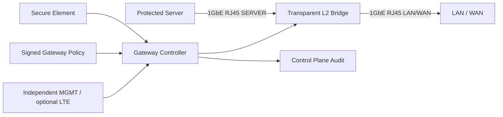

# AetherGuard Root-Resistant Gateway Appliance

Root-resistant Final Defense hardware baseline for AetherGuard.

> **Note:** This directory retains the legacy path name `aetherguard-network-isolation-gateway-v1` for repository continuity. The product is now the **AetherGuard Root-Resistant Gateway Appliance**, comprising an industrial multi-port gateway, an independent STM32H5/U5 security controller, a Secure Element / TPM, and a hardware-level fail-closed interlock.

## Scope

- External appliance, not a protected-host companion.
- Dual 1GbE RJ45 transparent L2 bridge: `SERVER` and `LAN/WAN`.
- Independent `MGMT` RJ45 for control-plane reporting and audit; LTE/cellular is an optional SKU path.
- Default failure action is network isolation: the `SERVER` port is not forwarded to `LAN/WAN`.
- The protected server keeps its existing IP configuration because the gateway bridges transparently when released or armed.
- No mains switching and no host power switching in v1.

## Trust Boundary

The Gateway Appliance is designed for the threat model where the protected server is root-compromised. The server OS, host agent, local companion, scripts, and host-side logs are not trusted to authorize release.

The trusted boundary is:

- Gateway firmware.
- Secure element identity and signing key.
- Signed local gateway policy.
- Firmware measurement / attestation report.
- Physical cabling that forces every protected server network path through the gateway.

The claim does not hold for bypass paths that are not cabled through the gateway: spare NICs, Wi-Fi, BMC, serial console, removable media, or direct physical bridge cables.

## Functional Blocks



## States

```ts
type BridgeState = 'isolated' | 'armed' | 'released' | 'fault' | 'disabled' | 'unknown';
type GatewayProtectionMode = 'external_network_gateway';
```

- `isolated`: fail-closed default; no protected server forwarding.
- `armed`: healthy and ready, still under gateway policy control.
- `released`: temporary bridge release window is active.
- `fault`: feedback, link, policy, attestation, or firmware measurement mismatch.
- `disabled`: gateway cannot enforce isolation.
- `unknown`: state has not been proven.

## API Contract

Gateway status is reported to:

```text
POST /api/final-defense/gateways/status/report
```

Required root-resistant active fields:

- `gatewayId`
- `tenantId`
- `policyDigest`
- `reportedPolicyDigest`
- `firmwareDigest`
- `bridgeState`
- `serverPortLink`
- `lanPortLink`
- `mgmtPath`
- `secureElementPresent`
- `lastAttestationAt`

Gateway actions are requested through:

```text
POST /api/final-defense/gateways/actions
```

Allowed v1 actions:

- `isolate`
- `arm`
- `release_temporary`
- `attest`

`release_temporary` requires a healthy root-resistant gateway state and a hardware confirmation grant with policy digest, challenge, bridge target, action, TTL, and monotonic counter.

## v1 Hardware Direction

The first board should prioritize conservative manufacturability:

- 2x 1GbE RJ45 data ports.
- 1x independent 1GbE RJ45 management port.
- Secure element, preferably ATECC608C or equivalent.
- MCU or embedded Linux module that owns bridge control and policy enforcement.
- Hardware watchdog that drives the data bridge to isolated on firmware lockup.
- Clear front-panel states for `isolated`, `armed`, `released`, and `fault`.

The exact switch/PHY architecture remains an implementation choice for schematic capture, but the security invariant is fixed: a root-compromised protected server cannot rewrite gateway policy, firmware, or bridge state.
